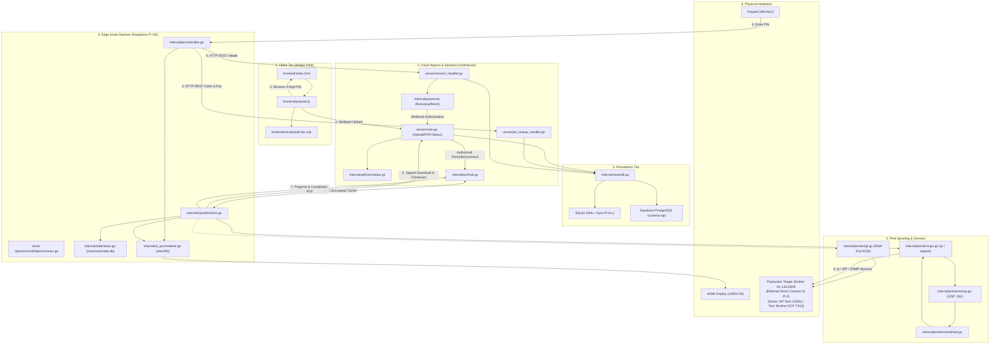
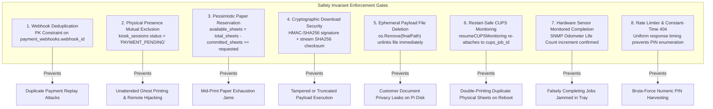
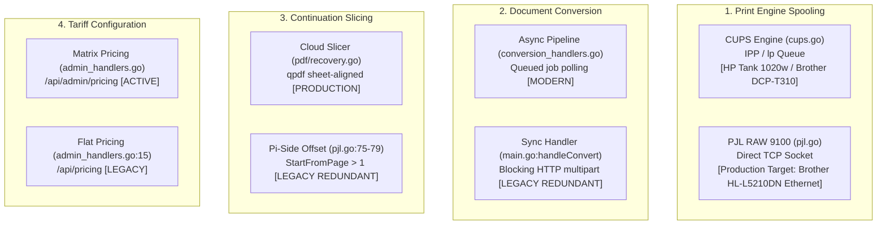
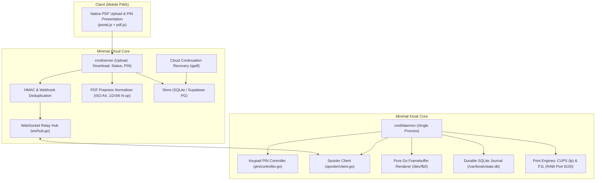

# XeroxGo Minimum Core Dependency Classification

This document provides a comprehensive dependency classification and safety analysis of the **XeroxGo Minimum Working Core**. It maps all direct and transitive dependencies required for the complete paid-print transaction, classifies components into strict functional tiers, analyzes safety invariants, evaluates printing protocols against actual production hardware, documents crash windows, and specifies a minimal target architecture without modifying production code.

---

## 1. Executive Summary & Scope

The primary mission of XeroxGo is to provide a reliable, hardened campus self-service printing kiosk with cloud document ingestion, dynamic UPI payment, and edge printer spooling on Raspberry Pi.

Based on the execution trace in [`docs/workflows/minimum-print-path.md`](file:///home/shabas/Projects/XeroxGo/docs/workflows/minimum-print-path.md), this document establishes the dependency boundary for the minimal working system. Every subsystem, file, and interface is classified under a 6-tier taxonomy:

| Tier | Definition | Inclusion Rule |
| :--- | :--- | :--- |
| **`CORE`** | Functional components strictly necessary to ingest a document, calculate pricing, present a PIN, accept payment, dispatch the job, spool to the printer, and report completion. | In functional execution path of single paid print. |
| **`SAFETY-CRITICAL`** | Components that protect customer funds, prevent hardware abuse, enforce physical customer proximity, ensure idempotency, and reconcile crash states. | Non-negotiable safety invariant; failure causes double-billing, double-printing, or ghost prints. |
| **`SUPPORT`** | Infrastructure, build scripts, quality gates, database DDL schemas, deployment configurations, and automated test fixtures. | Required for development, verification, and deployment. |
| **`OPTIONAL`** | Ancillary operational or commercial features that can be disabled via configuration or environment flags without degrading core paid printing. | Independent subsystems (e.g. ads, audio chime, live screen viewer, admin metrics). |
| **`LEGACY`** | Duplicate, superseded, or obsolete implementations where an alternative, modern path is active. | Redundancy candidates (e.g. synchronous `/api/convert`, Pi-side offset slicing, flat `/api/pricing`). |
| **`UNVERIFIED`** | Production code paths lacking automated test coverage or relying on unverified external assumptions. | Requires validation before architectural changes. |

> [!IMPORTANT]
> **Safety Requirements vs. Optional Features:**
> Crash recovery, webhook deduplication, customer presence gating, SHA256 payload integrity, and durable local SQLite journals are **`SAFETY-CRITICAL` requirements**, not optional features. A self-service kiosk operating with real money cannot treat fault tolerance as optional. Note that software safeguards mitigate operational risks but cannot physically guarantee paper tray supply or mechanical feed reliability against undetected sensor failures.

---

## 2. Direct & Transitive Dependency Architecture

The end-to-end paid print workflow spans six physical and logical tiers: Mobile Browser, Cloud Ingress, Cloud Backend, Database Persistence, Edge Kiosk Daemon, and Physical Hardware.

### 2.1 Startup & Configuration Dependencies

Both binaries have strictly validated startup dependencies:

#### Cloud Backend (`cloud-backend/cmd/server/main.go:1709-1880`)
1. **Listen Address:** `XEROXGO_CLOUD_ADDR` or `PORT` (defaults to `:8080`).
2. **Database Engine:** `DATABASE_URL` (PostgreSQL Supabase) or `XEROXGO_CLOUD_DB` (defaults to `./data/xeroxgo-cloud.db`). Directory created via `os.MkdirAll(0755)`.
3. **Storage Spool:** `XEROXGO_JOBS_DIR` (defaults to `./data/jobs`, permissions `0700`).
4. **Cryptographic Secrets (Mandatory in Production):**
   - `XEROXGO_DOWNLOAD_SECRET`: Min 16 bytes for HMAC-SHA256 URL signing ([`main.go:1759`](file:///home/shabas/Projects/XeroxGo/cloud-backend/cmd/server/main.go#L1759)).
   - `XEROXGO_WEBHOOK_SECRET`: Min 16 bytes for Razorpay webhook verification ([`main.go:1760`](file:///home/shabas/Projects/XeroxGo/cloud-backend/cmd/server/main.go#L1760)).
   - `XEROXGO_KIOSK_SECRET`: Min 16 bytes for WebSocket authentication ([`main.go:1839`](file:///home/shabas/Projects/XeroxGo/cloud-backend/cmd/server/main.go#L1839)).
5. **Pricing Configuration:** `XEROXGO_PRICE_PER_SHEET_PAISE` or existing record in `pricing` table ([`main.go:1789-1808`](file:///home/shabas/Projects/XeroxGo/cloud-backend/cmd/server/main.go#L1789-L1808)).
6. **Payment Provider:** `PAYMENT_PROVIDER=razorpay` requires `RAZORPAY_KEY_ID` and `RAZORPAY_KEY_SECRET`. Defaults to Mock provider if unset ([`main.go:1858-1876`](file:///home/shabas/Projects/XeroxGo/cloud-backend/cmd/server/main.go#L1858-L1876)).

#### Kiosk Daemon (`kiosk-daemon/cmd/daemon/main.go:243-295`)
1. **Kiosk Identification:** `--kiosk-id` (cannot be empty, e.g. `kiosk-001`).
2. **Authentication Secret:** `--kiosk-secret` or `XEROXGO_KIOSK_SECRET` (matches cloud).
3. **Cloud Endpoint:** `--cloud-url` (WebSocket URL, e.g. `wss://cloud.xeroxgo.in/ws`).
4. **Local State Store:** `--state-db` (defaults to `/var/kiosk/state.db`, verified `PRAGMA synchronous=FULL`).
5. **Temporary Download Directory:** `--download-dir` (defaults to `/var/kiosk/jobs`).
6. **Printer Target Configuration:**
   - CUPS Queue: `--cups-printer` or `--cups-queue` (e.g. `HPTank` for HP LaserJet Tank 1020w demo, `DCPT310` for Brother DCP-T310 earlier test).
   - PJL RAW Target: `--printer-addr` (defaults to `192.168.99.2:9100` for direct Ethernet connection to the **production Brother HL-L5210DN**).
7. **Hardware Sensors:** `--snmp-target` (printer IP), `--snmp-port` (161), `--snmp-community` (`public`).
8. **UI Framebuffer:** `--framebuffer` (defaults to `/dev/fb0`), optional `--screen-res` override.
9. **Physical Keypad:** `--keypad-device` (defaults to `/dev/tty1` or stdin).

### 2.2 Database Persistence Dependencies

The minimum paid workflow requires 10 tables across both stores:

| Database | Table Name | Purpose in Minimum Core | Safety Role |
| :--- | :--- | :--- | :--- |
| **Cloud Store** | `orders` | Primary order record, pricing, page/sheet counts, status | Root transaction entity |
| **Cloud Store** | `print_configs` | Duplex mode, copies, color mode, page range | Print job parameters |
| **Cloud Store** | `pin_reservations` | `PRIMARY KEY (kiosk_id, pin)`, reservation TTL | Collision & enumeration defense |
| **Cloud Store** | `pin_rate_limits` | Failed attempt counter, exponential backoff timestamp | Brute-force protection |
| **Cloud Store** | `kiosk_sessions` | Active customer claiming, physical paper check, 5m TTL | Presence gating |
| **Cloud Store** | `payment_attempts` | Dynamic UPI QR payload, intent tracking | Payment correlation |
| **Cloud Store** | `payment_webhooks` | `PRIMARY KEY (webhook_id)`, raw body hash | Webhook replay deduplication |
| **Cloud Store** | `payments` | Captured payment records, transaction reference | Financial audit trail |
| **Cloud Store** | `dispatch_intents` | Status (`PENDING`, `SENT`, `COMPLETED`), retry counter | Crash-safe dispatch replay |
| **Edge Kiosk** | `jobs` | Local SQLite job journal, CUPS job ID, sheet progress | Local idempotency & restart resume |
| **Edge Kiosk** | `printer_state` | Estimated physical sheets in paper tray (0–250) | Pessimistic stock limiter |

---

## 3. Comprehensive Component Classification Matrix

Every subsystem across the monorepo has been classified according to the 6-tier taxonomy:

| Subsystem / Component | Exact Source References | Classification | Rationale & Dependencies |
| :--- | :--- | :--- | :--- |
| **Shared Data Contracts** | [`pkg/contracts/models.go`](file:///home/shabas/Projects/XeroxGo/pkg/contracts/models.go) | **`CORE`** | Canonical interchange types (`PrintJobCommand`, `JobProgressEvent`, `PrinterHealth`, `JobStatus`). Enforced by Gate 1 baseline hash. |
| **Order Ingestion API** | [`cloud-backend/cmd/server/main.go:241-560`](file:///home/shabas/Projects/XeroxGo/cloud-backend/cmd/server/main.go#L241-L560) | **`CORE`** | `POST /api/k/{id}/upload`: multipart document ingestion, pricing, and initial order creation. |
| **Signed PDF Server** | [`cloud-backend/cmd/server/main.go:860-930`](file:///home/shabas/Projects/XeroxGo/cloud-backend/cmd/server/main.go#L860-L930) | **`SAFETY-CRITICAL`** | `GET /api/orders/{id}/pdf`: serves raw PDF payload strictly verified via HMAC-SHA256 signature and expiration timestamp. |
| **PIN Collision Limiter** | [`cloud-backend/cmd/server/main.go:123-146`](file:///home/shabas/Projects/XeroxGo/cloud-backend/cmd/server/main.go#L123-L146) | **`SAFETY-CRITICAL`** | `createOrderWithPINRetry`: atomic transaction with max 25 retries preventing duplicate PIN collision on same kiosk. |
| **PIN Lookup & Rate Limiting** | [`cloud-backend/cmd/server/pin_lookup_handler.go:46-120`](file:///home/shabas/Projects/XeroxGo/cloud-backend/cmd/server/pin_lookup_handler.go#L46-L120), [`pin_limiter.go`](file:///home/shabas/Projects/XeroxGo/cloud-backend/cmd/server/pin_limiter.go) | **`SAFETY-CRITICAL`** | Constant-time 404 responses and IP/kiosk rate limiting preventing PIN enumeration brute force. |
| **Session Presence Gater** | [`cloud-backend/cmd/server/session_handler.go:164-260`](file:///home/shabas/Projects/XeroxGo/cloud-backend/cmd/server/session_handler.go#L164-L260) | **`SAFETY-CRITICAL`** | Mutex claiming enforcing physical customer presence; reserves paper stock before payment creation. |
| **Payment Authorization Gate** | [`cloud-backend/internal/store/db.go:2537-2680`](file:///home/shabas/Projects/XeroxGo/cloud-backend/internal/store/db.go#L2537-L2680) | **`SAFETY-CRITICAL`** | `CapturePaymentAndCheckDispatch`: requires active session in `PAYMENT_PENDING` to authorize job; prevents unattended printing. |
| **Webhook Replay Guard** | [`cloud-backend/internal/store/db.go:1733-1765`](file:///home/shabas/Projects/XeroxGo/cloud-backend/internal/store/db.go#L1733-L1765) | **`SAFETY-CRITICAL`** | `RecordWebhook`: PK constraint on `payment_webhooks.webhook_id` drops duplicate gateway webhooks. |
| **WebSocket Relay Hub** | [`cloud-backend/internal/ws/hub.go`](file:///home/shabas/Projects/XeroxGo/cloud-backend/internal/ws/hub.go) | **`CORE`** | Bi-directional communication relaying print jobs, health heartbeats, and reconnect reconciliation. |
| **Dispatch Reconciler** | [`cloud-backend/internal/store/db.go:3017-3105`](file:///home/shabas/Projects/XeroxGo/cloud-backend/internal/store/db.go#L3017-L3105) | **`SAFETY-CRITICAL`** | Replays unacknowledged dispatch intents upon kiosk reconnection; cancels expired sessions to prevent ghost prints. |
| **PDF Prepress Normalizer** | [`cloud-backend/internal/pdf/normalizer.go`](file:///home/shabas/Projects/XeroxGo/cloud-backend/internal/pdf/normalizer.go) | **`CORE`** | Conforms incoming PDF to ISO A4, handles duplex blank back-padding, counts exact sheets, generates SHA256 checksum. N-up modes: strictly 1, 2, 4, 6 ([`normalizer.go:98`](file:///home/shabas/Projects/XeroxGo/cloud-backend/internal/pdf/normalizer.go#L98)). |
| **Payment Providers** | [`cloud-backend/internal/payments/razorpay.go`](file:///home/shabas/Projects/XeroxGo/cloud-backend/internal/payments/razorpay.go), [`mock.go`](file:///home/shabas/Projects/XeroxGo/cloud-backend/internal/payments/mock.go) | **`CORE`** | Dynamic UPI QR creation and HMAC signature verification. |
| **Kiosk Spooler Client** | [`kiosk-daemon/internal/spooler/client.go`](file:///home/shabas/Projects/XeroxGo/kiosk-daemon/internal/spooler/client.go) | **`CORE`** | Orchestrates WebSocket events, job queueing, download verification, and UI screen state transitions. |
| **Payload Stream Verifier** | [`kiosk-daemon/internal/spooler/client.go:1374-1475`](file:///home/shabas/Projects/XeroxGo/kiosk-daemon/internal/spooler/client.go#L1374-L1475) | **`SAFETY-CRITICAL`** | `downloadAndVerify`: validates domain origin, verifies HMAC URL, streams SHA256 check; prevents forged or truncated print execution. |
| **Restart CUPS Re-attacher** | [`kiosk-daemon/internal/spooler/client.go:343-440`](file:///home/shabas/Projects/XeroxGo/kiosk-daemon/internal/spooler/client.go#L343-L440), [`client.go:760-844`](file:///home/shabas/Projects/XeroxGo/kiosk-daemon/internal/spooler/client.go#L760-L844) | **`SAFETY-CRITICAL`** | `resumeCUPSMonitoring`: re-attaches to in-flight CUPS request IDs across daemon reboots without re-submitting `lp` (eliminates double-printing). |
| **Post-Print File Deletion** | [`kiosk-daemon/internal/spooler/client.go:1268`](file:///home/shabas/Projects/XeroxGo/kiosk-daemon/internal/spooler/client.go#L1268) | **`SAFETY-CRITICAL`** | Immediate unlinking (`os.Remove(finalPath)`) of downloaded PDF payload upon completion or terminal failure. Note: does not perform multi-pass cryptographic shredding. |
| **Keypad PIN Controller** | [`kiosk-daemon/internal/pin/controller.go`](file:///home/shabas/Projects/XeroxGo/kiosk-daemon/internal/pin/controller.go) | **`CORE`** | State machine handling keypad entry, order lookup, inactivity resets, and handoff to payment screen. |
| **Local SQLite Journal** | [`kiosk-daemon/internal/state/store.go`](file:///home/shabas/Projects/XeroxGo/kiosk-daemon/internal/state/store.go) | **`SAFETY-CRITICAL`** | WAL journal with `PRAGMA synchronous=FULL` storing job progress, CUPS job ID, and paper stock decrement. |
| **CUPS Print Engine** | [`kiosk-daemon/internal/printer/cups.go:335`](file:///home/shabas/Projects/XeroxGo/kiosk-daemon/internal/printer/cups.go#L335) | **`CORE`** | Print execution via `lp`, monitoring IPP attributes and SNMP odometer. Supports desktop tank and network queues. |
| **PJL RAW 9100 Engine** | [`kiosk-daemon/internal/printer/pjl.go`](file:///home/shabas/Projects/XeroxGo/kiosk-daemon/internal/printer/pjl.go) | **`CORE / HARDWARE-TARGET`** | Direct TCP RAW socket spooling to port 9100. Specifically configured for the **production Brother HL-L5210DN** directly connected to the Raspberry Pi 4 over Ethernet ([`deploy/rpi-os/xeroxgo-kiosk.default:19-21`](file:///home/shabas/Projects/XeroxGo/deploy/rpi-os/xeroxgo-kiosk.default#L19-L21)). |
| **Hardware Sensor Monitored Completion** | [`kiosk-daemon/internal/printer/cups.go:453-580`](file:///home/shabas/Projects/XeroxGo/kiosk-daemon/internal/printer/cups.go#L453-L580) | **`SAFETY-CRITICAL`** | `MonitorCUPSJobWithTelemetryCustom`: monitors physical sheet delivery via SNMP marker life count before marking job complete. |
| **Pure Go Framebuffer Renderer** | [`kiosk-daemon/internal/ui_ipc/renderer.go`](file:///home/shabas/Projects/XeroxGo/kiosk-daemon/internal/ui_ipc/renderer.go) | **`CORE`** | CGO-free direct `/dev/fb0` software rasterizer for Idle, PIN, Summary, Payment QR, and Progress screens. |
| **Customer Web Portal** | [`frontend/index.html`](file:///home/shabas/Projects/XeroxGo/frontend/index.html), [`frontend/js/portal.js`](file:///home/shabas/Projects/XeroxGo/frontend/js/portal.js) | **`CORE`** | PWA client interface handling upload, preview, print configuration, and PIN display. |
| **Monorepo Verification Gate** | [`scripts/verify_gate.sh`](file:///home/shabas/Projects/XeroxGo/scripts/verify_gate.sh) | **`SUPPORT`** | Continuous verification of contracts, CGO bans, Go vet, ARM64/host builds, and race detector test suite. |
| **CI/CD Pipeline** | [`.github/workflows/ci.yml`](file:///home/shabas/Projects/XeroxGo/.github/workflows/ci.yml) | **`SUPPORT`** | GitHub Actions workflow executing verification gate and deploying frontend to Vercel Edge. |
| **Database Schema DDL** | [`deploy/supabase/schema.sql`](file:///home/shabas/Projects/XeroxGo/deploy/supabase/schema.sql) | **`SUPPORT`** | PostgreSQL DDL definitions for cloud persistence. |
| **Raspberry Pi Systemd Units** | [`deploy/rpi-os/xeroxgo-kiosk.service`](file:///home/shabas/Projects/XeroxGo/deploy/rpi-os/xeroxgo-kiosk.service) | **`SUPPORT`** | Systemd daemon configuration and environment templates. |
| **Cloud Continuation Slicer** | [`cloud-backend/internal/pdf/recovery.go`](file:///home/shabas/Projects/XeroxGo/cloud-backend/internal/pdf/recovery.go) | **`SAFETY-CRITICAL`** | Cloud-owned continuation artifact generation using `qpdf` aligning with duplex sheet boundaries. |
| **Promotional Ads Carousel** | [`pkg/contracts/ads.go`](file:///home/shabas/Projects/XeroxGo/pkg/contracts/ads.go), [`store/ads.go`](file:///home/shabas/Projects/XeroxGo/cloud-backend/internal/store/ads.go), [`ads_handler.go`](file:///home/shabas/Projects/XeroxGo/cloud-backend/cmd/server/ads_handler.go) | **`OPTIONAL`** | Promotional banners rendered during idle mode. System operates cleanly with static fallback cards. |
| **Admin Dashboard & Analytics** | [`frontend/admin.html`](file:///home/shabas/Projects/XeroxGo/frontend/admin.html), [`js/admin.js`](file:///home/shabas/Projects/XeroxGo/frontend/js/admin.js), [`admin_handlers.go`](file:///home/shabas/Projects/XeroxGo/cloud-backend/cmd/server/admin_handlers.go), [`analytics.go`](file:///home/shabas/Projects/XeroxGo/cloud-backend/internal/store/analytics.go) | **`OPTIONAL`** | Revenue metrics, order search, CSV export, and live pricing overrides. |
| **Audio Synthesizer & Chime** | [`kiosk-daemon/internal/audio/audio.go`](file:///home/shabas/Projects/XeroxGo/kiosk-daemon/internal/audio/audio.go) | **`OPTIONAL`** | Completion chime playback via `aplay`. Automatically silences if ALSA audio hardware is missing. |
| **Live Browser Preview Viewer** | [`kiosk-daemon/internal/viewer/server.go`](file:///home/shabas/Projects/XeroxGo/kiosk-daemon/internal/viewer/server.go) | **`OPTIONAL`** | Embedded HTTP server (:8081) streaming framebuffer PNGs for remote monitoring. |
| **Plymouth Bootsplash Theme** | [`kiosk-daemon/plymouth/xeroxgo/*`](file:///home/shabas/Projects/XeroxGo/kiosk-daemon/plymouth/xeroxgo/), [`scripts/setup_plymouth.sh`](file:///home/shabas/Projects/XeroxGo/scripts/setup_plymouth.sh) | **`OPTIONAL`** | Silent bootsplash screen on Raspberry Pi OS. Cosmetic only. |
| **Demo Web Payment Portal** | [`cloud-backend/cmd/server/demo_pay_handler.go`](file:///home/shabas/Projects/XeroxGo/cloud-backend/cmd/server/demo_pay_handler.go), [`frontend/payment.html`](file:///home/shabas/Projects/XeroxGo/frontend/payment.html) | **`OPTIONAL`** | Browser-based UPI simulation page for development testing. |
| **Built-in Mock Printer Server** | [`kiosk-daemon/cmd/daemon/main.go:90-218`](file:///home/shabas/Projects/XeroxGo/kiosk-daemon/cmd/daemon/main.go#L90-L218) | **`OPTIONAL`** | Local loopback TCP mock printer responding to PJL commands. |
| **Office Conversion Worker** | [`cloud-backend/internal/pdf/convert.go`](file:///home/shabas/Projects/XeroxGo/cloud-backend/internal/pdf/convert.go), LibreOffice (`soffice`) | **`OPTIONAL`** | Headless LibreOffice conversion of DOCX/PPTX/XLSX into PDF. Native PDFs bypass this completely. |
| **Synchronous Document Conversion** | `cloud-backend/cmd/server/main.go` (`handleConvert`) | **`RETIRED`** | Synchronous multipart conversion endpoint `/api/convert`. Retired and removed in Task 3.6B; superseded by async `/api/conversions`. |
| **Pi-Side Offset Slicing** | `PrintJobCommand.StartFromPage > 1`, [`pjl.go:75-79`](file:///home/shabas/Projects/XeroxGo/kiosk-daemon/internal/printer/pjl.go#L75-L79) | **`LEGACY`** | Local offset slicing on the Pi. Superseded by cloud-owned continuation generation (`recovery.go`). |
| **Single-Tier Pricing API** | [`cloud-backend/cmd/server/admin_handlers.go:14-30`](file:///home/shabas/Projects/XeroxGo/cloud-backend/cmd/server/admin_handlers.go#L14-L30) (`handlePublicPricing`) | **`LEGACY`** | Flat per-sheet endpoint `/api/pricing`. Superseded by full-matrix `/api/admin/pricing`. |
| **Frontend Web Codebase** | [`frontend/js/portal.js`](file:///home/shabas/Projects/XeroxGo/frontend/js/portal.js), [`frontend/js/admin.js`](file:///home/shabas/Projects/XeroxGo/frontend/js/admin.js) | **`UNVERIFIED`** | 3,632 lines of client JavaScript with **zero automated unit or integration tests**. |
| **Physical Keypad TTY Reading** | [`kiosk-daemon/internal/input/keyboard.go`](file:///home/shabas/Projects/XeroxGo/kiosk-daemon/internal/input/keyboard.go) | **`UNVERIFIED`** | Direct Linux termios ioctl reading from `/dev/tty1`. Tested via simulated mocks, but lacks virtual console test. |
| **Physical Framebuffer Sync** | [`kiosk-daemon/internal/ui_ipc/renderer.go:210-250`](file:///home/shabas/Projects/XeroxGo/kiosk-daemon/internal/ui_ipc/renderer.go#L210-L250) | **`UNVERIFIED`** | `FBIOPUT_VSCREENINFO` ioctl calls verified on hardware, but mocked via memory buffers in automated tests. |

---

## 4. Deep-Dive: Safety Requirements vs. Optional Features

### 4.1 Webhook Deduplication (Gate 1)
- **Implementation:** [`cloud-backend/internal/store/db.go:1733-1765`](file:///home/shabas/Projects/XeroxGo/cloud-backend/internal/store/db.go#L1733-L1765) (`RecordWebhook`).
- **Mechanism:** Razorpay delivers payment webhooks with an `event_id` (e.g. `evt_xyz123`). The cloud store inserts this ID into `payment_webhooks` inside a strict unique constraint.
- **Why Safety-Critical:** Payment gateways retry webhooks exponentially if the HTTP response is delayed. Without the primary key constraint, concurrent webhook deliveries would execute multiple captures, creating duplicate ledger entries and triggering duplicate print dispatches.

### 4.2 Physical Customer Presence Gating (Gate 2)
- **Implementation:** [`cloud-backend/internal/store/db.go:2537-2680`](file:///home/shabas/Projects/XeroxGo/cloud-backend/internal/store/db.go#L2537-L2680) (`CapturePaymentAndCheckDispatch`).
- **Mechanism:** When a payment is captured, the database checks whether an active `kiosk_sessions` record exists with status `PAYMENT_PENDING` and unexpired TTL.
  - If the customer is physically present at the kiosk (session active), the session is marked `COMPLETED` and the order is marked `DISPATCHED`.
  - If the session expired (customer walked away) or was canceled, the order status transitions to `PAID_WAITING`. The job is **held** and never sent to the kiosk until the customer returns, enters their PIN, and re-claims the session.
- **Why Safety-Critical:** Prevents documents from being spooled to an unattended physical printer in a public campus corridor.

### 4.3 Pessimistic Paper Stock Reservation (Gate 3)
- **Implementation:** [`cloud-backend/internal/store/db.go:2189-2315`](file:///home/shabas/Projects/XeroxGo/cloud-backend/internal/store/db.go#L2189-L2315) (`CreateOrGetKioskSessionWithPaperCheck`).
- **Mechanism:** Before creating a session and rendering a payment QR code, the cloud calculates `uncommitted_stock = current_stock - committed_sheets`. If the order requires more sheets than remain uncommitted in the kiosk tray, the session creation fails with an explicit out-of-paper error.
- **Why Safety-Critical:** Prevents accepting money from a customer for a 50-page document when the physical tray only holds 10 sheets.

### 4.4 Cryptographic Download Verification (Gate 4)
- **Implementation:** [`kiosk-daemon/internal/spooler/client.go:1374-1475`](file:///home/shabas/Projects/XeroxGo/kiosk-daemon/internal/spooler/client.go#L1374-L1475) (`downloadAndVerify`).
- **Mechanism:**
  1. The download URL must originate from a trusted domain or local host.
  2. The URL includes an HMAC-SHA256 signature generated by the cloud server using `XEROXGO_DOWNLOAD_SECRET`. Expired or modified URLs return HTTP 403.
  3. As the Raspberry Pi streams the PDF to a temporary file, it passes bytes through an `io.TeeReader` calculating a SHA256 digest in real time. If the digest does not match `cmd.SHA256Checksum`, the file is deleted immediately and the job is rejected.
- **Why Safety-Critical:** Prevents man-in-the-middle payload substitution, incomplete transfers from printing corrupted pages, and unauthorized document downloads.

### 4.5 Immediate Post-Print File Deletion (Gate 5)
- **Implementation:** [`kiosk-daemon/internal/spooler/client.go:1268`](file:///home/shabas/Projects/XeroxGo/kiosk-daemon/internal/spooler/client.go#L1268) (`completeJob`).
- **Mechanism:** As soon as CUPS or PJL finishes or permanently errors, `os.Remove(finalPath)` is executed immediately. The temporary file is unlinked.
- **Technical Precision:** `os.Remove()` executes the standard Linux `unlink` syscall, removing the file entry from the directory. It does **not** perform multi-pass cryptographic disk shredding; raw flash/wear-leveling blocks on SD cards may retain bits until overwritten.

### 4.6 Restart-Safe CUPS Monitoring (Gate 6)
- **Implementation:** [`kiosk-daemon/internal/spooler/client.go:343-440`](file:///home/shabas/Projects/XeroxGo/kiosk-daemon/internal/spooler/client.go#L343-L440) (`Run`), [`client.go:760-844`](file:///home/shabas/Projects/XeroxGo/kiosk-daemon/internal/spooler/client.go#L760-L844) (`resumeCUPSMonitoring`).
- **Mechanism:** When the kiosk daemon restarts after a power flicker, it queries `/var/kiosk/state.db` for incomplete jobs:
  - If `submitted_to_printer == true` and `cups_job_id != ""`, it connects to CUPS via `ipptool` to check the actual queue state.
  - If the job is still pending or processing in CUPS, it spawns `resumeCUPSMonitoring` to re-attach to the existing CUPS job without re-issuing `lp`.
  - If the job already completed in CUPS while the daemon was restarting, it verifies printer hardware health and marks the job complete.
- **Why Safety-Critical:** A naive restart recovery routine would simply resubmit the PDF to `lp`, causing the printer to print the entire document a second time.

### 4.7 Hardware-Monitored Sheet Delivery (Gate 7)
- **Implementation:** [`kiosk-daemon/internal/printer/cups.go:453-580`](file:///home/shabas/Projects/XeroxGo/kiosk-daemon/internal/printer/cups.go#L453-L580) (`MonitorCUPSJobWithTelemetryCustom`).
- **Mechanism:** The CUPS IPP rasterizer reports job completion as soon as all pages are spooled into the printer's RAM buffer. However, the physical paper engine may take another 30 seconds to feed and eject the sheets. XeroxGo polls the SNMP marker life odometer (`oidPrtMarkerLifeCount` = `.1.3.6.1.2.1.43.10.2.1.4.1.1`) and hardware error states (`oidHrPrinterDetectedErrorState`). The job is only marked complete when the physical sheet delta matches the job requirement and no hardware errors exist.
- **Testing Caveat:** In automated test suites, this mechanism is tested via mocked command runners (`CommandRunner`); actual physical paper movement requires physical hardware verification.

### 4.8 Constant-Time Response & PIN Brute-Force Limiting (Gate 8)
- **Implementation:** [`cloud-backend/cmd/server/pin_lookup_handler.go:46-55`](file:///home/shabas/Projects/XeroxGo/cloud-backend/cmd/server/pin_lookup_handler.go#L46-L55), [`pin_limiter.go`](file:///home/shabas/Projects/XeroxGo/cloud-backend/cmd/server/pin_limiter.go).
- **Mechanism:** If an invalid PIN is entered, the server enforces an artificial minimum delay to match lookup execution time and returns a uniform 404 response. If 5 consecutive failed attempts occur within 2 minutes on a kiosk, further lookups are locked out for 2 minutes.
- **Why Safety-Critical:** Since display codes are 4-digit numbers (10,000 combinations), an attacker could automate PIN guessing without rate limiting and timing protection.

---

## 5. Independently Disableable Optional Subsystems

The following components are fully decoupled and can be deactivated via configuration flags or environment variables without impacting the core paid print pipeline:

1. **Promotional Ads Carousel:** `--ads-cache-path=""` (falls back to 3 static SVG cards; reduces idle CPU wakeups).
2. **Live Browser Preview Viewer:** `--viewer-addr=""` (embedded `:8081` HTTP server disabled by default).
3. **Audio Completion Chime:** `--enable-sound=false` (silences procedural chime; gracefully handles missing ALSA hardware).
4. **Admin Dashboard & Analytics Console:** [`frontend/admin.html`](file:///home/shabas/Projects/XeroxGo/frontend/admin.html), [`frontend/js/admin.js`](file:///home/shabas/Projects/XeroxGo/frontend/js/admin.js), [`cloud-backend/cmd/server/admin_handlers.go`](file:///home/shabas/Projects/XeroxGo/cloud-backend/cmd/server/admin_handlers.go). Interacts purely with cloud analytics queries; edge kiosk has zero network knowledge of admin console.
5. **Plymouth Bootsplash Theme:** [`kiosk-daemon/plymouth/xeroxgo/*`](file:///home/shabas/Projects/XeroxGo/kiosk-daemon/plymouth/xeroxgo/). Purely cosmetic boot screen.
6. **Demo Web Payment Portal:** `DEMO_MODE=false`. Switches from simulated tokens to production Razorpay.
7. **Office / Image Document Conversion:** LibreOffice (`soffice`) worker in [`convert.go`](file:///home/shabas/Projects/XeroxGo/cloud-backend/internal/pdf/convert.go). Native PDFs bypass conversion completely.

---

## 6. Overlapping Implementations & Hardware Protocol Evaluation

### 6.1 CUPS Engine vs. PJL RAW Port 9100 Evaluation
- **Production Hardware Reality:** The production kiosk printer is the **Brother HL-L5210DN** connected directly to the Raspberry Pi 4 over **Ethernet** (`192.168.99.2:9100`).
- **Protocol Suitability:**
  - The Brother HL-L5210DN natively supports **PJL RAW port 9100**. Streaming PDF directly to port 9100 bypasses CUPS filter chains and `cupsd` memory overhead on the Raspberry Pi 4.
  - The CUPS engine (`cups.go`) is essential when using USB desktop tank printers without port 9100 (e.g. earlier test Brother DCP-T310, current demo HP LaserJet Tank 1020w).
- **Corrected Architectural Conclusion:** **PJL is NOT legacy dead code.** It is the direct network printing protocol intended for the production Brother HL-L5210DN. Retiring `pjl.go` is unsafe until on-site hardware testing on the Brother HL-L5210DN over Ethernet compares throughput, duplex reliability, and status reporting against CUPS. Both engines must be maintained.

### 6.2 Asynchronous vs. Synchronous Document Conversion
- **Async Pipeline (`conversion_handlers.go`, `store/conversions.go`):** `POST /api/conversions` saves the file, creates a database job token, returns HTTP 202 immediately, processes via background worker, and serves status via `GET /api/conversions/{id}`.
- **Sync Handler (`main.go:932-1005`):** `POST /api/convert` blocks the HTTP request for up to 60 seconds while running LibreOffice on the web thread.
- **Redundancy Finding:** In [`frontend/js/portal.js:698-713`](file:///home/shabas/Projects/XeroxGo/frontend/js/portal.js#L698-L713), the frontend attempts `/api/conversions` first, but falls back to `/api/convert` if it receives a 404.
- **Resolution:** The synchronous handler has been removed in Task 3.6B, and `frontend/js/portal.js` was consolidated strictly to `/api/conversions` in Task 3.6A, with full test coverage under Gate 6.

### 6.3 Cloud Continuation Slicing vs. Pi-Side Offset Slicing
- **Cloud Slicer (`pdf/recovery.go`):** When printing jams on Sheet 3 of 5, the cloud generates a continuation PDF containing only Pages 5 through 10. The output is a standard 1-based PDF.
- **Pi-Side Offset (`PrintJobCommand.StartFromPage > 1`, `pjl.go:75-79`):** The Pi daemon attempts to skip pages by passing an offset into the print stream.
- **Redundancy Finding:** `cups.go` does not even read `cmd.StartFromPage` ([`cups.go:370-385`](file:///home/shabas/Projects/XeroxGo/kiosk-daemon/internal/printer/cups.go#L370-L385)). It submits the PDF directly. Because cloud continuation creates a clean, independent PDF, the Pi-side offset logic is dead code in the CUPS path.
- **Recommendation:** Retire `cmd.StartFromPage` in favor of pure cloud-owned continuation artifacts.

### 6.4 Single-Tier vs. Matrix Pricing Endpoints
- **Legacy (`admin_handlers.go:15`):** `GET /api/pricing` returns a single integer `price_per_sheet_paise`.
- **Admin Matrix (`admin_handlers.go:134-190`):** `GET /api/admin/pricing` returns B&W simplex, B&W duplex, color simplex, and color duplex rates.
- **Redundancy Finding:** The backend internally normalizes both endpoints to call `SetDetailedPricing` ([`store/analytics.go:158-169`](file:///home/shabas/Projects/XeroxGo/cloud-backend/internal/store/analytics.go#L158-L169)).
- **Recommendation:** Deprecate `/api/pricing` in favor of `/api/admin/pricing`.

---

## 7. Crash Windows, Failure Modes & Uncertainties

The system's behavior across all crash and power failure windows is analyzed below:

| Failure Scenario | Timing & Location | System Behavior & Data State | Resolution & Recovery Mechanism |
| :--- | :--- | :--- | :--- |
| **Crash Window 1** | Cloud server crashes immediately after DB payment capture, before WebSocket job dispatch. | `orders.status = 'DISPATCHED'`, `dispatch_intents.status = 'PENDING'`. Kiosk has received nothing. | **Safe:** Upon cloud restart or WebSocket reconnection, [`hub.go:142-154`](file:///home/shabas/Projects/XeroxGo/cloud-backend/internal/ws/hub.go#L142-L154) queries `GetPendingDispatchOrders` and automatically dispatches all pending intents. |
| **Crash Window 2** | Kiosk daemon crashes while downloading PDF from cloud before SHA256 verification. | File in `/var/kiosk/jobs` is partial. `state.db` record has `sheets_printed = 0`, `submitted_to_printer = 0`. | **Safe:** On daemon reboot, [`client.go:323-339`](file:///home/shabas/Projects/XeroxGo/kiosk-daemon/internal/spooler/client.go#L323-L339) identifies the job as unsubmitted and re-queues it. The partial download is truncated and redownloaded cleanly. |
| **Crash Window 3** | Kiosk daemon crashes after `lp` submission, but before hardware begins printing. | `state.db` contains `cups_job_id = 'HPTank-142'`, `submitted_to_printer = 1`. Job is queued in CUPS spool. | **Safe:** On reboot, [`client.go:343-380`](file:///home/shabas/Projects/XeroxGo/kiosk-daemon/internal/spooler/client.go#L343-L380) detects `cups_job_id`, checks CUPS status, and attaches `resumeCUPSMonitoring`. It does **not** re-invoke `lp`. |
| **Crash Window 4** | Complete power loss on Kiosk while physical printer is printing Sheet 3 of 10. | Physical printer stops mid-job or completes queued pages. Kiosk boots fresh. | **Partial Ambiguity:** On reboot, `state.db` has `sheets_printed = 2`. CUPS status may report `processing-stopped`. Kiosk marks job `PAUSED_ERROR` ("manual reconciliation required") and alerts cloud. Customer triggers cloud continuation recovery for sheets 4–10. |
| **Crash Window 5** | Printer runs out of paper mid-job (Sheet 4 of 10). | Physical engine halts. CUPS queue transitions to paused or error. SNMP reports `media-empty`. | **Safe:** `PollCUPSHealthCustom` detects `out of paper`. Kiosk updates state to `PAUSED_ERROR`, holds screen on error mode, and halts spooler. |
| **Crash Window 6** | Kiosk crashes after job finishes physically, before completion event reaches Cloud. | Kiosk marked job `COMPLETED` locally, but cloud still has `orders.status = 'DISPATCHED'`. | **Safe:** On reboot, cloud reconciles pending jobs. Kiosk detects job is marked `COMPLETED` in `state.db` and immediately resends `JobStatusCompleted` progress event ([`client.go:621-635`](file:///home/shabas/Projects/XeroxGo/kiosk-daemon/internal/spooler/client.go#L621-L635)). |
| **Hardware Blindspot** | SNMP offline (UDP 161 blocked or disabled), but CUPS queue online. | Printer status reported as `ONLINE / IDLE` by [`combined.go:80-95`](file:///home/shabas/Projects/XeroxGo/kiosk-daemon/internal/printer/combined.go#L80-L95). | **Vulnerability:** Kiosk is blind to paper jams, cover opens, and physical sheet ejection. It relies entirely on CUPS rasterizer completion. |

---

## 8. Test Coverage Gaps & Missing Behavioral Tests

The following critical gaps exist in the current automated test suite:

1. **Zero Frontend Automated Tests (High Priority):**
   - Files: [`frontend/js/portal.js`](file:///home/shabas/Projects/XeroxGo/frontend/js/portal.js) (2,239 LOC) and [`frontend/js/admin.js`](file:///home/shabas/Projects/XeroxGo/frontend/js/admin.js) (1,393 LOC).
   - Defect: There are **zero** unit tests (Jest/Vitest) or end-to-end tests (Playwright/Cypress). All regression testing currently depends on manual browser testing and Go backend mock requests.
2. **Unverified Linux `/dev/tty1` Raw Termios Reading:**
   - File: [`kiosk-daemon/internal/input/keyboard.go`](file:///home/shabas/Projects/XeroxGo/kiosk-daemon/internal/input/keyboard.go).
   - Defect: Raw termios syscalls and escape sequences (`\r`, `\x7f`, numeric keys) are tested via simulated memory channels (`simulated.go`), but lack automated integration testing against a virtual Linux PTY.
3. **Physical Framebuffer Hardware Synchronization:**
   - File: [`kiosk-daemon/internal/ui_ipc/renderer.go`](file:///home/shabas/Projects/XeroxGo/kiosk-daemon/internal/ui_ipc/renderer.go).
   - Defect: Screen rendering is tested via memory buffers and PNG sinks (`viewer/server.go`), but actual `FBIOPUT_VSCREENINFO` ioctl double-buffering is verified only manually on physical Raspberry Pi hardware.
4. **Shell Script Verification:**
   - Files: `scripts/deploy_pi.sh`, `scripts/install_kiosk_service.sh`, `scripts/setup_plymouth.sh`.
   - Defect: Shell scripts lack `shellcheck` linting and automated execution tests in CI.
5. **Payment Attempt Expiration Pruning:**
   - File: [`cloud-backend/internal/store/db.go:3129-3367`](file:///home/shabas/Projects/XeroxGo/cloud-backend/internal/store/db.go#L3129-L3367).
   - Defect: Abandoned payment attempts have `expires_at_ns`, but no periodic cron worker exists to prune expired rows from `payment_attempts`.

---

## 9. Proposed Minimal Target Architecture

Without modifying any production code today, this section specifies the minimal target configuration for a hardened, production-grade XeroxGo system:

### Architectural Pruning Plan (Recommended Simplification Sequence)
1. **Documents Module (Top Priority - COMPLETED in Tasks 3.6A & 3.6B):** Retired synchronous `handleConvert` (`/api/convert` in `main.go`) and updated `frontend/js/portal.js` to rely exclusively on `/api/conversions` with Gate 6 verification.
2. **Pricing Module:** Deprecate flat per-sheet endpoint `handlePublicPricing` (`/api/pricing` in [`admin_handlers.go:15`](file:///home/shabas/Projects/XeroxGo/cloud-backend/cmd/server/admin_handlers.go#L15)) and standardize on full-matrix `/api/admin/pricing`.
3. **Recovery Module:** Remove legacy `StartFromPage > 1` offset slicing logic from `client.go:1090` and contracts; rely 100% on cloud continuation slicing via `pdf/recovery.go`.
4. **Printing Module (Retain Dual Engine for Now):** Preserve both CUPS and PJL until physical Ethernet validation with the production Brother HL-L5210DN is completed.

---

## 10. Summary of Architectural Findings

| Category | Finding | Action / Status |
| :--- | :--- | :--- |
| **Essential Core** | 22 critical components spanning PDF ingestion, PIN reservation, payment authorization, WebSocket relay, local journal state, pure Go framebuffer rendering, and print spooling. | Frozen and enforced by verification gates. |
| **Safety Invariants** | 8 non-negotiable safety gates preventing duplicate billing, replay attacks, paper stock exhaustion, unverified payload execution, and double printing across reboots. | Preserved without compromise. |
| **Hardware Topology** | Production target is **Brother HL-L5210DN connected directly to Raspberry Pi 4 over Ethernet** (native PJL port 9100). Earlier test used Brother DCP-T310; demo uses HP LaserJet Tank 1020w. | Hardware accurately documented; PJL removal retracted. |
| **Optional Subsystems** | Ads carousel, live preview viewer, completion audio chime, admin analytics, and Plymouth bootsplash are fully decoupleable. | Safe to disable or isolate. |
| **Redundancies** | Async conversions supersede sync `/api/convert`; cloud continuation supersedes Pi-side offset slicing; matrix pricing supersedes flat `/api/pricing`. | Flagged for clean deprecation. |
| **Unresolved Risks** | 3,632 lines of frontend JavaScript lack automated testing; SNMP offline state blinds kiosk to physical paper jams; no automated DB pruning for expired payment attempts. | Documented as primary technical debt. |
