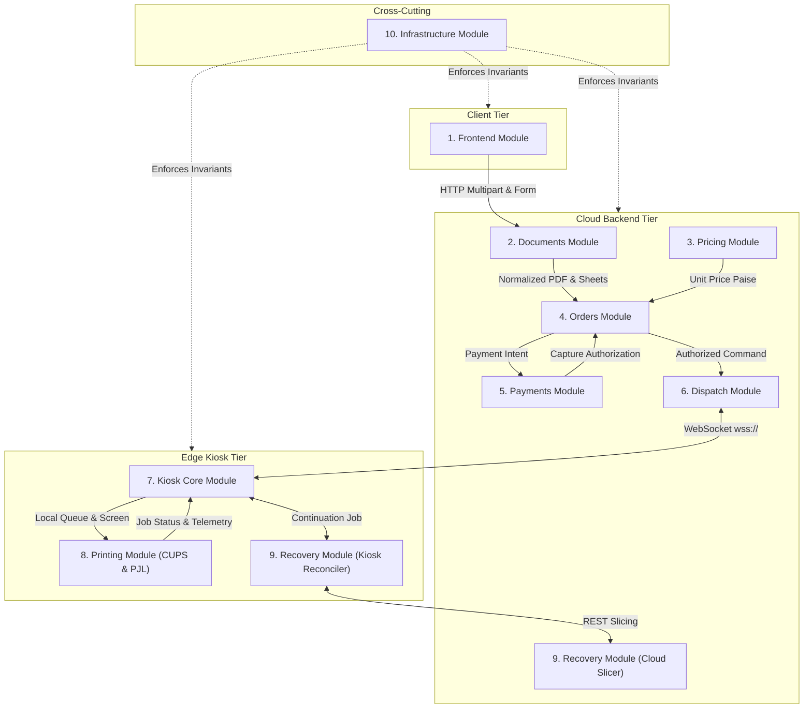
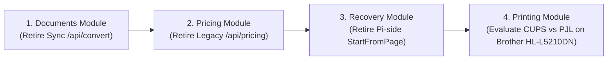

# XeroxGo Module Contracts & Behavioral Specifications

This document defines the formal behavioral contracts, boundaries, inputs, outputs, owned state, dependencies, permitted side effects, and lifecycle invariants for all 10 logical modules in the XeroxGo system.

---

## 1. System Module Contracts Overview

---

## 2. Logical Module Contracts

### 2.1 Frontend Module

- **Primary Responsibility:** User-facing mobile PWA portal and admin dashboard. Ingests client files, renders in-browser PDF previews, captures user print customizations (color, duplex, copies, page range), provides real-time pricing estimates, presents 4-digit PINs, and provides an admin KPI management dashboard.
- **Source Paths:**
  - Customer Portal: [`frontend/index.html`](file:///home/shabas/Projects/XeroxGo/frontend/index.html), [`frontend/js/portal.js`](file:///home/shabas/Projects/XeroxGo/frontend/js/portal.js), [`frontend/css/portal.css`](file:///home/shabas/Projects/XeroxGo/frontend/css/portal.css)
  - Admin Console: [`frontend/admin.html`](file:///home/shabas/Projects/XeroxGo/frontend/admin.html), [`frontend/js/admin.js`](file:///home/shabas/Projects/XeroxGo/frontend/js/admin.js), [`frontend/css/admin.css`](file:///home/shabas/Projects/XeroxGo/frontend/css/admin.css)
  - Web Checkout: [`frontend/payment.html`](file:///home/shabas/Projects/XeroxGo/frontend/payment.html)
- **Inputs:**
  - User uploaded file binaries (PDF, DOCX, PPTX, XLSX, JPG, PNG).
  - Print configuration selections: Copies (1–999), Duplex mode (`SIMPLEX`, `LONG_EDGE`, `SHORT_EDGE`), Color mode (`BW`, `COLOR`), Page ranges (e.g. `1-5, 8`), Pages-per-sheet N-up (1, 2, 4, 6).
  - Admin credentials for dashboard authentication.
- **Outputs:**
  - Multipart HTTP form submissions to cloud backend (`POST /api/k/{id}/upload`).
  - User-facing rendering of the 4-digit numeric PIN display card.
  - Admin configuration mutations (`POST /api/admin/pricing`, `POST /api/admin/ads`).
- **Owned State:**
  - Ephemeral browser in-memory cart state (`cartItems[]`).
  - Client-side PDF page cache rendered by Mozilla PDF.js.
  - Admin session token stored in browser `localStorage`.
- **Dependencies:**
  - Mozilla PDF.js ([`frontend/vendor/pdf.min.mjs`](file:///home/shabas/Projects/XeroxGo/frontend/vendor/pdf.min.mjs)).
  - PDF-Lib ([`frontend/vendor/pdf-lib.min.js`](file:///home/shabas/Projects/XeroxGo/frontend/vendor/pdf-lib.min.js)).
  - Vercel Edge CDN / Static hosting reverse proxy ([`frontend/vercel.json`](file:///home/shabas/Projects/XeroxGo/frontend/vercel.json)).
- **Permitted Side Effects:**
  - Rendering canvas preview bitmaps in the browser DOM.
  - Client-side array slicing and merging of multiple uploaded documents.
  - HTTP requests to cloud backend endpoints (`/api/*`).
- **Minimum Required Functionality:**
  - Ingest single or multi-page native PDF.
  - Extract client-side page count for initial UI feedback.
  - Transmit file and print configuration to cloud upload endpoint.
  - Display authoritative 4-digit PIN and total price returned by cloud.
- **Explicit Invariants:**
  1. The frontend client is **untrusted**; all page counts, sheet counts, and prices displayed in the browser are provisional estimates. Authoritative counts and pricing are computed exclusively by the cloud backend Documents and Pricing modules.
  2. The frontend never communicates directly with the edge kiosk Raspberry Pi or local printer.
- **Failure & Lifecycle Behavior:**
  - Network disconnect during upload displays a retry banner; partial uploads are aborted via `AbortController`.
  - Server validation errors (unsupported format, file > 25 MiB) surface explicit toast alerts without clearing cart state.

---

### 2.2 Documents Module

- **Primary Responsibility:** High-fidelity document conversion, layout imposition, prepress page sizing, duplex blank back-page padding, and canonical PDF page count extraction.
- **Source Paths:**
  - Normalization & Imposition: [`cloud-backend/internal/pdf/normalizer.go`](file:///home/shabas/Projects/XeroxGo/cloud-backend/internal/pdf/normalizer.go)
  - Office Conversion Worker: [`cloud-backend/internal/pdf/convert.go`](file:///home/shabas/Projects/XeroxGo/cloud-backend/internal/pdf/convert.go)
  - Async Conversion Handlers: [`cloud-backend/cmd/server/conversion_handlers.go`](file:///home/shabas/Projects/XeroxGo/cloud-backend/cmd/server/conversion_handlers.go)
  - Conversion Store: [`cloud-backend/internal/store/conversions.go`](file:///home/shabas/Projects/XeroxGo/cloud-backend/internal/store/conversions.go)
  - Legacy Sync Handler: Retired and removed in Task 3.6B (previously `handleConvert` in `cmd/server/main.go`).
- **Inputs:**
  - Raw document byte streams from upload handlers.
  - Normalization options: `Copies`, `Duplex`, `ColorMode`, `PageRange`, `Orientation`, `PagesPerSheet` ([`normalizer.go:33-35`](file:///home/shabas/Projects/XeroxGo/cloud-backend/internal/pdf/normalizer.go#L33-L35)). Supported N-up modes: strictly **1, 2, 4, 6** ([`normalizer.go:98, 318`](file:///home/shabas/Projects/XeroxGo/cloud-backend/internal/pdf/normalizer.go#L98)).
- **Outputs:**
  - Normalized, print-ready ISO A4 PDF written to temporary disk storage.
  - [`NormalizedResult`](file:///home/shabas/Projects/XeroxGo/cloud-backend/internal/pdf/normalizer.go#L25-L31) struct containing: `TotalPages`, `TotalSheets`, `SHA256Checksum`, and `OutputPath`.
- **Owned State:**
  - Temporary conversion scratch files in `XEROXGO_JOBS_DIR`.
  - Conversion job records in cloud `conversions` table.
- **Dependencies:**
  - External system binaries: Poppler (`pdfinfo`), Ghostscript (`gs`), CUPS filter (`pdftopdf`), QPDF (`qpdf`), LibreOffice (`soffice`).
- **Permitted Side Effects:**
  - Executing system CLI subprocesses (`exec.CommandContext`).
  - Creating and deleting temporary files in `jobsDir`.
- **Minimum Required Functionality:**
  - Validate native PDF using `qpdf --check`.
  - Extract physical page dimensions via `pdfinfo`.
  - Standardize page geometry to ISO A4 (595 $\times$ 842 pt).
  - Calculate exact physical sheets: $\text{Sheets} = \lceil \text{Pages} / 2 \rceil \times \text{Copies}$ for duplex; $\text{Sheets} = \text{Pages} \times \text{Copies}$ for simplex.
  - Calculate streaming SHA256 checksum of normalized output.
- **Explicit Invariants:**
  1. **Duplex Blank Padding Invariant:** In duplex mode, if the logical page count of a document is odd, the normalizer **must inject a blank back-page** into the PDF before appending subsequent copies or documents, ensuring each copy begins on a physical front page ([`normalizer.go:490-494`](file:///home/shabas/Projects/XeroxGo/cloud-backend/internal/pdf/normalizer.go#L490-L494)).
  2. **Imposition Modes:** Multi-page imposition supports strictly 1, 2, 4, and 6 pages per sheet via `pdftopdf` ([`normalizer.go:98`](file:///home/shabas/Projects/XeroxGo/cloud-backend/internal/pdf/normalizer.go#L98)). Unsupported N-up modes return explicit validation errors.
- **Failure & Lifecycle Behavior:**
  - Password-protected or malformed PDFs fail validation immediately with HTTP 400.
  - Conversion timeout is enforced via `context.WithTimeout(ctx, 45*time.Second)`. On timeout or error, all intermediate scratch files are unlinked.

---

### 2.3 Pricing Module

- **Primary Responsibility:** Calculation and enforcement of authoritative printing tariffs in fixed integer paise. Supports matrix tariffs (B&W Simplex, B&W Duplex, Color Simplex, Color Duplex) and volume discounts.
- **Source Paths:**
  - Authoritative Pricing Engine: [`cloud-backend/internal/pricing/pricing.go`](file:///home/shabas/Projects/XeroxGo/cloud-backend/internal/pricing/pricing.go) (`CalculatePricePaise`, `ResolveUnitPrice`, `ComputeDuplexDiscount`)
  - Legacy Price Calculation Delegation: [`cloud-backend/internal/payments/razorpay.go:16-20`](file:///home/shabas/Projects/XeroxGo/cloud-backend/internal/payments/razorpay.go#L16-L20) (`CalculatePricePaise`)
  - Tariff Resolution Delegation: [`cloud-backend/cmd/server/main.go:210-212`](file:///home/shabas/Projects/XeroxGo/cloud-backend/cmd/server/main.go#L210-L212) (`resolveUnitPrice`)
  - Tariff Persistence: [`cloud-backend/internal/store/analytics.go:120-170`](file:///home/shabas/Projects/XeroxGo/cloud-backend/internal/store/analytics.go#L120-L170) (`SetDetailedPricing`, `GetPricing`)
  - Admin Tariff Handler: [`cloud-backend/cmd/server/admin_handlers.go:35-95`](file:///home/shabas/Projects/XeroxGo/cloud-backend/cmd/server/admin_handlers.go#L35-L95) (`handleAdminPricing`)
  - Public Tariff Handler: [`cloud-backend/cmd/server/admin_handlers.go:15-32`](file:///home/shabas/Projects/XeroxGo/cloud-backend/cmd/server/admin_handlers.go#L15-L32) (`handlePublicPricing`, serving `GET /api/pricing`)
- **Inputs:**
  - `totalSides` (printed pages $\times$ copies), `colorMode` ("BW" / "COLOR"), `duplexMode` (`SIMPLEX` / `DUPLEX`).
  - Active `pricing` configuration record.
- **Outputs:**
  - `unit_price_paise` (int64) and `total_order_price_paise` (int64).
- **Owned State:**
  - Single row in cloud `pricing` table (`id = 1`).
- **Dependencies:**
  - Cloud Store persistence layer.
- **Permitted Side Effects:**
  - Updating `pricing` table via admin mutations.
- **Minimum Required Functionality:**
  - Resolve unit price per side based on color and duplex settings.
  - Multiply `totalSides * unit_price_paise` with integer overflow protection.
- **Explicit Invariants:**
  1. **Strict Integer Currency Invariant:** All pricing must be represented as 64-bit integer paise (1 INR = 100 paise). Floating-point currency calculations are strictly prohibited.
  2. **Non-Zero Tariff Invariant:** Unit prices must be strictly positive (`unit_price > 0`). Free printing is prohibited.
  3. **Order Price Immutability Invariant:** Once an order is persisted in `orders`, its `price_paise` is immutable. Subsequent changes to admin tariffs must never retroactively alter existing order prices ([`pricing_checkout_test.go:263`](file:///home/shabas/Projects/XeroxGo/cloud-backend/cmd/server/pricing_checkout_test.go#L263)).
  4. **Duplex Discount Invariant:** The duplex price per side must not exceed the simplex price per side.
- **Failure & Lifecycle Behavior:**
  - Integer overflow in multiplication immediately returns an error.
  - Startup without configured pricing in production mode fails fatally with `log.Fatalf("pricing unconfigured in production mode")` ([`main.go:1807`](file:///home/shabas/Projects/XeroxGo/cloud-backend/cmd/server/main.go#L1807)).

---

### 2.4 Orders Module

- **Primary Responsibility:** Order lifecycle management, 4-digit PIN allocation and collision retry, kiosk-scoped PIN lookup, paper tray capacity verification, transaction session mutual exclusion, and order state transitions.
- **Source Paths:**
  - Upload & Creation: [`cloud-backend/cmd/server/main.go:241-560`](file:///home/shabas/Projects/XeroxGo/cloud-backend/cmd/server/main.go#L241-L560) (`handleUpload`)
  - PIN Retry: [`cloud-backend/cmd/server/main.go:123-146`](file:///home/shabas/Projects/XeroxGo/cloud-backend/cmd/server/main.go#L123-L146) (`createOrderWithPINRetry`)
  - PIN Lookup Endpoint: [`cloud-backend/cmd/server/pin_lookup_handler.go:46-120`](file:///home/shabas/Projects/XeroxGo/cloud-backend/cmd/server/pin_lookup_handler.go#L46-L120) (`handlePINLookup`)
  - Session Claiming: [`cloud-backend/cmd/server/session_handler.go:164-260`](file:///home/shabas/Projects/XeroxGo/cloud-backend/cmd/server/session_handler.go#L164-L260) (`handleOrderClaim`)
  - Session Payment Initiation: [`cloud-backend/cmd/server/session_handler.go:363-440`](file:///home/shabas/Projects/XeroxGo/cloud-backend/cmd/server/session_handler.go#L363-L440) (`handleInitiatePayment`)
  - Store Engine: [`cloud-backend/internal/store/db.go`](file:///home/shabas/Projects/XeroxGo/cloud-backend/internal/store/db.go) (Orders, PINs, Sessions, Paper Stock)
- **Inputs:**
  - Document upload metadata and normalized output.
  - Keypad PIN lookup requests (`POST /api/k/{id}/orders/lookup`).
  - Session claim requests (`POST /api/k/{id}/orders/{order_id}/claim`).
- **Outputs:**
  - Persisted order records, reserved 4-digit PINs, active kiosk transaction sessions.
  - Order summary JSON payloads for edge display.
- **Owned State:**
  - Tables: `orders`, `print_configs`, `pin_reservations`, `pin_rate_limits`, `kiosk_sessions`.
- **Dependencies:**
  - Documents Module (for sheet count), Pricing Module (for tariff), Cloud Database Store.
- **Permitted Side Effects:**
  - Mutating database order and session statuses.
  - Reserving and releasing paper stock.
- **Minimum Required Functionality:**
  - Create order with unique 4-digit numeric PIN within 25 collision retries.
  - Enforce PIN expiration (default 24 hours).
  - Serve authenticated, rate-limited PIN lookups with uniform constant-time responses.
  - Lock transaction session to a single customer with a 5-minute TTL.
  - Pessimistically verify and reserve physical paper stock.
- **Explicit Invariants:**
  1. **PIN Uniqueness Invariant:** A 4-digit PIN must be unique per kiosk among active unexpired reservations. Enforced by `PRIMARY KEY (kiosk_id, pin)` in `pin_reservations`.
  2. **Paper Availability Invariant:** A transaction session cannot enter `PAYMENT_PENDING` unless `uncommitted_stock = current_stock - committed_sheets >= requested_sheets` ([`db.go:2189`](file:///home/shabas/Projects/XeroxGo/cloud-backend/internal/store/db.go#L2189)).
  3. **Mutual Exclusion Invariant:** Only one active session in `PAYMENT_PENDING` can exist per kiosk at any given time. Competing claims for other orders return HTTP 409 Conflict.
- **Failure & Lifecycle Behavior:**
  - PIN exhaustion after 25 retries aborts order creation.
  - Session expiration automatically releases reserved paper stock.

---

### 2.5 Payments Module

- **Primary Responsibility:** Dynamic UPI payment generation, payment gateway integration (Razorpay production and Mock dev provider), webhook verification, payment attempt tracking, and authorization gating for print dispatch.
- **Source Paths:**
  - Payment Gateways: [`cloud-backend/internal/payments/razorpay.go`](file:///home/shabas/Projects/XeroxGo/cloud-backend/internal/payments/razorpay.go), [`mock.go`](file:///home/shabas/Projects/XeroxGo/cloud-backend/internal/payments/mock.go)
  - Webhook Handler: [`cloud-backend/cmd/server/main.go:1417-1550`](file:///home/shabas/Projects/XeroxGo/cloud-backend/cmd/server/main.go#L1417-L1550) (`handleRazorpayWebhook`)
  - Payment Initiation: [`cloud-backend/cmd/server/session_handler.go:363-440`](file:///home/shabas/Projects/XeroxGo/cloud-backend/cmd/server/session_handler.go#L363-L440) (`handleInitiatePayment`)
  - Persistence & Deduplication: [`cloud-backend/internal/store/db.go:1733-1765`](file:///home/shabas/Projects/XeroxGo/cloud-backend/internal/store/db.go#L1733-L1765) (`RecordWebhook`), [`db.go:2537-2680`](file:///home/shabas/Projects/XeroxGo/cloud-backend/internal/store/db.go#L2537-L2680) (`CapturePaymentAndCheckDispatch`)
- **Inputs:**
  - Payment initiation requests from kiosk session (`POST /api/k/{id}/sessions/{id}/initiate-payment`).
  - Signed webhook payloads from Razorpay (`POST /api/webhooks/razorpay`).
- **Outputs:**
  - Dynamic UPI QR payload (`upi://pay?pa=...&am=...&tr=...`).
  - Captured payment audit records in `payments` and `payment_attempts`.
  - Authorized `PrintJobCommand` sent to Dispatch Module.
- **Owned State:**
  - Tables: `payment_attempts`, `payments`, `payment_webhooks`.
- **Dependencies:**
  - Razorpay REST API, Cloud Database Store.
- **Permitted Side Effects:**
  - External HTTP requests to payment gateway.
  - Transitioning orders to `PAID_WAITING` or `DISPATCHED`.
- **Minimum Required Functionality:**
  - Generate dynamic UPI QR payload tied to order ID and session ID.
  - Verify webhook HMAC-SHA256 signature using constant-time comparison.
  - Deduplicate incoming webhooks by gateway event ID.
  - Verify payment amount matches order amount in paise.
- **Explicit Invariants:**
  1. **Webhook Deduplication Invariant:** Duplicate webhook deliveries for the same event ID are discarded as idempotent no-ops via primary key constraint on `payment_webhooks.webhook_id`.
  2. **Presence-Gated Dispatch Invariant:** Captured payments authorize print dispatch **if and only if** the customer's transaction session is active and in `PAYMENT_PENDING`. If the session expired or was canceled, the order transitions to `PAID_WAITING` and dispatch is withheld until physical re-claiming ([`db.go:2537`](file:///home/shabas/Projects/XeroxGo/cloud-backend/internal/store/db.go#L2537)).
  3. **Exact Amount Invariant:** Webhooks with paid amounts differing from `orders.price_paise` are rejected with HTTP 400.
- **Failure & Lifecycle Behavior:**
  - Gateway network failures allow retrying payment initiation within session TTL.
  - Invalid webhook signatures return HTTP 400 and are dropped immediately.

---

### 2.6 Dispatch Module

- **Primary Responsibility:** Real-time bi-directional WebSocket relay between cloud backend and physical kiosks. Dispatches authorized print commands, receives health heartbeats, processes job progress acknowledgments, and reconciles pending dispatch intents across disconnections.
- **Source Paths:**
  - WebSocket Relay Hub: [`cloud-backend/internal/ws/hub.go`](file:///home/shabas/Projects/XeroxGo/cloud-backend/internal/ws/hub.go)
  - Dispatch Reconciliation: [`cloud-backend/internal/store/db.go:3017-3105`](file:///home/shabas/Projects/XeroxGo/cloud-backend/internal/store/db.go#L3017-L3105) (`ResetUnacknowledgedDispatchIntents`, `GetPendingDispatchOrders`)
- **Inputs:**
  - WebSocket connection requests (`GET /ws?kiosk_id=...`).
  - Authorized `PrintJobCommand` from Orders/Payments modules.
  - Wire messages from kiosks: `heartbeat`, `ack`, `job_ack`, `progress`.
- **Outputs:**
  - Serialized wire messages to kiosk (`job`, `sync_ads`, `refill`).
  - Progress updates persisted to `job_progress` table.
- **Owned State:**
  - In-memory active kiosk connections map (`sessions map[string]*kioskSession`).
  - Table: `dispatch_intents`.
- **Dependencies:**
  - Cloud Database Store, `coder/websocket` library.
- **Permitted Side Effects:**
  - Writing JSON frames over WebSocket connections.
  - Mutating dispatch intent records (`PENDING`, `SENT`, `COMPLETED`, `CANCELED`).
- **Minimum Required Functionality:**
  - Authenticate connecting kiosks via bearer token or HMAC secret.
  - Transmit `PrintJobCommand` to targeted kiosk over persistent socket.
  - Replay pending dispatch intents upon kiosk reconnection.
  - Record progress events and mark order `COMPLETED` upon final ACK.
- **Explicit Invariants:**
  1. **At-Least-Once Dispatch Invariant:** Dispatched jobs are tracked in `dispatch_intents` as `SENT`. If the kiosk disconnects before acknowledging, the intent resets to `PENDING` and is re-sent on reconnect ([`hub.go:142-154`](file:///home/shabas/Projects/XeroxGo/cloud-backend/internal/ws/hub.go#L142-L154)).
  2. **Session Validity Re-Verification:** Reconnecting kiosks cannot receive a pending job if the customer's session expired or was canceled during the outage; the intent is canceled and the order reverts to `PAID_WAITING` ([`db.go:3085-3093`](file:///home/shabas/Projects/XeroxGo/cloud-backend/internal/store/db.go#L3085-L3093)).
- **Failure & Lifecycle Behavior:**
  - Network disconnect triggers session cleanup and marks unacknowledged intents for retry.
  - Kiosk heartbeats occur every 30 seconds to maintain NAT keepalive.

---

### 2.7 Kiosk Core Module

- **Primary Responsibility:** Edge daemon lifecycle management, physical keypad input reading, finite state machine coordination (IDLE $\rightarrow$ PIN_ENTRY $\rightarrow$ ORDER_SUMMARY $\rightarrow$ PAYMENT_PENDING $\rightarrow$ PRINTING $\rightarrow$ COMPLETED), local SQLite persistence, and pure Go framebuffer rasterization to `/dev/fb0`.
- **Source Paths:**
  - Daemon Entrypoint: [`kiosk-daemon/cmd/daemon/main.go`](file:///home/shabas/Projects/XeroxGo/kiosk-daemon/cmd/daemon/main.go)
  - Keypad PIN Controller: [`kiosk-daemon/internal/pin/controller.go`](file:///home/shabas/Projects/XeroxGo/kiosk-daemon/internal/pin/controller.go)
  - Spooler Client: [`kiosk-daemon/internal/spooler/client.go`](file:///home/shabas/Projects/XeroxGo/kiosk-daemon/internal/spooler/client.go)
  - Local SQLite Store: [`kiosk-daemon/internal/state/store.go`](file:///home/shabas/Projects/XeroxGo/kiosk-daemon/internal/state/store.go)
  - Framebuffer Rasterizer: [`kiosk-daemon/internal/ui_ipc/renderer.go`](file:///home/shabas/Projects/XeroxGo/kiosk-daemon/internal/ui_ipc/renderer.go)
  - Keypad Input Device: [`kiosk-daemon/internal/input/keyboard.go`](file:///home/shabas/Projects/XeroxGo/kiosk-daemon/internal/input/keyboard.go)
- **Inputs:**
  - Keypad keystroke events from `/dev/tty1` or stdin.
  - WebSocket commands from Dispatch Module.
  - Job progress callbacks from Printing Module.
- **Outputs:**
  - Direct 16-bit RGB565 / 32-bit BGRA pixel writes to `/dev/fb0`.
  - HTTP REST calls to cloud backend (`orders/lookup`, `claim`, `initiate-payment`).
  - Progress updates sent to WebSocket hub.
- **Owned State:**
  - Local SQLite database (`/var/kiosk/state.db`) with `jobs` and `printer_state` tables.
  - In-memory FSM state, PIN buffer, active job tracker (`activeJobs`), deferred jobs queue (`deferredJobs`).
- **Dependencies:**
  - Linux Framebuffer (`/dev/fb0`), Linux TTY (`/dev/tty1`), Local SQLite engine.
- **Permitted Side Effects:**
  - Writing raw pixel buffers to `/dev/fb0`.
  - Creating and deleting temporary files in `/var/kiosk/jobs`.
  - Executing systemd watchdog notification (`sd_notify`).
- **Minimum Required Functionality:**
  - Capture digits '0'-'9', Backspace, and Submit from physical keypad.
  - Transition UI modes: Idle $\rightarrow$ PIN Entry $\rightarrow$ Order Summary $\rightarrow$ Payment QR $\rightarrow$ Downloading $\rightarrow$ Printing $\rightarrow$ Completed $\rightarrow$ Idle.
  - Enforce inactivity timeouts (30s PIN entry, 60s summary, 300s payment).
  - Defer unrelated incoming jobs during active customer keypad sessions.
  - Verify SHA256 checksum of downloaded PDF before spooling.
  - Unlink temporary PDF payload immediately upon job completion or terminal error.
- **Explicit Invariants:**
  1. **CGO-Free Rasterizer Invariant:** Framebuffer rendering is implemented in pure Go without X11, Wayland, or CGO graphics libraries.
  2. **Durable Local State Invariant:** Local SQLite store operates with `PRAGMA synchronous=FULL` and WAL journaling to protect against unexpected power cuts.
  3. **Immediate File Deletion Invariant:** Downloaded customer PDFs are unlinked (`os.Remove(finalPath)`) immediately after printing finishes ([`client.go:1268`](file:///home/shabas/Projects/XeroxGo/kiosk-daemon/internal/spooler/client.go#L1268)). Note: `os.Remove()` performs standard filesystem unlinking, not cryptographic multi-pass disk shredding.
  4. **Active Session Protection Invariant:** Incoming print jobs not belonging to the active keypad session are placed in `deferredJobs` and must never preempt or alter the screen of the user standing at the kiosk ([`client.go:998-1013`](file:///home/shabas/Projects/XeroxGo/kiosk-daemon/internal/spooler/client.go#L998-L1013)).
- **Failure & Lifecycle Behavior:**
  - On daemon startup, `state.db` is scanned for incomplete jobs; unsubmitted jobs are retried, while submitted jobs are reconciled via CUPS without double-printing.
  - Keypad inactivity resets FSM and drains deferred jobs.

---

### 2.8 Printing Module

- **Primary Responsibility:** Physical document printing execution and status verification. Supports dual printing engines:
  1. **CUPS Engine:** Submits jobs to local/network CUPS queues (`lp`), monitors IPP attributes, and tracks physical sheet delivery via SNMP marker life odometer. Used for local desktop and tank printers.
  2. **PJL RAW 9100 Engine:** Direct TCP RAW socket streaming to port 9100 on enterprise laser printers (Brother HL-L5210DN).
- **Source Paths:**
  - CUPS Engine: [`kiosk-daemon/internal/printer/cups.go`](file:///home/shabas/Projects/XeroxGo/kiosk-daemon/internal/printer/cups.go) (`PrintPDFWithCUPSHooksCustom` at line 335, `MonitorCUPSJobWithTelemetryCustom` at line 453)
  - SNMP Telemetry Poller: [`kiosk-daemon/internal/printer/snmp.go`](file:///home/shabas/Projects/XeroxGo/kiosk-daemon/internal/printer/snmp.go)
  - Combined Health Merger: [`kiosk-daemon/internal/printer/combined.go`](file:///home/shabas/Projects/XeroxGo/kiosk-daemon/internal/printer/combined.go)
  - PJL Spooler: [`kiosk-daemon/internal/printer/pjl.go`](file:///home/shabas/Projects/XeroxGo/kiosk-daemon/internal/printer/pjl.go)
- **Inputs:**
  - `PrintJobCommand` specifying copies, duplex mode, total pages, and total sheets.
  - Local path to normalized PDF file.
  - Page progress callback `onPage(streamSheetsCompleted int)`.
- **Outputs:**
  - Execution of `lp -d {queue} -n {copies} -o sides={duplex} {pdfPath}` or direct TCP stream to port 9100.
  - Periodic `JobProgressEvent` stream sent to Spooler.
  - Hardware health reports (`contracts.PrinterHealth`).
- **Owned State:**
  - Stateless execution wrapper; state tracked via CUPS daemon (`cupsd`) and printer hardware SNMP registers.
- **Dependencies:**
  - Local CUPS daemon (`lp`, `ipptool`, `/var/run/cups/cups.sock`).
  - Network access: TCP port 9100 (PJL) and UDP port 161 (SNMP) to physical printer.
- **Hardware Targets:**
  - Earlier test: **Brother DCP-T310** (USB desktop color ink-tank).
  - Current demo: **HP LaserJet Tank 1020w** (USB queue `HPTank`).
  - Production target: **Brother HL-L5210DN** (enterprise duplex monochrome laser directly connected to Raspberry Pi 4 over **Ethernet** at `192.168.99.2:9100`).
- **Permitted Side Effects:**
  - Executing `lp` and `ipptool` commands.
  - Transmitting TCP and SNMP UDP datagrams.
- **Minimum Required Functionality:**
  - Parse CUPS request ID from `lp` output (e.g. `request id is HPTank-142`).
  - Poll IPP attributes every 500ms for job state (`processing`, `completed`, `aborted`).
  - Track SNMP `oidPrtMarkerLifeCount` to verify physical paper feed.
  - Detect printer errors (paper jam, cover open, media empty).
- **Explicit Invariants:**
  1. **Single Submission Invariant:** A job is submitted to `lp` or port 9100 exactly once. Re-submission of an existing job is prohibited.
  2. **Sensor-Monitored Completion Invariant:** In CUPS mode, a job is completed when the SNMP marker life odometer confirms physical sheet count delivery and no hardware errors exist ([`cups.go:453-580`](file:///home/shabas/Projects/XeroxGo/kiosk-daemon/internal/printer/cups.go#L453-L580)).
  3. **No Synthetic Halfway Progress:** The progress callback must never emit synthetic or interpolated sheet progress; progress events must reflect real IPP or SNMP increments.
- **Failure & Lifecycle Behavior:**
  - If CUPS returns `processing-stopped` or SNMP reports `jam`, the job halts, emits `JobStatusPausedError`, and preserves the local record.
  - Daemon restart reconnects to the existing CUPS request ID via `ipptool` without re-submitting `lp`.

---

### 2.9 Recovery Module

- **Primary Responsibility:** Handling interrupted print jobs (jams, cover opens, paper depletion). Cloud-owned continuation PDF generation via `qpdf` slices the canonical document to resume from exact physical sheet boundaries without Pi-side manipulation.
- **Source Paths:**
  - Cloud Slicer: [`cloud-backend/internal/pdf/recovery.go`](file:///home/shabas/Projects/XeroxGo/cloud-backend/internal/pdf/recovery.go)
  - Recovery REST Endpoint: [`cloud-backend/cmd/server/recovery_handler.go`](file:///home/shabas/Projects/XeroxGo/cloud-backend/cmd/server/recovery_handler.go)
  - Recovery Store: [`cloud-backend/internal/store/recovery.go`](file:///home/shabas/Projects/XeroxGo/cloud-backend/internal/store/recovery.go)
  - Kiosk Recovery Requester: [`kiosk-daemon/internal/spooler/client.go:1689-1775`](file:///home/shabas/Projects/XeroxGo/kiosk-daemon/internal/spooler/client.go#L1689-L1775) (`RequestCloudRecovery`)
- **Inputs:**
  - Original canonical print-ready PDF path.
  - `confirmed_sheets_printed` (int) and `output_confirmed` (bool).
- **Outputs:**
  - Immutable continuation PDF containing only unprinted pages.
  - New continuation `PrintJobCommand` dispatched to kiosk.
- **Owned State:**
  - Table: `recovery_records`.
- **Dependencies:**
  - QPDF binary (`qpdf`), Cloud Store.
- **Permitted Side Effects:**
  - Executing `qpdf` command to create continuation PDF.
  - Inserting recovery tracking records.
- **Minimum Required Functionality:**
  - Calculate remaining logical pages and physical sheets based on confirmed delivered sheets.
  - Align slice points strictly to duplex sheet boundaries (odd front page, even back page).
  - Handle multi-copy remainder calculations.
  - Generate SHA256 checksum and signed download URL for continuation PDF.
- **Explicit Invariants:**
  1. **Uncertain Output Gating Invariant:** Cloud recovery **strictly rejects** continuation requests if `output_confirmed == false` ([`recovery_handler.go:123-132`](file:///home/shabas/Projects/XeroxGo/cloud-backend/cmd/server/recovery_handler.go#L123-L132)). Manual physical sheet inspection or explicit customer confirmation is mandatory.
  2. **Duplex Sheet Alignment Invariant:** In duplex mode, continuation PDFs must always start on a physical sheet boundary (odd-numbered canonical page). Slicing midway through a two-sided sheet is prohibited.
  3. **Zero Pi Slicing Invariant:** The Raspberry Pi must never perform PDF page manipulation; continuation artifacts must be 100% cloud-generated.
- **Failure & Lifecycle Behavior:**
  - If `confirmed_sheets_printed == total_sheets`, the recovery endpoint marks the job complete without generating a PDF.
  - If `confirmed_sheets_printed < 0` or exceeds total sheets, returns HTTP 400.

---

### 2.10 Infrastructure Module

- **Primary Responsibility:** Monorepo quality gates, frozen contract enforcement, CGO driver bans, multi-arch builds, deployment automation, and systemd service supervision.
- **Source Paths:**
  - Verification Gate: [`scripts/verify_gate.sh`](file:///home/shabas/Projects/XeroxGo/scripts/verify_gate.sh)
  - CI Pipeline: [`.github/workflows/ci.yml`](file:///home/shabas/Projects/XeroxGo/.github/workflows/ci.yml)
  - Supabase Schema: [`deploy/supabase/schema.sql`](file:///home/shabas/Projects/XeroxGo/deploy/supabase/schema.sql)
  - Systemd Service: [`deploy/rpi-os/xeroxgo-kiosk.service`](file:///home/shabas/Projects/XeroxGo/deploy/rpi-os/xeroxgo-kiosk.service)
  - Deployment Scripts: `scripts/deploy_pi.sh`, `scripts/install_kiosk_service.sh`
- **Inputs:**
  - Git repository state, environment variables.
- **Outputs:**
  - Verification gate pass/fail signals.
  - Built binaries: `xeroxgo-kiosk-daemon` (arm64) and `xeroxgo-cloud-server` (host).
- **Owned State:**
  - Monorepo gate hash baselines (`Gate 1` commit hash `7a537f6a...`).
- **Dependencies:**
  - Go compiler (`go`), Git, Bash, Coreutils.
- **Permitted Side Effects:**
  - Compiling Go binaries, running test suites with race detector.
- **Minimum Required Functionality:**
  - Enforce frozen contracts in `pkg/contracts/models.go`.
  - Block usage of `mattn/go-sqlite3` across all Go source files.
  - Validate clean `go vet`.
  - Compile arm64 daemon binary with `CGO_ENABLED=0`.
  - Execute monorepo test suite with race detector enabled (`-race`).
- **Explicit Invariants:**
  1. **Contract Hash Invariant:** Changes to `pkg/contracts/models.go` must strictly preserve binary wire compatibility and match the baseline hash.
  2. **Zero CGO SQLite Invariant:** The codebase must use pure Go SQLite drivers (`modernc.org/sqlite`); CGO SQLite is banned to prevent cross-compilation failures on ARM64.
- **Failure & Lifecycle Behavior:**
  - Failure in any of the 5 gates aborts CI deployment and blocks pull requests.

---

## 3. Independent Simplification Potential & Recommended Sequence

| Sequence | Module | Target for Simplification | Rationale & Safety |
| :---: | :--- | :--- | :--- |
| **1** | **Documents Module** | **COMPLETED (Tasks 3.6A & 3.6B):** Retired synchronous `handleConvert` (`POST /api/convert`) and consolidated `portal.js` to rely exclusively on `/api/conversions` with Gate 6 verification. | **Zero edge hardware coupling:** Eliminates thread blocking on the cloud web server and unifies office document conversion into the asynchronous worker queue. |
| **2** | **Pricing Module** | Deprecate flat per-sheet endpoint `handlePublicPricing` (`GET /api/pricing` in [`admin_handlers.go:15`](file:///home/shabas/Projects/XeroxGo/cloud-backend/cmd/server/admin_handlers.go#L15)) in favor of full-matrix `/api/admin/pricing`. | **Data Model Parity:** Backend already converts single prices to detailed matrix records internally. Removing the legacy endpoint simplifies routing. |
| **3** | **Recovery Module** | Remove `StartFromPage > 1` offset slicing logic from `client.go:1090` and contracts. | **Single Slicing Source of Truth:** Cloud `pdf/recovery.go` creates complete, self-contained continuation PDFs with `start_from_page = 1`. Pi offset slicing is obsolete. |
| **4** | **Printing Module** | Evaluate CUPS vs PJL specifically on the **production Brother HL-L5210DN over Ethernet** before retiring either engine. | **Hardware Safety:** The Brother HL-L5210DN connects directly over Ethernet (`192.168.99.2:9100`) and natively supports PJL. PJL removal must **not** occur until on-site hardware verification is complete. |
