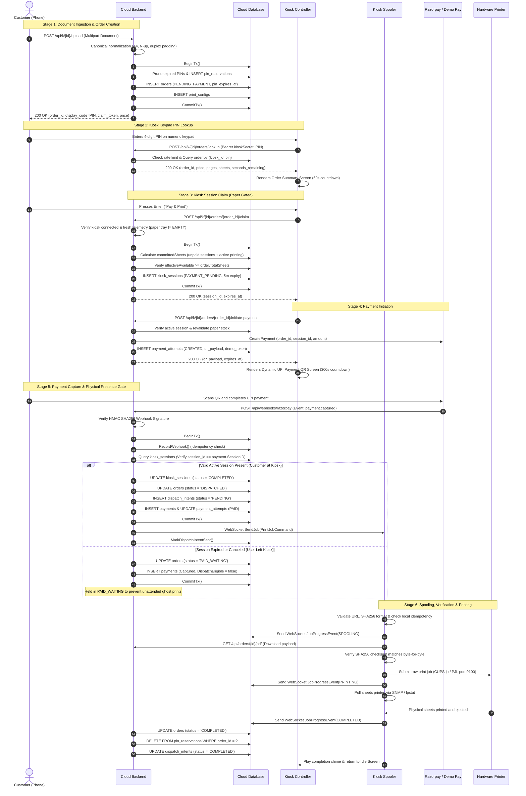
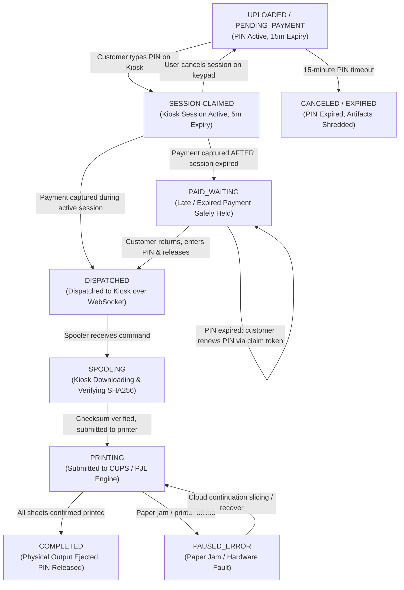

# XeroxGo Orders & Sessions Architecture Audit

This document delivers a comprehensive architectural audit of the **Order, PIN, Kiosk Session, Paper Reservation, Payment Authorization, and Expiration** logic across the XeroxGo Cloud Backend, Kiosk Daemon, and Shared Contracts.

---

## 1. Executive Summary & Audit Scope

The XeroxGo printing transaction spans mobile document preparation, cloud-side normalization, numeric PIN allocation, physical kiosk interaction, dynamic payment QR generation, payment capture, and hardware print dispatch. 

Because physical printing cannot be digitally "rolled back" once ink meets paper, the order and session architecture must enforce strict safety invariants against duplicate billing, unattended "ghost printing", paper tray exhaustion, race conditions, and server/kiosk crash windows.

### 1.1 Audited Codebase Components

| Layer | Component | Source Reference | Responsibility |
| :--- | :--- | :--- | :--- |
| **Contracts** | Shared Data Models | [`pkg/contracts/models.go`](file:///home/shabas/Projects/XeroxGo/pkg/contracts/models.go) | Canonical definitions for `JobStatus`, `PrintOrder`, `PrintJobCommand`, `PrinterHealth`, `JobProgressEvent`. |
| **Cloud Routing** | Ingress Router & Dispatcher | [`cloud-backend/cmd/server/main.go`](file:///home/shabas/Projects/XeroxGo/cloud-backend/cmd/server/main.go) | Server entrypoint, HTTP route mux (`app.routes()`), proxy security, webhook routing, WebSocket hub. |
| **Cloud API** | PIN Lookup Handler | [`cloud-backend/cmd/server/pin_lookup_handler.go`](file:///home/shabas/Projects/XeroxGo/cloud-backend/cmd/server/pin_lookup_handler.go) | Authenticated, rate-limited, read-only order lookup by 4-digit PIN with uniform 404 responses. |
| **Cloud API** | Kiosk Session Handler | [`cloud-backend/cmd/server/session_handler.go`](file:///home/shabas/Projects/XeroxGo/cloud-backend/cmd/server/session_handler.go) | Kiosk transaction session lifecycle: order claim, cancellation, paper stock check, payment initiation, paid order release, recovery PIN renewal, paper refill. |
| **Cloud API** | Demo Checkout Handler | [`cloud-backend/cmd/server/demo_pay_handler.go`](file:///home/shabas/Projects/XeroxGo/cloud-backend/cmd/server/demo_pay_handler.go) | Web-based simulated UPI checkout for mobile demo testing and automated evaluation. |
| **Cloud Store** | Database Persistence Engine | [`cloud-backend/internal/store/db.go`](file:///home/shabas/Projects/XeroxGo/cloud-backend/internal/store/db.go) | SQLite / PostgreSQL storage: atomic transactions, PIN reservations, session claims, paper commitments, payment attempts, dispatch intents, recovery records. |
| **Cloud Security** | PIN Rate Limiter | [`cloud-backend/cmd/server/pin_limiter.go`](file:///home/shabas/Projects/XeroxGo/cloud-backend/cmd/server/pin_limiter.go) | Durable brute-force protection tracking failed PIN attempts per kiosk across restarts. |
| **Cloud Relay** | WebSocket Communication Hub | [`cloud-backend/internal/ws/hub.go`](file:///home/shabas/Projects/XeroxGo/cloud-backend/internal/ws/hub.go) | Bi-directional communication with kiosks: job dispatch, health monitoring, ad sync, unacknowledged intent reconciliation. |
| **Kiosk Client** | Cloud PIN Client | [`kiosk-daemon/internal/cloud/pin_client.go`](file:///home/shabas/Projects/XeroxGo/kiosk-daemon/internal/cloud/pin_client.go) | HTTP client executing PIN lookups, order claims, payment initiations, and session cancellations. |
| **Kiosk UI** | Keypad PIN Controller | [`kiosk-daemon/internal/pin/controller.go`](file:///home/shabas/Projects/XeroxGo/kiosk-daemon/internal/pin/controller.go) | State machine coordinating keypad buffer, timeouts, countdowns, and framebuffer rendering. |
| **Kiosk Spooler** | Spooler Client | [`kiosk-daemon/internal/spooler/client.go`](file:///home/shabas/Projects/XeroxGo/kiosk-daemon/internal/spooler/client.go) | Job execution queue, PDF checksum validation, printer submission (CUPS/PJL), telemetry reporting, completion chimes. |

---

## 2. End-to-End Transaction Lifecycle Trace

The complete lifecycle from document submission to physical paper ejection follows an 8-stage sequence:



---

## 3. Detailed State Transitions & Database Mutations

### 3.1 State Diagram: Order Lifecycle



### 3.2 State Transition Matrix

| Current State | Target State | Triggering Action | Pre-Conditions | Database Mutations | Concurrency & Idempotency Guard |
| :--- | :--- | :--- | :--- | :--- | :--- |
| *(None)* | **`PENDING_PAYMENT`** | `POST /api/k/{id}/upload` | Valid document payload, copies $\ge 1$, valid A4 layout. | `INSERT INTO pin_reservations`<br/>`INSERT INTO orders`<br/>`INSERT INTO print_configs` | `PRIMARY KEY (kiosk_id, pin)` enforces atomic reservation. Collision retried up to 25 times. |
| **`PENDING_PAYMENT`** | **`PENDING_PAYMENT`** (Claimed) | `POST /api/k/{id}/orders/{id}/claim` | Kiosk printer online, tray not empty, `effectiveAvailable >= TotalSheets`. | `INSERT INTO kiosk_sessions (status='PAYMENT_PENDING')` | Existing active session on same kiosk returned idempotently; conflicting claim rejected (`409 Conflict`). |
| **`PENDING_PAYMENT`** | **`DISPATCHED`** | `POST /api/webhooks/razorpay` or `POST /pay/{token}` | Payment verified; active unexpired session matches `payment.SessionID`. | `UPDATE kiosk_sessions SET status='COMPLETED'`<br/>`UPDATE orders SET status='DISPATCHED'`<br/>`INSERT INTO dispatch_intents (status='PENDING')`<br/>`INSERT INTO payments` | `RecordWebhook` idempotency table prevents duplicate processing. Atomic transaction gates dispatch. |
| **`PENDING_PAYMENT`** | **`PAID_WAITING`** | Payment captured after session expiry or cancellation | Webhook valid, but active kiosk session is missing, expired, or mismatched. | `UPDATE orders SET status='PAID_WAITING'`<br/>`INSERT INTO payments (status='captured')` | **Anti-Ghost-Print Gate:** Money captured, but print dispatch blocked. Order preserved for customer redemption. |
| **`PAID_WAITING`** | **`DISPATCHED`** | `POST /api/k/{id}/orders/{id}/release` | Order in `PAID_WAITING`; customer creates active kiosk session and releases. | `UPDATE kiosk_sessions SET status='COMPLETED'`<br/>`UPDATE orders SET status='DISPATCHED'`<br/>`INSERT INTO dispatch_intents (status='PENDING')` | Transaction verifies physical kiosk presence before releasing print job. |
| **`DISPATCHED`** | **`SPOOLING`** | Kiosk spooler receives command | Spooler validates URL origin, path, and SHA256 hex format. | `UPDATE orders SET status='SPOOLING'`<br/>`INSERT INTO job_progress` | Local SQLite checks `StoredJob.Status`. Ignores command if already completed or submitted. |
| **`SPOOLING`** | **`PRINTING`** | PDF downloaded, verified, and sent to printer | SHA256 checksum matches byte-for-byte; CUPS/PJL accepts stream. | `UPDATE orders SET status='PRINTING'`<br/>`UPDATE job_progress SET pages_printed=0` | Atomic state transition; local store records `SubmittedToPrinter = true` with CUPS job ID. |
| **`PRINTING`** | **`COMPLETED`** | Hardware printer confirms all sheets printed | Telemetry confirms physical sheet count matches `TotalSheets`. | `UPDATE orders SET status='COMPLETED'`<br/>`DELETE FROM pin_reservations WHERE order_id=?`<br/>`UPDATE dispatch_intents SET status='COMPLETED'` | Final completion releases PIN reservation back to kiosk pool. Local spooler chimes and resets. |
| **`PRINTING`** | **`PAUSED_ERROR`** | Printer reports paper jam, cover open, or stall | Hardware telemetry error reported by CUPS or SNMP. | `UPDATE orders SET status='PAUSED_ERROR'`<br/>`UPDATE job_progress SET error_reason=?` | Confirmed printed sheets recorded. Job eligible for cloud continuation recovery. |

---

## 4. State Ownership & Invariant Analysis

### 4.1 Authoritative State Ownership

```
┌─────────────────────────────────────────────────────────────────────────────┐
│                          AUTHORITATIVE OWNERSHIP                            │
├────────────────────────────────┬────────────────────────────────────────────┤
│ Domain Entity                  │ Authoritative Owner                        │
├────────────────────────────────┼────────────────────────────────────────────┤
│ Order Status & Authoritative   │ Cloud Database (`orders` table)            │
│ Pricing (Integer Paise)        │                                            │
│ PIN Allocation & Uniqueness    │ Cloud Database (`pin_reservations` table)  │
│ Kiosk Transaction Session      │ Cloud Database (`kiosk_sessions` table)    │
│ Payment Record & Capture State │ Cloud Database (`payments` table)          │
│ In-Flight Dispatch Intents     │ Cloud Database (`dispatch_intents` table)  │
│ Hardware Telemetry & Jam State │ Kiosk Daemon Spooler (SNMP + CUPS driver)  │
│ Physical Sheet Count & Stock   │ Kiosk Local Store (`kiosk.db` SQLite)      │
│ Local Job Idempotency & Re-run │ Kiosk Local Store (`StoredJob` record)     │
└────────────────────────────────┴────────────────────────────────────────────┘
```

### 4.2 Core Safety Invariants

#### Invariant 1: Atomic PIN Allocation & Collision Resistance
- **Implementation:** [`cloud-backend/internal/store/db.go:943-956`](file:///home/shabas/Projects/XeroxGo/cloud-backend/internal/store/db.go#L943-L956)
- **Mechanism:** Enforced by database primary key `PRIMARY KEY (kiosk_id, pin)` in table `pin_reservations`.
- **Collision Policy:** If an identical PIN is generated on the same kiosk before the prior reservation expires, the database rejects the insert with `ErrPINCollision`. The upload handler retries random generation with exponential backoff up to 25 times ([`session_handler.go:757-782`](file:///home/shabas/Projects/XeroxGo/cloud-backend/cmd/server/session_handler.go#L757-L782)).
- **Safety Guarantee:** No two active orders on the same kiosk can ever share a PIN.

#### Invariant 2: Paper Availability & Overcommitment Guard
- **Implementation:** [`cloud-backend/internal/store/db.go:2118-2175`](file:///home/shabas/Projects/XeroxGo/cloud-backend/internal/store/db.go#L2118-L2175) (`GetCommittedPaperSheetsTx`)
- **Mechanism:** Before creating a session or initiating payment, the cloud queries current estimated stock and computes existing commitments:
  $$\text{Committed Sheets} = \sum_{\text{Unpaid Active Sessions}} \text{total\_sheets} + \sum_{\text{Active Printing Jobs}} (\text{total\_sheets} - \text{sheets\_printed})$$
- **Safety Guarantee:** If $\text{Stock} - \text{Committed Sheets} < \text{Order Sheets}$, claim is rejected with `INSUFFICIENT_PAPER` (HTTP 409). Customers cannot pay for prints the kiosk lacks physical paper to produce.

#### Invariant 3: Customer Physical Presence Authorization Gate (Anti-Ghost-Printing)
- **Implementation:** [`cloud-backend/internal/store/db.go:2655-2715`](file:///home/shabas/Projects/XeroxGo/cloud-backend/internal/store/db.go#L2655-L2715)
- **Mechanism:** When a payment capture webhook arrives, print dispatch is authorized **only if** an active session exists on `kiosk_id` with `status = 'PAYMENT_PENDING'`, `expires_at > now`, and `session_id == payment.SessionID`.
- **Safety Guarantee:** If the customer walked away, timed out, or canceled the session, `DispatchEligible` evaluates to `false`. Money is captured safely in `PAID_WAITING`, but no paper is printed into an empty room.

#### Invariant 4: Payment Webhook Deduplication
- **Implementation:** [`cloud-backend/internal/store/db.go:1733-1765`](file:///home/shabas/Projects/XeroxGo/cloud-backend/internal/store/db.go#L1733-L1765)
- **Mechanism:** Webhooks insert `event_id` into `payment_webhooks(webhook_id)`. If Razorpay retries the same webhook, the database primary key rejects the duplicate insert and returns HTTP 200 `{"status":"duplicate"}`.
- **Safety Guarantee:** Retried payment notifications cannot cause duplicate orders, duplicate balance captures, or duplicate dispatches.

#### Invariant 5: Local Spooler Re-print Prevention
- **Implementation:** [`kiosk-daemon/internal/spooler/client.go:621-649`](file:///home/shabas/Projects/XeroxGo/kiosk-daemon/internal/spooler/client.go#L621-L649)
- **Mechanism:** Before accepting a `PrintJobCommand`, the kiosk spooler queries local SQLite `StoredJob`. If the job is already marked `COMPLETED` or `SubmittedToPrinter = true`, the command is dropped and existing progress is re-transmitted.
- **Safety Guarantee:** Network re-transmissions or cloud restarts cannot trigger duplicate physical printouts.

#### Invariant 6: Reconnection & Stranded Intent Reconciliation
- **Implementation:** [`cloud-backend/internal/store/db.go:3015-3105`](file:///home/shabas/Projects/XeroxGo/cloud-backend/internal/store/db.go#L3015-L3105)
- **Mechanism:** When a kiosk disconnects, unacknowledged `SENT` intents revert to `PENDING`. Upon reconnection, `GetPendingDispatchOrders` queries `PENDING` intents, checks that the customer session was **not canceled or expired**, and resends the job.
- **Safety Guarantee:** Disconnections during payment do not strand orders, and stale sessions are not printed after the customer leaves.

---

## 5. Redundancy & Code Cleanliness Findings

The audit identified several areas of historical duplication, twin routing aliases, and legacy simulation logic:

### 5.1 Duplicate Routing Aliases in API Gateway

In [`cloud-backend/cmd/server/main.go:1480-1495`](file:///home/shabas/Projects/XeroxGo/cloud-backend/cmd/server/main.go#L1480-L1495), the server maintains duplicate URL paths for nearly every kiosk operation:

| Canonical Route | Duplicate Alias Route | Target Handler | Reason for Duplication | Recommendation |
| :--- | :--- | :--- | :--- | :--- |
| `POST /api/k/{id}/orders/lookup` | `POST /api/k/{id}/pin/lookup` | `app.handlePINLookup` | Historical migration from `/pin/lookup` to RESTful `/orders/lookup`. | **DEPRECATE $\rightarrow$ REMOVE** alias after confirming frontend/kiosk use canonical route. |
| `POST /api/k/{id}/orders/{id}/claim` | `POST /api/k/{id}/orders/{id}/confirm` | `app.handleOrderClaim` | Kiosk daemon originally called `/confirm`; later renamed to `/claim`. | **DEPRECATE $\rightarrow$ REMOVE** alias. |
| `POST /api/k/{id}/sessions/{id}/cancel` | `POST /api/k/{id}/orders/{id}/cancel-session` | `app.handleSessionCancel` | Keypad controller supports both order-scoped and session-scoped cancel paths. | **CONSOLIDATE** on session-scoped cancel. |
| `POST /api/k/{id}/orders/{id}/initiate-payment` | `POST /api/k/{id}/sessions/{id}/initiate-payment` | `app.handleInitiatePayment` | Handlers parse either `/orders/` or `/sessions/` from path. | **CONSOLIDATE** on session-scoped payment initiation. |
| `POST /api/orders/{id}/recovery-pin` | `POST /api/k/{id}/orders/{id}/recovery-pin` | `app.handleRecoveryPIN` | Public order recovery vs kiosk-authenticated recovery. | **KEEP BOTH:** Distinct auth contexts (public claim token vs kiosk Bearer token). |

### 5.2 Legacy Simulation Handler vs. Demo Checkout

- **Legacy Handler ([`main.go:786-958`](file:///home/shabas/Projects/XeroxGo/cloud-backend/cmd/server/main.go#L786-L958) — `handleSimulatePayment`):**
  - 172 lines of code that fabricates a synthetic Razorpay webhook payload, generates an HMAC signature, records a fake webhook ID, auto-creates synthetic kiosk sessions if `require_session != 1`, and dispatches jobs.
  - Highly brittle, bypasses standard payment attempt tokens, and auto-disables in demo mode (`if s.cfg.demoMode { return 403 }`).
- **Modern Demo Checkout ([`demo_pay_handler.go`](file:///home/shabas/Projects/XeroxGo/cloud-backend/cmd/server/demo_pay_handler.go)):**
  - Fully integrated with `payment_attempts`, supports `GET /pay/{token}` (renders mobile checkout UI or JSON) and `POST /pay/{token}` (executes atomic capture).
  - Cleanly honors session validity and physical presence gates.
- **Recommendation:** `handleSimulatePayment` is a redundant legacy implementation. Deprecate and remove once test suites (`payment_safety_test.go`) transition to standard mock provider calls or demo checkout.

### 5.3 Essential vs. Accidental Complexity

It is vital to distinguish necessary multi-entity safeguards from redundant complexity:

| Architecture Element | Multi-Entity Separation | Verdict | Justification |
| :--- | :--- | :--- | :--- |
| **`claim_token` vs. `session_id`** | Two distinct tokens per order | **ESSENTIAL SAFEGUARD** | `claim_token` (`clm_*`) is issued to the mobile customer at upload time as proof of **document ownership**. `session_id` (`sess_*`) is generated at the kiosk when the PIN is entered as proof of **physical presence**. Collapsing them would allow remote web users to spoof physical presence and trigger unattended printing. |
| **`payment_attempts` vs. `payments`** | Two database tables | **ESSENTIAL SAFEGUARD** | `payment_attempts` tracks uncommitted QR generation attempts (which may expire or be canceled without payment). `payments` records durable, immutable, captured financial transactions. Storing both in a single table would cause uncommitted attempts to pollute financial ledger integrity. |
| **`dispatch_intents` Table** | Separate from `orders` table | **ESSENTIAL SAFEGUARD** | Decouples payment authorization from network delivery. If a kiosk is offline or WebSocket drops during webhook processing, `dispatch_intents` provides durable state reconciliation on reconnect without re-mutating order status or financial records. |
| **`display_code` in `orders` vs. `pin_reservations`** | Duplicate PIN storage | **ESSENTIAL SAFEGUARD** | `pin_reservations` enforces a strict temporary uniqueness constraint (`PRIMARY KEY (kiosk_id, pin)`). When a job completes, its PIN reservation is deleted so another student can reuse the 4-digit code. `orders.display_code` preserves the historical PIN string on the completed order for accounting and dispute audit logs. |

---

## 6. Concurrency, Race Conditions & Failure Modes

### 6.1 PostgreSQL Concurrent Claim Race (Phantom Read)

- **Vulnerability:** In [`cloud-backend/internal/store/db.go:2238-2280`](file:///home/shabas/Projects/XeroxGo/cloud-backend/internal/store/db.go#L2238-L2280), `CreateOrGetKioskSessionWithPaperCheck` checks for existing `PAYMENT_PENDING` sessions using a standard `SELECT`.
- **SQLite Behavior:** SQLite enforces global serialization on write transactions (`BeginTx`), so concurrent claims are serialized safely.
- **PostgreSQL Behavior:** Under PostgreSQL's default `READ COMMITTED` transaction isolation, two simultaneous requests claiming the same order could both execute the `SELECT`, find 0 active sessions, and both execute `INSERT INTO kiosk_sessions`.
- **Current Mitigation:** The schema defines `CREATE INDEX idx_kiosk_sessions_order_status ON kiosk_sessions (order_id, status);`, but this is **NOT a unique index**.
- **Recommended Fix:** Change the index to a unique partial index:
  ```sql
  CREATE UNIQUE INDEX idx_kiosk_sessions_active_order 
  ON kiosk_sessions (order_id) 
  WHERE status = 'PAYMENT_PENDING';
  ```
  This guarantees database-level rejection of concurrent claims regardless of database engine or transaction isolation level.

### 6.2 PostgreSQL Paper Overcommitment Phantom Read

- **Vulnerability:** `getCommittedPaperSheetsTx` computes committed paper across active sessions and printing jobs.
- **Risk:** In PostgreSQL, two separate orders claiming paper on the same kiosk at the same millisecond could both compute `effectiveAvailable = Stock - Committed`, conclude paper is sufficient, and both create sessions—exceeding total tray capacity.
- **Recommended Fix:** In PostgreSQL deployments, wrap the paper check in a kiosk-level lock:
  ```sql
  SELECT pg_advisory_xact_lock(hashtext('kiosk_paper_' || $1));
  ```
  This serializes paper reservation checks per kiosk without blocking unrelated kiosks.

### 6.3 Missing Automated Database Pruning Job

- **Finding:** While expired PIN reservations are pruned during `CreateOrder` on that kiosk, and expired sessions are pruned during `CreateOrGetKioskSession`, orders that are abandoned (customer never visits kiosk) leave stale records in `pin_reservations`, `kiosk_sessions`, and `payment_attempts`.
- **Impact:** On kiosks with low traffic, expired PIN reservations can linger until the next upload. Stale payment attempts accumulate over months, increasing database index sizes.
- **Recommended Fix:** Introduce a background cron/ticker worker running every 10 minutes:
  ```sql
  DELETE FROM pin_reservations WHERE expires_at_ns <= now_ns;
  UPDATE kiosk_sessions SET status = 'EXPIRED', updated_at_ns = now_ns WHERE status = 'PAYMENT_PENDING' AND expires_at_ns <= now_ns;
  UPDATE payment_attempts SET status = 'EXPIRED', updated_at_ns = now_ns WHERE status = 'CREATED' AND expires_at_ns <= now_ns;
  ```

---

## 7. Existing Test Coverage vs. Acceptance Gaps

### 7.1 Existing Verified Test Suites

| Test Suite File | Coverage Scope | Verified Invariants |
| :--- | :--- | :--- |
| [`cmd/server/pin_lookup_test.go`](file:///home/shabas/Projects/XeroxGo/cloud-backend/cmd/server/pin_lookup_test.go) | 10 tests | 4-digit numeric format, crypto random generation, atomic uniqueness, collision retry, strict Bearer auth, uniform 404 responses, timestamp boundary expiry, durable rate limiting across server restart. |
| [`cmd/server/transaction_session_test.go`](file:///home/shabas/Projects/XeroxGo/cloud-backend/cmd/server/transaction_session_test.go) | 5 tests | Order claim success, claim idempotency, conflicting cross-kiosk claims (409), active session requirement for payment initiation, cancellation flow, read-only guarantees. |
| [`cmd/server/paper_availability_test.go`](file:///home/shabas/Projects/XeroxGo/cloud-backend/cmd/server/paper_availability_test.go) | 3 tests | Offline printer rejection (503), stale telemetry rejection (409), paper tray empty rejection (409), multi-session overcommitment prevention, refill command dispatch. |
| [`cmd/server/payment_safety_test.go`](file:///home/shabas/Projects/XeroxGo/cloud-backend/cmd/server/payment_safety_test.go) | 24 tests | Late payment holding in `PAID_WAITING`, canceled session ghost-print prevention, concurrent webhook atomic single dispatch, webhook idempotency, paid order release, recovery PIN renewal, reconnect reconciliation. |
| [`kiosk-daemon/internal/pin/controller_test.go`](file:///home/shabas/Projects/XeroxGo/kiosk-daemon/internal/pin/controller_test.go) | 11 tests | Keypad digit buffer, backspace, clear, inactivity timeouts, order summary rendering, countdown ticking, paper shortage error rendering, payment URL wrapping. |
| [`kiosk-daemon/internal/spooler/pin_flow_test.go`](file:///home/shabas/Projects/XeroxGo/kiosk-daemon/internal/spooler/pin_flow_test.go) | 8 tests | End-to-end PIN flow simulation, kiosk isolation, read-only lookup invariant, payment initiation, dynamic QR rendering, trusted origin URL validation. |

### 7.2 Missing Acceptance Coverage (Gaps Identified)

| Gap ID | Description | Failure Risk | Acceptance Criteria Needed |
| :---: | :--- | :--- | :--- |
| **GAP-ORD-01** | Concurrent Claims on PostgreSQL | High concurrency race could create twin active sessions on one order. | Automated test asserting that concurrent `CreateOrGetKioskSession` calls across parallel goroutines result in strictly 1 active session. |
| **GAP-ORD-02** | Simultaneous Paper Overcommitment Race | Two orders claiming the last remaining sheets simultaneously could both succeed. | Parallel claim test where two orders each requiring 6 sheets attempt to claim a kiosk with exactly 10 sheets available. Strictly 1 must succeed; 1 must receive `INSUFFICIENT_PAPER`. |
| **GAP-ORD-03** | Stale Intent Dispatch Reversal on Reconnect | Kiosk reconnecting after session cancellation could trigger ghost printing. | Test verifying that `GetPendingDispatchOrders` cancels intents whose sessions expired or were canceled during the disconnect window. |
| **GAP-ORD-04** | Background Pruning of Abandoned PINs & Sessions | Stale records accumulate if no new orders arrive on a kiosk. | Test verifying background pruner cleans expired `pin_reservations` and marks expired `kiosk_sessions` and `payment_attempts`. |

---

## 8. Smallest Reliable Orders & Sessions Architecture

To achieve maximum reliability with minimum moving parts while preserving all existing external APIs:

```mermaid
flowchart TD
    subgraph Client ["Client Layer"]
        Portal["Student Mobile Portal"]
        Keypad["Kiosk Keypad / Touchscreen"]
    end

    subgraph Gateway ["Consolidated Cloud Gateway"]
        AuthMux["Unified REST Router<br/>(Clean Routes, Aliases Deprecated)"]
        PINRate["Durable PIN Rate Limiter"]
    end

    subgraph Core ["Orders & Sessions Core"]
        OrderMgr["Order & PIN Manager<br/>(Atomic Reservation, 15m Expiry)"]
        SessMgr["Session & Paper Manager<br/>(Presence Lock, Stock Check, 5m Expiry)"]
        PayAuth["Payment Authorization Gate<br/>(Anti-Ghost-Print Check)"]
        DispatchSync["Dispatch Intent Store<br/>(WebSocket Relay & Reconnect Reconciliation)"]
    end

    subgraph Storage ["Durable Store (SQLite / Postgres)"]
        DBOrders[("orders & print_configs")]
        DBPIN[("pin_reservations")]
        DBSess[("kiosk_sessions")]
        DBPay[("payments & payment_attempts")]
        DBIntent[("dispatch_intents")]
    end

    subgraph Edge ["Edge Execution"]
        Spooler["Kiosk Spooler Client"]
        LocalStore[("kiosk.db SQLite")]
        Hardware["CUPS / PJL Engine"]
    end

    Portal -->|POST /api/k/{id}/upload| AuthMux
    Keypad -->|POST /orders/lookup| AuthMux
    Keypad -->|POST /orders/{id}/claim| AuthMux
    Keypad -->|POST /orders/{id}/initiate-payment| AuthMux

    AuthMux --> PINRate
    PINRate --> OrderMgr
    AuthMux --> SessMgr
    AuthMux --> PayAuth

    OrderMgr --> DBOrders
    OrderMgr --> DBPIN
    SessMgr --> DBSess
    PayAuth --> DBPay
    PayAuth --> DispatchSync
    DispatchSync --> DBIntent

    DispatchSync -->|WebSocket SendJob| Spooler
    Spooler --> LocalStore
    Spooler --> Hardware
```

### Recommended Implementation Sequence

1. **Phase 1 (Database Hardening):** Add partial unique index `idx_kiosk_sessions_active_order` (`UNIQUE(order_id) WHERE status = 'PAYMENT_PENDING'`) to eliminate PostgreSQL concurrent claim races.
2. **Phase 2 (Route Consolidation):** Deprecate legacy aliases (`/pin/lookup`, `/confirm`, `/cancel-session`) in favor of canonical REST paths (`/orders/lookup`, `/claim`, `/sessions/{id}/cancel`).
3. **Phase 3 (Legacy Simulation Retirement):** Retire legacy `handleSimulatePayment` (172 lines) from `main.go`, standardizing all payment testing on `demo_pay_handler.go` and `payments.MockProvider`.
4. **Phase 4 (Automated Pruning Worker):** Add a lightweight 10-minute periodic pruner for expired `pin_reservations`, `kiosk_sessions`, and `payment_attempts`.

---

## 9. Smallest Safe Next Implementation Task

**Recommended Next Step: Task 4.2 — Consolidate Kiosk Order & Session Endpoints.**
- **Objective:** Consolidate twin routing aliases (`/orders/lookup` vs `/pin/lookup`, `/claim` vs `/confirm`, `/sessions/cancel` vs `/orders/cancel-session`) into canonical REST routes, and remove the redundant `handleSimulatePayment` handler from `main.go` in favor of `demo_pay_handler.go`.
- **Safety Guarantee:** Preserves all database schemas, payment contracts, physical presence authorization gates, and paper reservation invariants without modifying edge hardware code.

