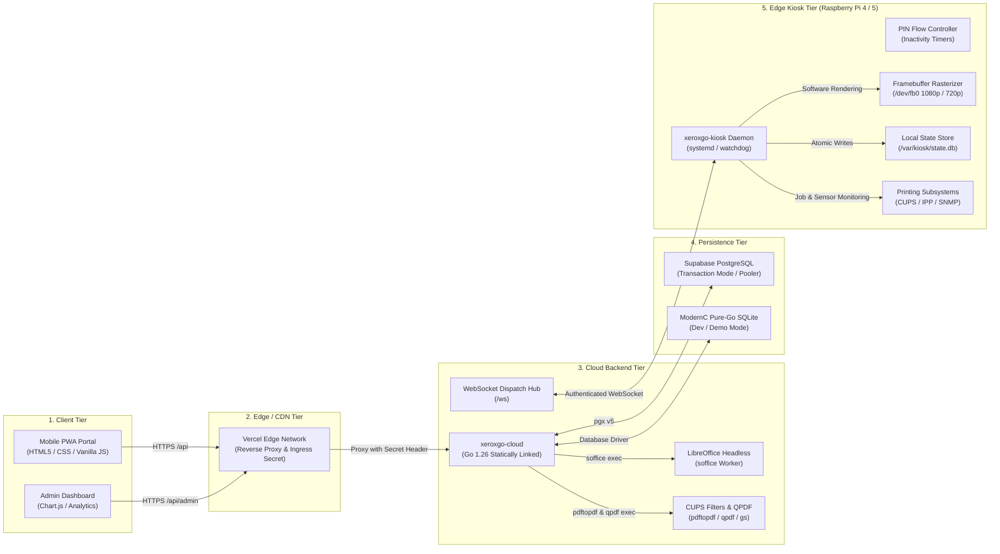
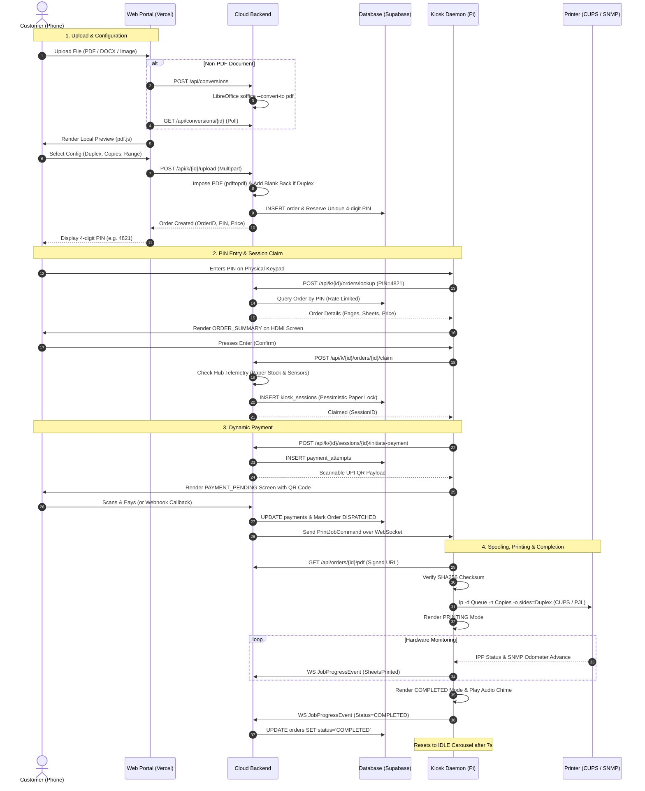
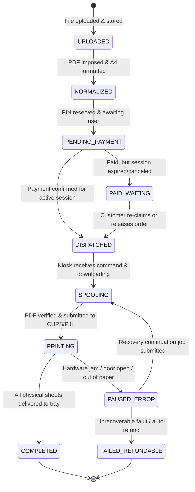
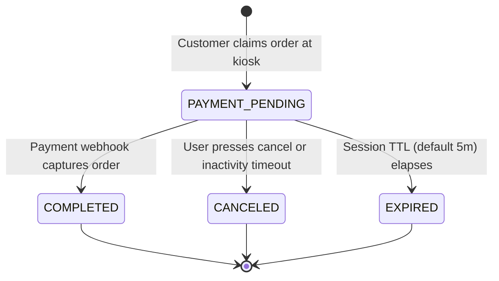
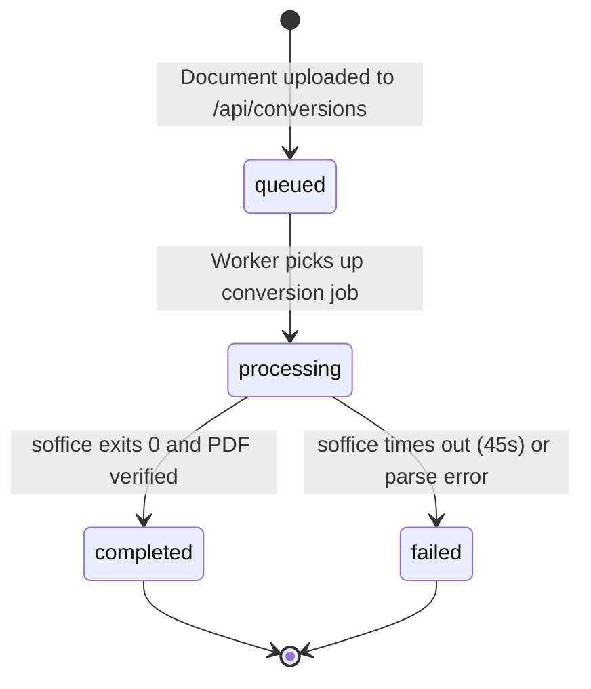
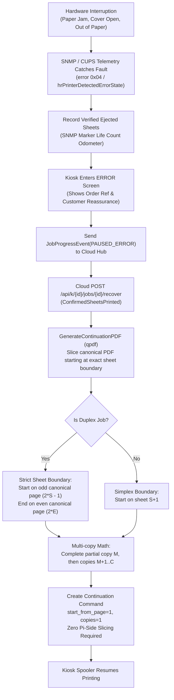

# XeroxGo System Architecture & Technical Overview

This document provides a comprehensive, factual, and detailed technical architectural overview of the XeroxGo self-service campus printing system as implemented in the codebase.

---

## 1. System Topology & Multi-Tier Architecture

XeroxGo is engineered as a distributed, edge-orchestrated kiosk printing system structured across five primary execution tiers:

### Tier Descriptions & Responsibilities:
1. **Client Tier (`frontend/`):** Lightweight Single-Page Application (SPA) and Progressive Web App (PWA). Employs in-browser PDF parsing via Mozilla PDF.js ([`frontend/vendor/pdf.min.mjs`](file:///home/shabas/Projects/XeroxGo/frontend/vendor/pdf.min.mjs)) and PDF page manipulation via PDF-Lib ([`frontend/vendor/pdf-lib.min.js`](file:///home/shabas/Projects/XeroxGo/frontend/vendor/pdf-lib.min.js)).
2. **Edge / CDN Tier (`frontend/vercel.json`):** Vercel Edge rules terminate SSL, rewrite client routes, and proxy API calls (`/api/*`, `/pay/*`) to the cloud backend. When `XEROXGO_PROXY_SECRET` is configured, Vercel injects an HMAC header to prevent direct public scraping of cloud origin endpoints ([`cloud-backend/cmd/server/main.go:2015-2031`](file:///home/shabas/Projects/XeroxGo/cloud-backend/cmd/server/main.go#L2015-L2031)).
3. **Cloud Backend Tier (`cloud-backend/`):** Built as a statically linked binary with `CGO_ENABLED=0`. Encapsulates document conversion, imposition normalization, 4-digit PIN generation, transaction session locking, payment webhooks, and the bi-directional WebSocket hub.
4. **Persistence Tier (`deploy/supabase/schema.sql`, `cloud-backend/internal/store/db.go`):** Supports dual database backends without code divergence:
   - **PostgreSQL (Supabase):** Uses `github.com/jackc/pgx/v5` with `QueryExecModeExec` to ensure compatibility with Supabase transaction poolers (Supavisor / PgBouncer) ([`db.go:134-135`](file:///home/shabas/Projects/XeroxGo/cloud-backend/internal/store/db.go#L134-L135)).
   - **SQLite:** Uses `modernc.org/sqlite` (pure Go, zero CGO) for local development, CI tests, and single-node setups.
5. **Edge Kiosk Tier (`kiosk-daemon/`):** Runs on Raspberry Pi OS. Interacts with the physical Linux framebuffer (`/dev/fb0`) using a pure Go software renderer ([`kiosk-daemon/internal/ui_ipc/renderer.go`](file:///home/shabas/Projects/XeroxGo/kiosk-daemon/internal/ui_ipc/renderer.go)), captures physical keypad strokes via Linux TTY raw mode, and executes print commands via CUPS and SNMP telemetry.

---

## 2. End-to-End Workflow Tracing

### Detailed Phase Execution Breakdown:

#### Phase 1: Upload & Document Normalization
1. **Office Conversion (`POST /api/conversions`):** Non-PDF files are staged in `/data/jobs/conversions` and queued in the `conversions` table ([`cloud-backend/cmd/server/conversion_handlers.go:24-128`](file:///home/shabas/Projects/XeroxGo/cloud-backend/cmd/server/conversion_handlers.go#L24-L128)). The background conversion worker (`startConversionWorker`) executes headless LibreOffice ([`cloud-backend/internal/pdf/convert.go:133-145`](file:///home/shabas/Projects/XeroxGo/cloud-backend/internal/pdf/convert.go#L133-L145)) with isolated user profiles.
2. **Imposition Normalization (`POST /api/k/{kiosk_id}/upload`):** Staged in `/data/jobs/<order_id>/source.pdf`. 
   - Slices custom page ranges if provided ([`cloud-backend/internal/pdf/normalizer.go:149-235`](file:///home/shabas/Projects/XeroxGo/cloud-backend/internal/pdf/normalizer.go#L149-L235)).
   - Executes N-up imposition and orientation adjustments via `pdftopdf` ([`normalizer.go:88-144`](file:///home/shabas/Projects/XeroxGo/cloud-backend/internal/pdf/normalizer.go#L88-L144)).
   - Duplex blank page padding: For duplex orders with an odd number of pages, a blank back-page is automatically appended via Ghostscript/PDF-Lib so subsequent copies do not begin on the reverse side of an earlier copy ([`normalizer.go:377-410`](file:///home/shabas/Projects/XeroxGo/cloud-backend/internal/pdf/normalizer.go#L377-L410)).
   - Generates SHA256 checksum of the canonical PDF ([`normalizer.go:428-438`](file:///home/shabas/Projects/XeroxGo/cloud-backend/internal/pdf/normalizer.go#L428-L438)).
3. **PIN Reservation & Order Insertion:**
   - 4-digit PIN is allocated using cryptographic random generation and checked for active collisions on that specific kiosk ([`main.go:103-146`](file:///home/shabas/Projects/XeroxGo/cloud-backend/cmd/server/main.go#L103-L146)).
   - Order is inserted into `orders`, `print_configs`, and `pin_reservations` within a database transaction ([`db.go:853-930`](file:///home/shabas/Projects/XeroxGo/cloud-backend/internal/store/db.go#L853-L930)). Status initialized to `PENDING_PAYMENT`.

#### Phase 2: Kiosk Discovery, PIN Lookup & Session Claiming
1. **Keypad Input:** The customer enters the 4-digit PIN on the physical kiosk keypad. `internal/input/keyboard.go` reads raw keycodes from `/dev/tty1` and delivers `Key0`-`Key9` events to `internal/pin/controller.go`.
2. **PIN Lookup (`POST /api/k/{kiosk_id}/orders/lookup`):**
   - Kiosk calls cloud backend with `Authorization: Bearer <kiosk_secret>` ([`cloud-backend/cmd/server/pin_lookup_handler.go:61-73`](file:///home/shabas/Projects/XeroxGo/cloud-backend/cmd/server/pin_lookup_handler.go#L61-L73)).
   - Checked against persistent database rate-limiter: 5 consecutive failures triggers exponential backoff ([`pin_limiter.go:20-56`](file:///home/shabas/Projects/XeroxGo/cloud-backend/cmd/server/pin_limiter.go#L20-L56)).
   - Valid lookup returns order summary (`pinLookupResponse`). Any non-matching, expired, or cross-kiosk PIN returns uniform HTTP 404 ([`pin_lookup_handler.go:146-170`](file:///home/shabas/Projects/XeroxGo/cloud-backend/cmd/server/pin_lookup_handler.go#L146-L170)).
3. **Order Summary Display:** Kiosk transitions to `ORDER_SUMMARY` screen mode showing total pages, total sheets, copies, duplex mode, color mode, and price in rupees ([`kiosk-daemon/internal/ui_ipc/renderer.go:1052-1140`](file:///home/shabas/Projects/XeroxGo/kiosk-daemon/internal/ui_ipc/renderer.go#L1052-L1140)).
4. **Order Claim (`POST /api/k/{kiosk_id}/orders/{order_id}/claim`):**
   - Customer confirms by pressing Enter.
   - Cloud validates that kiosk printer is online, paper supply is adequate, output tray is clear, and cover is closed via cached WebSocket hub telemetry ([`session_handler.go:76-162`](file:///home/shabas/Projects/XeroxGo/cloud-backend/cmd/server/session_handler.go#L76-L162)).
   - Cloud creates `kiosk_sessions` record (`status=PAYMENT_PENDING`, default TTL 5 minutes) and atomically locks the order with a unique `claim_token` ([`db.go:2189-2364`](file:///home/shabas/Projects/XeroxGo/cloud-backend/internal/store/db.go#L2189-L2364)).

#### Phase 3: Dynamic Payment & Dispatch
1. **Initiate Payment (`POST /api/k/{kiosk_id}/sessions/{session_id}/initiate-payment`):**
   - Cloud calls payment provider (`Razorpay` or `MockProvider`) to generate a dynamic UPI payment string ([`session_handler.go:363-564`](file:///home/shabas/Projects/XeroxGo/cloud-backend/cmd/server/session_handler.go#L363-L564)).
   - Persists attempt in `payment_attempts` with an idempotency key.
   - Returns UPI payload (`upi://pay?pa=...&am=...&tr=...`) to kiosk.
2. **Kiosk QR Screen:** Kiosk renders `PAYMENT_PENDING` screen showing a 2D barcode (QR code) alongside an animated countdown timer ([`renderer.go:1142-1240`](file:///home/shabas/Projects/XeroxGo/kiosk-daemon/internal/ui_ipc/renderer.go#L1142-L1240)).
3. **Payment Webhook Capture (`POST /api/webhooks/razorpay` or Demo Pay):**
   - Payment provider invokes cloud webhook upon successful UPI transfer.
   - Cloud verifies HMAC signature, records webhook ID in `payment_webhooks` to prevent replay attacks ([`main.go:1417-1450`](file:///home/shabas/Projects/XeroxGo/cloud-backend/cmd/server/main.go#L1417-L1450)).
   - Updates `payments` table and transitions `payment_attempts` to `PAID`.
   - Atomically checks session status:
     - **Session Active:** Transitions order to `DISPATCHED`, marks session `COMPLETED`, records `dispatch_intents`, and dispatches `PrintJobCommand` over WebSocket ([`db.go:2537-2760`](file:///home/shabas/Projects/XeroxGo/cloud-backend/internal/store/db.go#L2537-L2760)).
     - **Session Expired / Canceled:** Transitions order to `PAID_WAITING`. Job is held safely in cloud until customer re-claims it ([`main.go:1537-1560`](file:///home/shabas/Projects/XeroxGo/cloud-backend/cmd/server/main.go#L1537-L1560)).

#### Phase 4: Kiosk Spooler & CUPS Execution
1. **Command Ingestion:** Kiosk spooler receives `PrintJobCommand` over WebSocket ([`kiosk-daemon/internal/spooler/client.go:600`](file:///home/shabas/Projects/XeroxGo/kiosk-daemon/internal/spooler/client.go#L600)).
2. **Safe Order Synchronization:** If kiosk screen is currently occupied by an active customer session for a *different* order, the incoming job is queued into `deferredJobs` until the active session completes or times out ([`client.go:616-628`](file:///home/shabas/Projects/XeroxGo/kiosk-daemon/internal/spooler/client.go#L616-L628)).
3. **Download & Checksum Verification:**
   - Kiosk switches screen mode to `DOWNLOADING` ([`client.go:1484`](file:///home/shabas/Projects/XeroxGo/kiosk-daemon/internal/spooler/client.go#L1484)).
   - Downloads PDF from cloud backend signed URL (`/api/orders/{id}/pdf?expires=...&sig=...`).
   - Computes SHA256 stream digest and verifies against `PrintJobCommand.SHA256Checksum` ([`client.go:1400-1430`](file:///home/shabas/Projects/XeroxGo/kiosk-daemon/internal/spooler/client.go#L1400-L1430)).
4. **Paper Stock Deduction:** Deducts `TotalSheets` from local SQLite paper stock ([`kiosk-daemon/internal/state/store.go:665-703`](file:///home/shabas/Projects/XeroxGo/kiosk-daemon/internal/state/store.go#L665-L703)).
5. **CUPS Submission:**
   - Submits PDF to local CUPS queue via `lp -d <queue> -n <copies> -t <job_id> -o sides=<duplex> <pdfPath>` ([`kiosk-daemon/internal/printer/cups.go:371-385`](file:///home/shabas/Projects/XeroxGo/kiosk-daemon/internal/printer/cups.go#L371-L385)), or streams directly to port 9100 via PJL ([`pjl.go`](file:///home/shabas/Projects/XeroxGo/kiosk-daemon/internal/printer/pjl.go)) on the production Brother HL-L5210DN over Ethernet. Note: `-o fit-to-page` is intentionally omitted because the PDF is already standardized to ISO A4 by the prepress normalizer.
   - Captures CUPS request ID (e.g. `HPTank-142`) and stores in local state store ([`store.go:471-509`](file:///home/shabas/Projects/XeroxGo/kiosk-daemon/internal/state/store.go#L471-L509)).
   - Switches screen mode to `PRINTING` ([`client.go:1095`](file:///home/shabas/Projects/XeroxGo/kiosk-daemon/internal/spooler/client.go#L1095)).
6. **Telemetry & Progress Relaying:**
   - Polls IPP job attributes (`job-media-sheets-completed`) and SNMP printer odometer (`oidPrtMarkerLifeCount`).
   - Hardware sensor faults (paper jam, cover open, tray empty) are detected in real-time ([`cups.go:509-528`](file:///home/shabas/Projects/XeroxGo/kiosk-daemon/internal/printer/cups.go#L509-L528)).
   - Dispatches `JobProgressEvent` to cloud over WebSocket every sheet increment ([`client.go:585-598`](file:///home/shabas/Projects/XeroxGo/kiosk-daemon/internal/spooler/client.go#L585-L598)).

#### Phase 5: Completion & Audio Chime
1. **Completion Confirmation:** Once CUPS reports `completed` or SNMP odometer confirms all physical sheets have been delivered to the output bin:
   - Spooler records job completion in local SQLite (`store.go:238-301`).
   - Dispatches `JobProgressEvent{Status: "COMPLETED"}` to cloud hub ([`client.go:1245-1295`](file:///home/shabas/Projects/XeroxGo/kiosk-daemon/internal/spooler/client.go#L1245-L1295)).
   - Cloud updates database `orders.status = 'COMPLETED'`.
2. **Audio & UI Transition:**
   - Screen switches to `COMPLETED` mode ([`renderer.go:792-860`](file:///home/shabas/Projects/XeroxGo/kiosk-daemon/internal/ui_ipc/renderer.go#L792-L860)).
   - Spooler plays procedural audio completion chime ([`kiosk-daemon/internal/audio/audio.go:90-120`](file:///home/shabas/Projects/XeroxGo/kiosk-daemon/internal/audio/audio.go#L90-L120)).
   - Holds completion screen for configured timeout (`--completed-timeout`, default 7 seconds), then returns to `IDLE` QR promo carousel ([`client.go:1346-1372`](file:///home/shabas/Projects/XeroxGo/kiosk-daemon/internal/spooler/client.go#L1346-L1372)).

---

## 3. Implemented State Machines & Transitions

### 3.1 Order Lifecycle (`contracts.JobStatus`)

The 10 contractual job states defined in [`pkg/contracts/models.go:7-18`](file:///home/shabas/Projects/XeroxGo/pkg/contracts/models.go#L7-L18) govern order progression:

#### Detailed State Transition Table:

| Current State | Next State | Trigger / Condition | Source Location |
| :--- | :--- | :--- | :--- |
| `[*] ` | `UPLOADED` | Multipart upload saved to staging disk | [`main.go:275-300`](file:///home/shabas/Projects/XeroxGo/cloud-backend/cmd/server/main.go#L275-L300) |
| `UPLOADED` | `NORMALIZED` | Page count extracted, blank padding added, checksum generated | [`normalizer.go:343-440`](file:///home/shabas/Projects/XeroxGo/cloud-backend/internal/pdf/normalizer.go#L343-L440) |
| `NORMALIZED` | `PENDING_PAYMENT` | 4-digit PIN reserved in `pin_reservations` and order saved | [`main.go:136`](file:///home/shabas/Projects/XeroxGo/cloud-backend/cmd/server/main.go#L136), [`db.go:853`](file:///home/shabas/Projects/XeroxGo/cloud-backend/internal/store/db.go#L853) |
| `PENDING_PAYMENT` | `DISPATCHED` | Webhook confirms payment while `kiosk_sessions` is active | [`db.go:2537-2760`](file:///home/shabas/Projects/XeroxGo/cloud-backend/internal/store/db.go#L2537-L2760) |
| `PENDING_PAYMENT` | `PAID_WAITING` | Webhook confirms payment after session expired or canceled | [`main.go:1537-1560`](file:///home/shabas/Projects/XeroxGo/cloud-backend/cmd/server/main.go#L1537-L1560) |
| `PAID_WAITING` | `DISPATCHED` | Customer claims order on kiosk via `/claim` or `/release` | [`session_handler.go:566-670`](file:///home/shabas/Projects/XeroxGo/cloud-backend/cmd/server/session_handler.go#L566-L670) |
| `DISPATCHED` | `SPOOLING` | Kiosk receives `PrintJobCommand` and begins HTTP download | [`spooler/client.go:1008`](file:///home/shabas/Projects/XeroxGo/kiosk-daemon/internal/spooler/client.go#L1008) |
| `SPOOLING` | `PRINTING` | Checksum matches; job submitted to CUPS queue (`lp`) | [`spooler/client.go:1095`](file:///home/shabas/Projects/XeroxGo/kiosk-daemon/internal/spooler/client.go#L1095) |
| `PRINTING` | `COMPLETED` | CUPS reports complete / SNMP odometer advances full sheets | [`cups.go:530-545`](file:///home/shabas/Projects/XeroxGo/kiosk-daemon/internal/printer/cups.go#L530-L545), [`client.go:1245`](file:///home/shabas/Projects/XeroxGo/kiosk-daemon/internal/spooler/client.go#L1245) |
| `PRINTING` | `PAUSED_ERROR` | SNMP reports paper jam, cover open, or CUPS job aborted | [`cups.go:509-528`](file:///home/shabas/Projects/XeroxGo/kiosk-daemon/internal/printer/cups.go#L509-L528), [`client.go:1321`](file:///home/shabas/Projects/XeroxGo/kiosk-daemon/internal/spooler/client.go#L1321) |
| `PAUSED_ERROR` | `SPOOLING` | Cloud recovery continuation job created and sent to kiosk | [`recovery_handler.go:49-278`](file:///home/shabas/Projects/XeroxGo/cloud-backend/cmd/server/recovery_handler.go#L49-L278) |
| `PAUSED_ERROR` | `FAILED_REFUNDABLE` | Unrecoverable error; unprinted sheets flagged for refund | [`store/db.go:1668`](file:///home/shabas/Projects/XeroxGo/cloud-backend/internal/store/db.go#L1668) |

---

### 3.2 Kiosk Session Lifecycle (`store.KioskSessionStatus`)

Defined in [`cloud-backend/internal/store/db.go:98-105`](file:///home/shabas/Projects/XeroxGo/cloud-backend/internal/store/db.go#L98-L105):

- **Pessimistic Paper Reservation:** When a session enters `PAYMENT_PENDING`, the required sheets are reserved against the kiosk's available paper stock. Competing claim requests that exceed remaining stock receive HTTP 409 `insufficient paper in kiosk tray` ([`db.go:2189-2220`](file:///home/shabas/Projects/XeroxGo/cloud-backend/internal/store/db.go#L2189-L2220)).
- **Session Release & Rollback:** When a session transitions to `CANCELED` or `EXPIRED`, the reserved sheets are immediately released back to the kiosk pool.

---

### 3.3 Asynchronous Document Conversion Lifecycle (`store.ConversionStatus`)

Defined in [`cloud-backend/internal/store/conversions.go:11-19`](file:///home/shabas/Projects/XeroxGo/cloud-backend/internal/store/conversions.go#L11-L19):

---

## 4. Hardware Printer Configurations

The XeroxGo printing subsystem supports three deployment and evaluation tiers:
- **Production Target Printer:** **Brother HL-L5210DN** (enterprise high-speed monochrome duplex laser). The Raspberry Pi 4 is connected **directly to the printer over Ethernet** (static IP `192.168.99.2:9100` configured in [`deploy/rpi-os/xeroxgo-kiosk.default`](file:///home/shabas/Projects/XeroxGo/deploy/rpi-os/xeroxgo-kiosk.default)). Supports direct PJL RAW port 9100 streaming and CUPS network queues.
- **Current Demonstration Printer:** **HP LaserJet Tank 1020w** (compact USB tank printer configured under CUPS queue `HPTank`).
- **Earlier Test Printer:** **Brother DCP-T310** (USB desktop color ink-tank printer evaluated under CUPS queue `DCPT310` with manufacturer raster filters).

---

## 5. Recovery Architecture & Failure Handling

XeroxGo implements a **cloud-owned recovery architecture** designed to maintain deterministic sheet-level accounting and prevent duplicate printing:

### Key Recovery Guarantees:
1. **Zero Pi Slicing:** The Raspberry Pi never performs PDF page extraction or slicing. Slicing logic is executed cloud-side via `qpdf` ([`cloud-backend/internal/pdf/recovery.go:26-80`](file:///home/shabas/Projects/XeroxGo/cloud-backend/internal/pdf/recovery.go#L26-L80)).
2. **Sheet Boundary Alignment:** In duplex mode, continuation PDFs strictly start on odd-numbered canonical pages and end on even-numbered pages, preventing front/back transposition ([`recovery.go:135-155`](file:///home/shabas/Projects/XeroxGo/cloud-backend/internal/pdf/recovery.go#L135-L155)).
3. **Multi-Copy Continuity:** If a 5-copy job fails on sheet 3 of copy 2, the continuation artifact contains the remainder of copy 2, followed by full copies 3, 4, and 5 ([`recovery.go:126-170`](file:///home/shabas/Projects/XeroxGo/cloud-backend/internal/pdf/recovery.go#L126-L170)).
4. **Physical Output Uncertainty:** In accordance with architectural safety rules, if the physical delivery of sheets cannot be verified, automatic resumption is forbidden. Explicit reconciliation is required ([`cloud-backend/cmd/server/recovery_handler.go:123-132`](file:///home/shabas/Projects/XeroxGo/cloud-backend/cmd/server/recovery_handler.go#L123-L132)).
5. **Crash Recovery for In-Flight Jobs:** If the kiosk daemon crashes while CUPS is actively printing, on reboot `resumeCUPSMonitoring` re-attaches to the active CUPS job ID without re-submitting the print file, preventing double printing ([`kiosk-daemon/internal/spooler/client.go:760-844`](file:///home/shabas/Projects/XeroxGo/kiosk-daemon/internal/spooler/client.go#L760-L844)).

