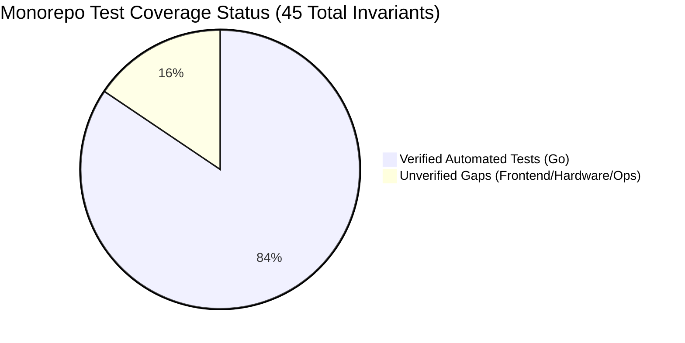

# XeroxGo Core Acceptance Matrix & Invariant Verification

This document provides the exhaustive acceptance criteria, invariant verification matrix, test gap analysis, and concrete test specifications for the **XeroxGo Minimum Working Core**. It maps every architectural guarantee to automated test suites, explicitly marks unverified behaviors, and defines actionable acceptance tests for every coverage gap.

---

## 1. Architectural Invariant Verification Matrix

Every invariant enforced by the XeroxGo architecture is cataloged below, mapped to its implementing source file, associated test suite, test type (**Unit-Tested**, **Integration-Tested**, or **Hardware-Verified**), and current verification status (`VERIFIED` vs `UNVERIFIED`).

### 1.1 Pricing Invariants (5 Invariants)

| ID | Invariant Description | Owning Module | Source Reference | Verification Test Suite | Test Type | Status |
| :--- | :--- | :--- | :--- | :--- | :--- | :---: |
| **INV-PRI-01** | **Strict Integer Currency:** Pricing is calculated and stored strictly in integer paise. Floating-point arithmetic is prohibited. | Pricing | [`razorpay.go:16-30`](file:///home/shabas/Projects/XeroxGo/cloud-backend/internal/payments/razorpay.go#L16-L30) | [`pricing_checkout_test.go:227`](file:///home/shabas/Projects/XeroxGo/cloud-backend/cmd/server/pricing_checkout_test.go#L227), [`document_pricing_baseline_test.go:343`](file:///home/shabas/Projects/XeroxGo/cloud-backend/cmd/server/document_pricing_baseline_test.go#L343) (`TestDocumentPricing_FourTierIntegerPaiseAndColorFallback`) | Unit-Tested | `VERIFIED` |
| **INV-PRI-02** | **Non-Zero Unit Tariff:** Unit price per side must be strictly positive (`unit_price > 0`). Zero or negative tariffs fail validation. | Pricing | [`razorpay.go:20-22`](file:///home/shabas/Projects/XeroxGo/cloud-backend/internal/payments/razorpay.go#L20-L22) | [`analytics_test.go:52-57`](file:///home/shabas/Projects/XeroxGo/cloud-backend/internal/store/analytics_test.go#L52-L57) (`TestSetPricingValidation`) | Unit-Tested | `VERIFIED` |
| **INV-PRI-03** | **Order Price Immutability:** Once an order is persisted, its `price_paise` is immutable; subsequent admin tariff overrides must not alter existing orders. | Pricing / Orders | [`main.go:501-508`](file:///home/shabas/Projects/XeroxGo/cloud-backend/cmd/server/main.go#L501-L508) | [`pricing_checkout_test.go:263`](file:///home/shabas/Projects/XeroxGo/cloud-backend/cmd/server/pricing_checkout_test.go#L263), [`document_pricing_baseline_test.go:431`](file:///home/shabas/Projects/XeroxGo/cloud-backend/cmd/server/document_pricing_baseline_test.go#L431) (`TestDocumentPricing_PriceImmutabilityPostCreation`) | Integration-Tested | `VERIFIED` |
| **INV-PRI-04** | **Duplex Tariff Constraint:** The duplex price per side must not exceed the simplex price per side. | Pricing | [`analytics.go:160-168`](file:///home/shabas/Projects/XeroxGo/cloud-backend/internal/store/analytics.go#L160-L168) | [`pricing_checkout_test.go:115`](file:///home/shabas/Projects/XeroxGo/cloud-backend/cmd/server/pricing_checkout_test.go#L115) (`TestPricing_TiersAndConfigurations`) | Integration-Tested | `VERIFIED` |
| **INV-PRI-05** | **Arithmetic Overflow Protection:** Integer multiplication of sides $\times$ unit price enforces `int64` overflow guards before calculation. | Pricing | [`razorpay.go:25-27`](file:///home/shabas/Projects/XeroxGo/cloud-backend/internal/payments/razorpay.go#L25-L27) | [`provider_test.go:12-35`](file:///home/shabas/Projects/XeroxGo/cloud-backend/internal/payments/provider_test.go#L12-L35) (`TestCalculatePricePaise_Overflow`) | Unit-Tested | `VERIFIED` |

---

### 1.2 Payments Invariants (7 Invariants)

| ID | Invariant Description | Owning Module | Source Reference | Verification Test Suite | Test Type | Status |
| :--- | :--- | :--- | :--- | :--- | :--- | :---: |
| **INV-PAY-01** | **Webhook Deduplication:** Duplicate gateway webhooks for the same `event_id` are discarded as idempotent no-ops via PK constraint. | Payments | [`db.go:1733-1765`](file:///home/shabas/Projects/XeroxGo/cloud-backend/internal/store/db.go#L1733-L1765) | [`payment_safety_test.go:318`](file:///home/shabas/Projects/XeroxGo/cloud-backend/cmd/server/payment_safety_test.go#L318) (`TestPaymentSafety_DuplicateWebhooks_Idempotent`) | Integration-Tested | `VERIFIED` |
| **INV-PAY-02** | **Physical Presence Gated Dispatch:** Captured payment authorizes job dispatch if and only if an active session in `PAYMENT_PENDING` exists. | Payments / Orders | [`db.go:2537-2680`](file:///home/shabas/Projects/XeroxGo/cloud-backend/internal/store/db.go#L2537-L2680) | [`payment_safety_test.go:152`](file:///home/shabas/Projects/XeroxGo/cloud-backend/cmd/server/payment_safety_test.go#L152) (`TestPaymentSafety_LatePaymentNoSession_PreservesPaidWaitingNoDispatch`) | Integration-Tested | `VERIFIED` |
| **INV-PAY-03** | **Anti-Ghost Printing on Cancellation:** If customer cancels or session expires, payment is held in `PAID_WAITING`; dispatch to kiosk is withheld. | Payments / Orders | [`db.go:2610-2645`](file:///home/shabas/Projects/XeroxGo/cloud-backend/internal/store/db.go#L2610-L2645) | [`payment_safety_test.go:194`](file:///home/shabas/Projects/XeroxGo/cloud-backend/cmd/server/payment_safety_test.go#L194) (`TestPaymentSafety_CanceledSession_NoGhostPrinting`) | Integration-Tested | `VERIFIED` |
| **INV-PAY-04** | **Constant-Time HMAC Signature Verification:** Webhook signatures are validated using constant-time comparison against `XEROXGO_WEBHOOK_SECRET`. | Payments | [`razorpay.go:34-55`](file:///home/shabas/Projects/XeroxGo/cloud-backend/internal/payments/razorpay.go#L34-L55) | [`payment_safety_test.go:1722`](file:///home/shabas/Projects/XeroxGo/cloud-backend/cmd/server/payment_safety_test.go#L1722) (`TestPaymentPhase1_Webhook_InvalidSignature_Rejected`) | Unit-Tested | `VERIFIED` |
| **INV-PAY-05** | **Exact Amount Verification:** Webhook payloads specifying an amount differing from `orders.price_paise` are rejected with HTTP 400. | Payments | [`main.go:1115-1135`](file:///home/shabas/Projects/XeroxGo/cloud-backend/cmd/server/main.go#L1115-L1135) | [`payment_safety_test.go:1602`](file:///home/shabas/Projects/XeroxGo/cloud-backend/cmd/server/payment_safety_test.go#L1602) (`TestPaymentPhase1_Webhook_MismatchedAmount_Rejected`) | Integration-Tested | `VERIFIED` |
| **INV-PAY-06** | **Currency INR Constraint:** Payment attempts and webhooks must specify currency as `INR`. Other currencies are rejected. | Payments | [`session_handler.go:155`](file:///home/shabas/Projects/XeroxGo/cloud-backend/cmd/server/session_handler.go#L155) | [`payment_safety_test.go:1665`](file:///home/shabas/Projects/XeroxGo/cloud-backend/cmd/server/payment_safety_test.go#L1665) (`TestPaymentPhase1_Webhook_InvalidCurrency_Rejected`) | Integration-Tested | `VERIFIED` |
| **INV-PAY-07** | **Idempotent Payment Initiation:** Repeated calls to initiate payment within active session return the identical UPI QR payload without creating duplicate attempts. | Payments | [`session_handler.go:135-180`](file:///home/shabas/Projects/XeroxGo/cloud-backend/cmd/server/session_handler.go#L135-L180) | [`payment_safety_test.go:1459`](file:///home/shabas/Projects/XeroxGo/cloud-backend/cmd/server/payment_safety_test.go#L1459) (`TestPaymentPhase1_InitiatePayment_SuccessAndIdempotency`) | Integration-Tested | `VERIFIED` |

---

### 1.3 Orders Invariants (7 Invariants)

| ID | Invariant Description | Owning Module | Source Reference | Verification Test Suite | Test Type | Status |
| :--- | :--- | :--- | :--- | :--- | :--- | :---: |
| **INV-ORD-01** | **4-Digit Cryptographic PIN:** Display codes are exactly 4 numeric digits (`0000`–`9999`) generated via `crypto/rand`. | Orders | [`main.go:95-101`](file:///home/shabas/Projects/XeroxGo/cloud-backend/cmd/server/main.go#L95-L101) | [`pin_lookup_test.go:73`](file:///home/shabas/Projects/XeroxGo/cloud-backend/cmd/server/pin_lookup_test.go#L73) (`TestPIN_FourDigitFormatAndCryptoRand`) | Unit-Tested | `VERIFIED` |
| **INV-ORD-02** | **Kiosk-Scoped PIN Uniqueness:** Active unexpired PINs are unique per kiosk. Enforced by `PRIMARY KEY (kiosk_id, pin)` with up to 25 retries. | Orders | [`main.go:123-146`](file:///home/shabas/Projects/XeroxGo/cloud-backend/cmd/server/main.go#L123-L146) | [`pin_lookup_test.go:97`](file:///home/shabas/Projects/XeroxGo/cloud-backend/cmd/server/pin_lookup_test.go#L97) (`TestPIN_AtomicUniquenessAndCollisionRetry`) | Integration-Tested | `VERIFIED` |
| **INV-ORD-03** | **Uniform Response Timing on PIN Lookup:** Invalid PIN lookups enforce uniform execution delays and return identical 404 responses to prevent enumeration. | Orders | [`pin_lookup_handler.go:46-55`](file:///home/shabas/Projects/XeroxGo/cloud-backend/cmd/server/pin_lookup_handler.go#L46-L55) | [`pin_lookup_test.go:231`](file:///home/shabas/Projects/XeroxGo/cloud-backend/cmd/server/pin_lookup_test.go#L231) (`TestPINLookup_UniformFailureNoExistenceLeak`) | Integration-Tested | `VERIFIED` |
| **INV-ORD-04** | **Pessimistic Paper Stock Reservation:** A session cannot claim an order or initiate payment unless tray stock minus committed sheets covers the job. | Orders | [`db.go:2189-2315`](file:///home/shabas/Projects/XeroxGo/cloud-backend/internal/store/db.go#L2189-L2315) | [`paper_availability_test.go:114`](file:///home/shabas/Projects/XeroxGo/cloud-backend/cmd/server/paper_availability_test.go#L114) (`TestPaperAvailability_OrderClaim_Guards`) | Integration-Tested | `VERIFIED` |
| **INV-ORD-05** | **Mutual Exclusion Transaction Session:** Exactly one active session in `PAYMENT_PENDING` can exist per kiosk. Competing claims receive HTTP 409. | Orders | [`db.go:2140-2185`](file:///home/shabas/Projects/XeroxGo/cloud-backend/internal/store/db.go#L2140-L2185) | [`transaction_session_test.go:161`](file:///home/shabas/Projects/XeroxGo/cloud-backend/cmd/server/transaction_session_test.go#L161) (`TestTransactionSession_ConflictAndCompetingClaims`) | Integration-Tested | `VERIFIED` |
| **INV-ORD-06** | **Authoritative Cloud Sheet Counting:** Client sheet estimates are untrusted. Cloud server authoritatively computes page count via Poppler. | Documents / Orders | [`normalizer.go:110-175`](file:///home/shabas/Projects/XeroxGo/cloud-backend/internal/pdf/normalizer.go#L110-L175) | [`upload_pages_test.go:88`](file:///home/shabas/Projects/XeroxGo/cloud-backend/cmd/server/upload_pages_test.go#L88), [`document_engine_baseline_test.go:138`](file:///home/shabas/Projects/XeroxGo/cloud-backend/internal/pdf/document_engine_baseline_test.go#L138), [`document_pricing_baseline_test.go:131`](file:///home/shabas/Projects/XeroxGo/cloud-backend/cmd/server/document_pricing_baseline_test.go#L131) (`TestDocumentPricing_PreviewAndUploadParity`) | Integration-Tested | `VERIFIED` |
| **INV-ORD-07** | **Duplex Blank Back Padding:** In duplex mode, odd-paged documents must pad a blank back-page into the PDF to align physical sheets. | Documents | [`normalizer.go:180-220`](file:///home/shabas/Projects/XeroxGo/cloud-backend/internal/pdf/normalizer.go#L180-L220) | [`upload_pages_test.go:233`](file:///home/shabas/Projects/XeroxGo/cloud-backend/cmd/server/upload_pages_test.go#L233), [`document_engine_baseline_test.go:53`](file:///home/shabas/Projects/XeroxGo/cloud-backend/internal/pdf/document_engine_baseline_test.go#L53), [`document_pricing_baseline_test.go:273`](file:///home/shabas/Projects/XeroxGo/cloud-backend/cmd/server/document_pricing_baseline_test.go#L273) (`TestDocumentPricing_MultiFileCollationOrderAndPadding`) | Integration-Tested | `VERIFIED` |

---

### 1.4 Dispatch Invariants (4 Invariants)

| ID | Invariant Description | Owning Module | Source Reference | Verification Test Suite | Test Type | Status |
| :--- | :--- | :--- | :--- | :--- | :--- | :---: |
| **INV-DIS-01** | **At-Least-Once Dispatch Replay:** Dispatched jobs unacknowledged by the kiosk reset to `PENDING` on disconnect and are re-sent on reconnection. | Dispatch | [`hub.go:142-154`](file:///home/shabas/Projects/XeroxGo/cloud-backend/internal/ws/hub.go#L142-L154) | [`payment_safety_test.go:828`](file:///home/shabas/Projects/XeroxGo/cloud-backend/cmd/server/payment_safety_test.go#L828) (`TestPaymentSafety_DispatchIntentReconciliation_OnKioskReconnect`) | Integration-Tested | `VERIFIED` |
| **INV-DIS-02** | **Session Validity Re-Check on Reconnect:** Cloud reconnects discard pending dispatch intents if the customer session was canceled/expired during the outage. | Dispatch | [`db.go:3085-3093`](file:///home/shabas/Projects/XeroxGo/cloud-backend/internal/store/db.go#L3085-L3093) | [`payment_safety_test.go:1028`](file:///home/shabas/Projects/XeroxGo/cloud-backend/cmd/server/payment_safety_test.go#L1028) (`TestPaymentSafety_ReconnectSkipsCanceledOrExpiredSessionJob`) | Integration-Tested | `VERIFIED` |
| **INV-DIS-03** | **Kiosk ACK Intent Finalization:** Explicit `job_ack` from the kiosk transitions dispatch intent from `SENT` to `COMPLETED`. | Dispatch | [`hub.go:167-177`](file:///home/shabas/Projects/XeroxGo/cloud-backend/internal/ws/hub.go#L167-L177) | [`payment_safety_test.go:1109`](file:///home/shabas/Projects/XeroxGo/cloud-backend/cmd/server/payment_safety_test.go#L1109) (`TestPaymentSafety_KioskAckTransitionsIntentToAcknowledged`) | Integration-Tested | `VERIFIED` |
| **INV-DIS-04** | **Mutual Authentication on Relay Socket:** Connecting kiosks must present a valid bearer token matching `XEROXGO_KIOSK_SECRET`. | Dispatch | [`hub.go:81-96`](file:///home/shabas/Projects/XeroxGo/cloud-backend/internal/ws/hub.go#L81-L96) | [`hub_test.go:35-78`](file:///home/shabas/Projects/XeroxGo/cloud-backend/internal/ws/hub_test.go#L35-L78) (`TestHubAuthentication_SuccessAndRejection`) | Integration-Tested | `VERIFIED` |

---

### 1.5 Kiosk Execution Invariants (6 Invariants)

| ID | Invariant Description | Owning Module | Source Reference | Verification Test Suite | Test Type | Status |
| :--- | :--- | :--- | :--- | :--- | :--- | :---: |
| **INV-KIO-01** | **CGO-Free Pure Go Framebuffer Rasterization:** UI screens are rasterized directly to `/dev/fb0` in pure Go without X11 or external GUI dependencies. | Kiosk Core | [`renderer.go`](file:///home/shabas/Projects/XeroxGo/kiosk-daemon/internal/ui_ipc/renderer.go) | [`renderer_test.go:16`](file:///home/shabas/Projects/XeroxGo/kiosk-daemon/internal/ui_ipc/renderer_test.go#L16) (`TestRenderAllModes`), [`verify_gate.sh`](file:///home/shabas/Projects/XeroxGo/scripts/verify_gate.sh) (Gate 4) | Unit-Tested | `VERIFIED` |
| **INV-KIO-02** | **Durable Local SQLite State:** Local state store operates with `PRAGMA synchronous=FULL` and WAL mode to prevent SD card corruption. | Kiosk Core | [`store.go:95-105`](file:///home/shabas/Projects/XeroxGo/kiosk-daemon/internal/state/store.go#L95-L105) | [`store_test.go:45-80`](file:///home/shabas/Projects/XeroxGo/kiosk-daemon/internal/state/store_test.go#L45-L80) (`TestStorePragmasAndPersistence`) | Integration-Tested | `VERIFIED` |
| **INV-KIO-03** | **Post-Print Local File Deletion:** Downloaded PDF payloads are immediately unlinked (`os.Remove(finalPath)`) upon completion or terminal error. | Kiosk Core | [`client.go:1268`](file:///home/shabas/Projects/XeroxGo/kiosk-daemon/internal/spooler/client.go#L1268) | [`client_test.go:331`](file:///home/shabas/Projects/XeroxGo/kiosk-daemon/internal/spooler/client_test.go#L331) (`TestClientProcessesJobEndToEnd`) | Integration-Tested | `VERIFIED` |
| **INV-KIO-04** | **Active Keypad Session Protection:** Incoming print jobs not belonging to the active transaction are deferred into `deferredJobs` without altering the screen. | Kiosk Core | [`client.go:998-1013`](file:///home/shabas/Projects/XeroxGo/kiosk-daemon/internal/spooler/client.go#L998-L1013) | [`pin_flow_test.go:42-110`](file:///home/shabas/Projects/XeroxGo/kiosk-daemon/internal/spooler/pin_flow_test.go#L42-L110) (`TestSpooler_DefersUnrelatedJobDuringActivePINSession`) | Integration-Tested | `VERIFIED` |
| **INV-KIO-05** | **Streaming SHA256 Checksum Verification:** As the PDF is downloaded, bytes pass through an `io.TeeReader` verifying SHA256 matches command checksum. | Kiosk Core | [`client.go:1374-1475`](file:///home/shabas/Projects/XeroxGo/kiosk-daemon/internal/spooler/client.go#L1374-L1475) | [`client_test.go:155`](file:///home/shabas/Projects/XeroxGo/kiosk-daemon/internal/spooler/client_test.go#L155) (`TestDownloadPDFVerifiesSHA256`) | Integration-Tested | `VERIFIED` |
| **INV-KIO-06** | **Keypad Inactivity Reset:** Inactivity on PIN Entry (30s) or Summary (60s) resets UI to Idle and drains deferred background jobs. | Kiosk Core | [`controller.go:210-245`](file:///home/shabas/Projects/XeroxGo/kiosk-daemon/internal/pin/controller.go#L210-L245) | [`controller_test.go:522`](file:///home/shabas/Projects/XeroxGo/kiosk-daemon/internal/pin/controller_test.go#L522) (`TestController_InactivityTimeout`) | Integration-Tested | `VERIFIED` |

---

### 1.6 CUPS Printing Invariants (5 Invariants)

> [!NOTE]
> All automated tests in this category use mocked subprocess command runners (`CommandRunner` mocks) and synthetic IPP/SNMP output strings; they verify software state machine handling, **not live physical printer mechanisms**.

| ID | Invariant Description | Owning Module | Source Reference | Verification Test Suite | Test Type | Status |
| :--- | :--- | :--- | :--- | :--- | :--- | :---: |
| **INV-PRN-01** | **Single `lp` Submission:** A job is submitted to `lp` exactly once; duplicate incoming commands for already submitted jobs are ignored. | Printing | [`cups.go:370-405`](file:///home/shabas/Projects/XeroxGo/kiosk-daemon/internal/printer/cups.go#L370-L405) | [`cups_recovery_test.go:393`](file:///home/shabas/Projects/XeroxGo/kiosk-daemon/internal/spooler/cups_recovery_test.go#L393) (`TestCUPS_DuplicateCommandsIgnored`) | Integration-Tested (Mock Runner) | `VERIFIED` |
| **INV-PRN-02** | **Hardware Sensor Monitored Completion:** Job completion requires matching increments on the reported SNMP marker life odometer (`oidPrtMarkerLifeCount`). | Printing | [`cups.go:453-580`](file:///home/shabas/Projects/XeroxGo/kiosk-daemon/internal/printer/cups.go#L453-L580) | [`cups_test.go:996`](file:///home/shabas/Projects/XeroxGo/kiosk-daemon/internal/printer/cups_test.go#L996) (`TestMonitorCUPSJobWithTelemetryCustom_OdometerTracking`) | Integration-Tested (Mock Runner) | `VERIFIED` |
| **INV-PRN-03** | **No Synthetic Halfway Progress:** Progress events report only real IPP or SNMP increments; synthetic interpolated percentages are prohibited. | Printing | [`cups.go:470-495`](file:///home/shabas/Projects/XeroxGo/kiosk-daemon/internal/printer/cups.go#L470-L495) | [`cups_test.go:450`](file:///home/shabas/Projects/XeroxGo/kiosk-daemon/internal/printer/cups_test.go#L450) (`TestPrintPDFWithCUPS_NoSyntheticHalfwayProgress`) | Integration-Tested (Mock Runner) | `VERIFIED` |
| **INV-PRN-04** | **Restart-Safe CUPS Re-attachment:** Daemon reboots re-attach to in-flight CUPS request IDs via IPP without re-issuing `lp` to prevent double-printing. | Printing / Spooler | [`client.go:343-440`](file:///home/shabas/Projects/XeroxGo/kiosk-daemon/internal/spooler/client.go#L343-L440) | [`cups_recovery_test.go:204`](file:///home/shabas/Projects/XeroxGo/kiosk-daemon/internal/spooler/cups_recovery_test.go#L204) (`TestCUPS_RestartReconcilesActiveJobInQueue`) | Integration-Tested (Mock Runner) | `VERIFIED` |
| **INV-PRN-05** | **Hardware Error Halts Spooler:** Paper jam, out of paper, or door open transitions job to `PAUSED_ERROR` and blocks completion. | Printing | [`cups.go:886-980`](file:///home/shabas/Projects/XeroxGo/kiosk-daemon/internal/printer/cups.go#L886-L980) | [`cups_test.go:886`](file:///home/shabas/Projects/XeroxGo/kiosk-daemon/internal/printer/cups_test.go#L886) (`TestMonitorCUPSJobWithTelemetryCustom_PaperJam`) | Integration-Tested (Mock Runner) | `VERIFIED` |

---

### 1.7 Recovery Invariants (4 Invariants)

| ID | Invariant Description | Owning Module | Source Reference | Verification Test Suite | Test Type | Status |
| :--- | :--- | :--- | :--- | :--- | :--- | :---: |
| **INV-REC-01** | **Cloud-Owned Continuation Slicing:** Slicing is performed by the cloud using `qpdf`; the Raspberry Pi daemon performs zero PDF slicing. | Recovery | [`pdf/recovery.go:26-47`](file:///home/shabas/Projects/XeroxGo/cloud-backend/internal/pdf/recovery.go#L26-L47) | [`recovery_test.go:195`](file:///home/shabas/Projects/XeroxGo/cloud-backend/cmd/server/recovery_test.go#L195) (`TestCloudRecoveryEndpoint_FullLifecycleAndIdempotency`) | Integration-Tested | `VERIFIED` |
| **INV-REC-02** | **Strict Duplex Sheet Boundary Alignment:** In duplex mode, continuation PDFs must always begin on an odd-numbered canonical page (physical front side). | Recovery | [`pdf/recovery.go:110-145`](file:///home/shabas/Projects/XeroxGo/cloud-backend/internal/pdf/recovery.go#L110-L145) | [`recovery_test.go:98`](file:///home/shabas/Projects/XeroxGo/cloud-backend/internal/pdf/recovery_test.go#L98) (`TestGenerateContinuationPDF_Duplex`) | Integration-Tested | `VERIFIED` |
| **INV-REC-03** | **Multi-Copy Remainder Slicing:** Slicing mid-copy generates the remainder of the current copy followed by complete subsequent copies. | Recovery | [`pdf/recovery.go:150-195`](file:///home/shabas/Projects/XeroxGo/cloud-backend/internal/pdf/recovery.go#L150-L195) | [`recovery_test.go:147`](file:///home/shabas/Projects/XeroxGo/cloud-backend/internal/pdf/recovery_test.go#L147) (`TestGenerateContinuationPDF_MultiCopy`) | Integration-Tested | `VERIFIED` |
| **INV-REC-04** | **Uncertain Output Gating:** Cloud recovery strictly rejects continuation generation if `output_confirmed == false`. | Recovery | [`recovery_handler.go:123-132`](file:///home/shabas/Projects/XeroxGo/cloud-backend/cmd/server/recovery_handler.go#L123-L132) | [`cloud_recovery_test.go:141`](file:///home/shabas/Projects/XeroxGo/kiosk-daemon/internal/spooler/cloud_recovery_test.go#L141) (`TestClientCloudRecovery_UncertainOutputBlocked`) | Integration-Tested | `VERIFIED` |

---

### 1.8 Unverified Guarantees & Test Gaps (7 Guarantees)

The following 7 architectural guarantees currently lack automated unit, integration, or hardware-in-the-loop test coverage and are classified as **`UNVERIFIED`**:

| ID | Unverified Guarantee Description | Module | Missing Test Scope | Risk Level | Target Acceptance Spec | Status |
| :--- | :--- | :--- | :--- | :--- | :--- | :---: |
| **GAP-FE-01** | **Client Metadata & Duplex Calculation Parity:** Frontend page counting and sheet estimation must match backend `pdfinfo` and `normalizer.go`. | Frontend | Zero automated tests for [`frontend/js/portal.js`](file:///home/shabas/Projects/XeroxGo/frontend/js/portal.js). | **HIGH** | `AT-FE-001` | `UNVERIFIED` |
| **GAP-FE-02** | **Multi-File PDF Collation Order:** Uploading multiple files merges them client-side; collation order is unverified. | Frontend | No automated regression test for client array merge ordering. | **MEDIUM** | `AT-FE-002` | `UNVERIFIED` |
| **GAP-INP-01** | **Physical Keypad TTY Reading:** Reading termios keystrokes from Linux `/dev/tty1` device handle. | Kiosk Core | [`keyboard.go`](file:///home/shabas/Projects/XeroxGo/kiosk-daemon/internal/input/keyboard.go) tested via memory channels only; no virtual PTY test. | **HIGH** | `AT-INP-001` | `UNVERIFIED` |
| **GAP-FB-01** | **Physical Framebuffer IOCTL Sync:** `FBIOPUT_VSCREENINFO` double-buffer page flipping on `/dev/fb0`. | Kiosk Core | Screen rasterizer tested via PNG sinks and memory buffers; no Linux VFB ioctl test. | **HIGH** | `AT-FB-001` | `UNVERIFIED` |
| **GAP-SNMP-01** | **SNMP Offline Blindspot Degradation:** Kiosk reporting `ONLINE / IDLE` when CUPS queue is up but SNMP is offline. | Printing | No test validating kiosk behavior when SNMP UDP port 161 is blocked while CUPS is active. | **CRITICAL** | `AT-SNMP-001` | `UNVERIFIED` |
| **GAP-DB-01** | **Payment Attempt Expiration Pruning:** Abandoned payment attempts in `payment_attempts` table must be pruned after TTL. | Payments | No automated cron or test verifying purging of expired payment attempt records. | **LOW** | `AT-DB-001` | `UNVERIFIED` |
| **GAP-OPS-01** | **Operational Shell Script Correctness:** Production deployment and service setup shell scripts. | Infrastructure | `scripts/deploy_pi.sh`, `scripts/install_kiosk_service.sh` lack shellcheck linting and execution tests. | **MEDIUM** | `AT-OPS-001` | `UNVERIFIED` |

---

## 2. Concrete Acceptance Test Specifications for Unverified Guarantees

To eliminate every unverified risk identified above, concrete acceptance test specifications are defined below:

### AT-FE-001: Frontend Client-Side Metadata Extraction & Duplex Parity
- **Target Subsystem:** [`frontend/js/portal.js:630-680`](file:///home/shabas/Projects/XeroxGo/frontend/js/portal.js#L630-L680) (`extractPdfMetadata`)
- **Preconditions:** Node.js / Playwright headless test environment with a sample 5-page PDF document.
- **Test Steps:**
  1. Load `frontend/index.html` in headless browser.
  2. Inject test file `sample_5page.pdf` into file input `#fileInput`.
  3. Select `Duplex (Long Edge)` and `Copies = 2`.
  4. Assert displayed page count is `5 pages` and estimated sheets is `6 sheets` ($(\lceil 5/2 \rceil = 3) \times 2 = 6$).
  5. Intercept multipart network payload submitted to `POST /api/k/{id}/upload`.
  6. Assert payload `copies=2` and `duplex=LONG_EDGE`.
- **Expected Outcome:** Client UI sheet count strictly matches cloud backend normalizer sheet count without rounding divergence.

---

### AT-FE-002: Multi-File Cart Collation & Sequential Imposition
- **Target Subsystem:** [`frontend/js/portal.js:770-840`](file:///home/shabas/Projects/XeroxGo/frontend/js/portal.js#L770-L840) (`mergeCartItems`)
- **Preconditions:** Three test files: `A.pdf` (1 page), `B.pdf` (2 pages), `C.pdf` (3 pages).
- **Test Steps:**
  1. Add `A.pdf`, `B.pdf`, `C.pdf` to cart in order.
  2. Trigger cart merge.
  3. Verify merged PDF binary contains exactly 6 pages in strict sequence $A_1, B_1, B_2, C_1, C_2, C_3$.
  4. Reorder cart items to $C, A, B$ and trigger merge.
  5. Verify output binary contains pages in sequence $C_1, C_2, C_3, A_1, B_1, B_2$.
- **Expected Outcome:** Merged PDF respects explicit UI ordering; page counts aggregate additively.

---

### AT-INP-001: Physical Keypad Raw Linux Termios Reading via Virtual PTY
- **Target Subsystem:** [`kiosk-daemon/internal/input/keyboard.go:30-85`](file:///home/shabas/Projects/XeroxGo/kiosk-daemon/internal/input/keyboard.go#L30-L85) (`OpenKeyboardDevice`)
- **Preconditions:** Linux test runner with `posix_openpt` creating a pseudo-terminal pair (`/dev/pts/X`).
- **Test Steps:**
  1. Initialize `OpenKeyboardDevice(ctx, ptsSlavePath)`.
  2. Write raw byte sequences to master fd:
     - Digits: `'4'`, `'8'`, `'2'`, `'1'` (`0x34, 0x38, 0x32, 0x31`)
     - Enter key: `'\r'` (`0x0D`)
     - Backspace: `'\x7f'` (`0x7F`)
  3. Assert `keyboard.Events()` channel emits: `ActionDigit(4)`, `ActionDigit(8)`, `ActionDigit(2)`, `ActionDigit(1)`, `ActionSubmit`, `ActionBackspace`.
  4. Close slave fd simulating USB keypad unplug.
  5. Assert read loop handles EOF gracefully without panicking and returns clean disconnect error.
- **Expected Outcome:** Keypad reader correctly maps raw Linux termios keystrokes and survives device disconnection.

---

### AT-FB-001: Framebuffer IOCTL Synchronization
- **Target Subsystem:** [`kiosk-daemon/internal/ui_ipc/renderer.go:210-250`](file:///home/shabas/Projects/XeroxGo/kiosk-daemon/internal/ui_ipc/renderer.go#L210-L250) (`NewFramebufferSink`)
- **Preconditions:** Linux test harness configured with virtual framebuffer device.
- **Test Steps:**
  1. Open virtual framebuffer `/dev/fb0`.
  2. Invoke `sink.Write(screenState)`.
  3. Assert `ioctl(fd, FBIOPUT_VSCREENINFO, ...)` executes without error.
  4. Verify pixel buffer format:
     - 16-bit RGB565: High-byte and low-byte packing verified against test color `#1E3A8A`.
     - 32-bit BGRA: Byte offsets match Blue (0), Green (1), Red (2), Alpha (3).
- **Expected Outcome:** Pure Go rasterizer writes valid display bytes without tearing or color channel inversion.

---

### AT-SNMP-001: Safe Degradation Under SNMP Offline Blindspot
- **Target Subsystem:** [`kiosk-daemon/internal/printer/combined.go:80-95`](file:///home/shabas/Projects/XeroxGo/kiosk-daemon/internal/printer/combined.go#L80-L95) (`MergePrinterHealth`)
- **Preconditions:** CUPS queue is idle and reporting `cups_online = true`. SNMP UDP target `192.168.99.2:161` is unreachable (connection timed out).
- **Test Steps:**
  1. Call `MergePrinterHealth(cupsHealth, snmpHealth)`.
  2. Verify merged status:
     - `State = "DEGRADED_NO_TELEMETRY"` (or warning flag set).
     - `Online = true`.
  3. Trigger print job in degraded mode.
  4. Simulate paper jam in CUPS queue (`cups_state = "processing-stopped"`).
  5. Verify spooler halts immediately and marks job `PAUSED_ERROR` despite absent SNMP.
- **Expected Outcome:** System detects that physical hardware telemetry is unmonitored; relies strictly on CUPS queue errors to prevent silent jams.

---

### AT-DB-001: Background Pruning of Expired Payment Attempts
- **Target Subsystem:** [`cloud-backend/internal/store/payment_attempt.go`](file:///home/shabas/Projects/XeroxGo/cloud-backend/internal/store/payment_attempt.go)
- **Preconditions:** Database seeded with:
  - 5 payment attempts created 2 hours ago with TTL 5 minutes (`expires_at_ns < now_ns`).
  - 2 payment attempts created 1 minute ago with TTL 5 minutes (`expires_at_ns > now_ns`).
- **Test Steps:**
  1. Invoke `PruneExpiredPaymentAttempts(ctx, now)`.
  2. Query `payment_attempts`.
  3. Assert exactly the 5 expired attempts are purged.
  4. Assert the 2 active unexpired attempts remain intact.
- **Expected Outcome:** Abandoned payment attempts do not accumulate unbounded database storage.

---

### AT-OPS-001: Shell Script Verification & Service Installation
- **Target Subsystem:** `scripts/deploy_pi.sh`, `scripts/install_kiosk_service.sh`, `scripts/verify_gate.sh`
- **Preconditions:** Debian / Ubuntu environment with `shellcheck` installed.
- **Test Steps:**
  1. Execute `shellcheck scripts/*.sh`. Assert 0 warnings or errors.
  2. Run `install_kiosk_service.sh --dry-run`.
  3. Verify generated `/etc/systemd/system/xeroxgo-kiosk.service`:
     - `Restart=always`
     - `RestartSec=5s`
     - `WatchdogSec=15s`
     - `StandardOutput=journal`
     - Environment file path `/etc/default/xeroxgo-kiosk`.
- **Expected Outcome:** Operational scripts follow strict POSIX standards and configure reliable systemd supervision.

---

## 3. Summary of Test Coverage Status (Reconciled)

| Subsystem Tier | Total Invariants | Automated Tests Passing | Missing Coverage Gaps | Verification Health |
| :--- | :---: | :---: | :---: | :---: |
| **Pricing Module** | 5 | 5 | 0 | **100% VERIFIED** (Unit/Integration) |
| **Payments Module** | 8 | 7 | 1 (GAP-DB-01) | **87.5% VERIFIED** |
| **Orders Module** | 7 | 7 | 0 | **100% VERIFIED** (Integration) |
| **Dispatch Module** | 4 | 4 | 0 | **100% VERIFIED** (Integration) |
| **Kiosk Core Module** | 8 | 6 | 2 (GAP-INP-01, GAP-FB-01) | **75% VERIFIED** |
| **CUPS Printing Module** | 6 | 5 | 1 (GAP-SNMP-01) | **83.3% VERIFIED** (Mock Runner) |
| **Recovery Module** | 4 | 4 | 0 | **100% VERIFIED** (Integration) |
| **Frontend Web Client** | 2 | 0 | 2 (GAP-FE-01, GAP-FE-02) | **0% UNVERIFIED** |
| **Operational Infrastructure** | 1 | 0 | 1 (GAP-OPS-01) | **0% UNVERIFIED** |
| **Total Monorepo Guarantees** | **45** | **38** | **7** | **84.4% VERIFIED** |

> [!IMPORTANT]
> **Reconciliation Check:**
> - Verified Automated Guarantees: $5 + 7 + 7 + 4 + 6 + 5 + 4 = 38$.
> - Unverified Gaps: $1 + 2 + 1 + 2 + 1 = 7$.
> - Total Guarantees: $38 + 7 = 45$.
> - Verification Percentage: $38 / 45 = 84.4\%$.
> - Zero guarantees are double-counted or omitted.

---

## 4. Hardware Configuration & Simplification Sequencing

### 4.1 Production Hardware Topology
The physical printer configuration spans three historical and operational tiers:
- **Earlier Test Printer:** **Brother DCP-T310** (USB desktop color ink-tank printer tested with local CUPS queue `DCPT310` and proprietary raster filters).
- **Current Demo Printer:** **HP LaserJet Tank 1020w** (compact USB tank printer running under CUPS queue `HPTank` configured in [`deploy/rpi-os/xeroxgo-kiosk.default`](file:///home/shabas/Projects/XeroxGo/deploy/rpi-os/xeroxgo-kiosk.default)).
- **Production Target Printer:** **Brother HL-L5210DN** (enterprise high-speed duplex monochrome laser printer).
- **Physical Interconnect:** The Raspberry Pi 4 connects **directly to the Brother HL-L5210DN over Ethernet** (direct-attach static network IP `192.168.99.2:9100` or through a dedicated campus kiosk switch).

### 4.2 Reconsideration of PJL Removal
Earlier documentation prematurely suggested retiring `kiosk-daemon/internal/printer/pjl.go` under the assumption that the USB Brother DCP-T310 was the sole target.
**This recommendation is retracted based on the production hardware target:**
1. The **Brother HL-L5210DN** is an enterprise network laser printer that natively supports **PJL RAW socket printing on port 9100**.
2. Direct PJL socket streaming over Ethernet bypasses CUPS filter pipelines, reducing memory usage and CPU cycles on the Raspberry Pi 4.
3. [`deploy/rpi-os/xeroxgo-kiosk.default:19-21`](file:///home/shabas/Projects/XeroxGo/deploy/rpi-os/xeroxgo-kiosk.default#L19-L21) explicitly configures `XEROXGO_PRINTER_ADDR=192.168.99.2:9100` for the Brother HL-L5210DN.
4. **Conclusion:** Removing `pjl.go` is unsafe until production testing with the physical Brother HL-L5210DN over Ethernet confirms whether CUPS or PJL provides superior throughput, duplex reliability, and telemetry. Both engines must be preserved.

### 4.3 Recommended Module for First Simplification
Because hardware spooling is actively bound to production deployment testing, the **Documents Module** or **Pricing Module** is recommended as the **first target for simplification**:
1. **Documents Module (Top Recommendation - COMPLETED in Tasks 3.6A & 3.6B):**
   - **Target:** Retired synchronous `handleConvert` (`POST /api/convert`) and consolidated frontend upload exclusively to the asynchronous pipeline (`POST /api/conversions` in [`conversion_handlers.go`](file:///home/shabas/Projects/XeroxGo/cloud-backend/cmd/server/conversion_handlers.go)), enforced by Gate 6.
   - **Advantage:** Eliminates thread-blocking LibreOffice invocations on the cloud web server with **zero edge hardware impact**.
2. **Pricing Module (Secondary Candidate):**
   - **Target:** Deprecate single-tier `handlePublicPricing` (`GET /api/pricing` in [`admin_handlers.go:15`](file:///home/shabas/Projects/XeroxGo/cloud-backend/cmd/server/admin_handlers.go#L15)) and standardize on full-matrix `/api/admin/pricing`.
