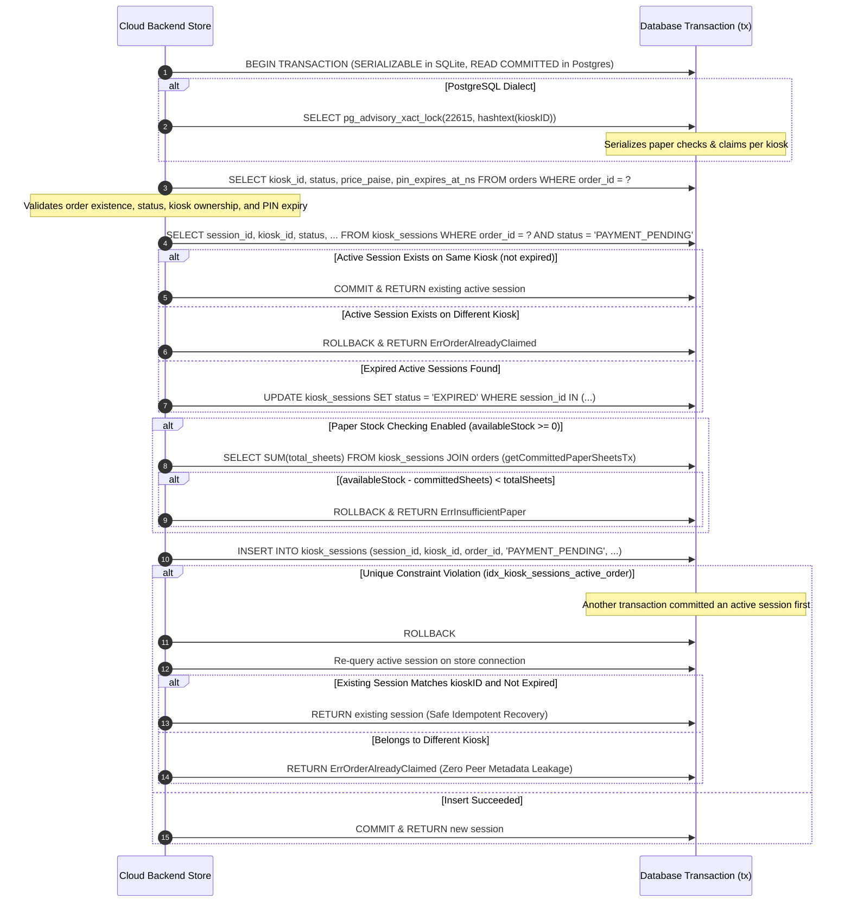

# Orders & Sessions Concurrency & Transaction Safety

## 1. Executive Summary

This document details the transaction semantics, concurrency baseline, and transaction safety implementation for order claiming, session management, and paper stock reservation in XeroxGo (Tasks 4.2, 4.3, & 4.3B).

Prior to Task 4.3, concurrent claims under PostgreSQL suffered from two critical race conditions:
1. **Twin Active Sessions:** Non-unique index on `kiosk_sessions(order_id, status)` allowed two concurrent transactions under `READ COMMITTED` to simultaneously create active `PAYMENT_PENDING` sessions for the same order.
2. **Paper Overcommitment Phantom Reads:** Unlocked paper commitment queries allowed simultaneous claims on the same kiosk to overcommit physical tray paper capacity.

In Tasks 4.3 and 4.3B, comprehensive transactional safety protections were implemented, audited, and empirically verified across both SQLite and PostgreSQL:
- **Database-Level Partial Unique Index:** Enforces at most one active `PAYMENT_PENDING` session per order at the database engine layer.
- **Preflight Duplicate Active Session Detection:** Inspects existing records strictly before index creation and aborts if duplicate active sessions exist, refusing to alter or delete customer data automatically.
- **Transaction-Scoped Advisory Locking (PostgreSQL):** Serializes paper stock checks and session creation/cancellation/completion per kiosk via `pg_advisory_xact_lock(22615, hashtext(kiosk_id))`.
- **Safe Uniqueness Conflict Recovery:** Idempotently returns the existing authorized session for the same kiosk upon insert collision, or returns a controlled `ErrOrderAlreadyClaimed` conflict without leaking another customer's session.
- **Audited Concurrent Production Migration:** Phased migration script supporting `CREATE INDEX CONCURRENTLY` outside explicit transaction blocks, with invalid-index detection queries and safe recovery procedures.

> [!IMPORTANT]
> **Environment Verification Status Delineation:**
> - **SQLite Monorepo Gate:** **VERIFIED** across all automated test suites.
> - **PostgreSQL Live Concurrency:** **VERIFIED on PostgreSQL 16** via disposable local container integration tests (`TestPostgresConcurrency_IntegrationSuite`).
> - **Default Unset Environment:** When `SUPABASE_URI` or `POSTGRES_URL` is unset, PostgreSQL integration tests gracefully skip and explicitly report `[UNVERIFIED]`. SQLite results are never falsely substituted for PostgreSQL guarantees.

---

## 2. Transaction & Locking Architecture

### 2.1 Session Claiming Transaction Flow
Session claiming is implemented in [`cloud-backend/internal/store/db.go:CreateOrGetKioskSessionWithPaperCheck`](file:///home/shabas/Projects/XeroxGo/cloud-backend/internal/store/db.go#L2240-L2440):



### 2.2 Compatible Locking Across Stock-Changing Operations

To prevent deadlocks and maintain strict mutual exclusion for physical paper stock, all operations that alter or check paper commitments adhere to consistent lock ordering:

| Operation | Implementation | PostgreSQL Locking Mechanism | SQLite Locking Mechanism | Lock Ordering Guarantee |
| :--- | :--- | :--- | :--- | :--- |
| **Claim Session & Reserve Paper** | [`CreateOrGetKioskSessionWithPaperCheck`](file:///home/shabas/Projects/XeroxGo/cloud-backend/internal/store/db.go#L2240) | `SELECT pg_advisory_xact_lock(22615, hashtext(kiosk_id))` (exclusive per-kiosk lock) | Connection pool serialization (`MaxOpenConns=1`) | Lock acquired immediately after `BeginTx` before any reads. |
| **Cancel Session & Free Paper** | [`CancelKioskSession`](file:///home/shabas/Projects/XeroxGo/cloud-backend/internal/store/db.go#L2520) | `SELECT pg_advisory_xact_lock(22615, hashtext(kiosk_id))` inside transaction | Connection pool serialization (`MaxOpenConns=1`) | Lock acquired immediately after `BeginTx` before session status update. |
| **Complete Session on Print** | [`CompleteKioskSession`](file:///home/shabas/Projects/XeroxGo/cloud-backend/internal/store/db.go#L2585) | `SELECT pg_advisory_xact_lock(22615, hashtext(kiosk_id))` inside transaction | Connection pool serialization (`MaxOpenConns=1`) | Kiosk ID queried from session, advisory lock acquired before transition. |
| **Pre-Payment Stock Revalidation** | [`session_handler.go:420`](file:///home/shabas/Projects/XeroxGo/cloud-backend/cmd/server/session_handler.go#L420) | Read query excluding current order; session already reserved | In-memory read from Store | Non-mutating telemetry revalidation. |

---

## 3. Database Migration, Preflight Checks & Recovery

### 3.1 Partial Unique Constraint Definition
Both PostgreSQL and SQLite support partial unique indexes. The constraint is defined as:

```sql
CREATE UNIQUE INDEX IF NOT EXISTS idx_kiosk_sessions_active_order 
ON kiosk_sessions (order_id) 
WHERE status = 'PAYMENT_PENDING';
```

**Index Invariants:**
- **Exclusion of Historical Rows:** Records with status `EXPIRED`, `CANCELED`, or `COMPLETED` do not match the index filter predicate. An order can accumulate full lifecycle history across retried sessions.
- **Mutual Exclusion:** Exactly one active transaction session can exist for an order at any single point in time.

### 3.2 Preflight Detection of Conflicting Production Records & Startup Decoupling
In Task 4.3B and Task INT-4A, the initialization sequences in [`cloud-backend/internal/store/db.go`](file:///home/shabas/Projects/XeroxGo/cloud-backend/internal/store/db.go) were hardened:
1. In `initPostgresSchema`: Startup is decoupled from index creation. PostgreSQL startup runs a fail-closed preflight duplicate check, but does **not** automatically run `CREATE UNIQUE INDEX` via `pgMigrations`. Production index deployment is owned exclusively by the explicit standalone migration script ([`deploy/supabase/migrations/20261113_active_kiosk_sessions_unique.sql`](file:///home/shabas/Projects/XeroxGo/deploy/supabase/migrations/20261113_active_kiosk_sessions_unique.sql)).
2. In `EnsureActiveSessionConstraint(ctx)`: Provides the supported, documented method for fresh development and disposable test databases to obtain the partial unique constraint after running fail-closed preflight validation.
3. In `migrateSQLiteSchema`: Preflight duplicate detection executes before `idx_kiosk_sessions_active_order` is created.
4. Fail-Closed Error Handling: If the preflight query encounters any database error (connection drop, table lock, column resolution failure) or detects duplicate active sessions:
   - Initialization **ABORTS IMMEDIATELY** (fails closed).
   - No rows are deleted, updated, or modified automatically.
   - Startup fails with an explicit error requiring manual operator investigation.

### 3.3 Production Migration & `CREATE INDEX CONCURRENTLY`
The production migration is documented in [`deploy/supabase/migrations/20261113_active_kiosk_sessions_unique.sql`](file:///home/shabas/Projects/XeroxGo/deploy/supabase/migrations/20261113_active_kiosk_sessions_unique.sql).

**Transaction Block Requirement:**
> [!WARNING]
> In PostgreSQL, `CREATE INDEX CONCURRENTLY` **cannot** be executed within a multi-statement transaction block (`BEGIN ... COMMIT`).
> It must be executed as a standalone statement in **AUTOCOMMIT** mode (e.g. standard `psql` command, Supabase SQL Editor, or migration tool configured with `autocommit=true`).

### 3.4 Invalid Index Detection & Safe Recovery Procedure
If a concurrent index build fails (due to connection loss, query timeout, deadlocks, or concurrent insert collisions), PostgreSQL leaves an **INVALID** index behind:

1. **Detect Invalid Indexes:**
   ```sql
   SELECT 
       c.relname AS index_name,
       pg_size_pretty(pg_relation_size(c.oid)) AS index_size,
       i.indisvalid AS is_valid,
       i.indisunique AS is_unique
   FROM pg_class c
   JOIN pg_index i ON c.oid = i.indexrelid
   JOIN pg_namespace n ON n.oid = c.relnamespace
   WHERE c.relname = 'idx_kiosk_sessions_active_order';
   ```
2. **Operational Consequences of Invalid Index:**
   - An index with `indisvalid = false` is never used for query optimization or constraint enforcement.
   - It continues to consume storage and incurs write amplification on every `INSERT`/`UPDATE` to `kiosk_sessions`.
3. **Safe Recovery Steps:**
   - Step 1: Drop the invalid index concurrently:
     ```sql
     DROP INDEX CONCURRENTLY IF EXISTS idx_kiosk_sessions_active_order;
     ```
   - Step 2: Re-run Phase 1 preflight detection to inspect and resolve any conflicting active sessions manually.
   - Step 3: Re-run Phase 2 standalone statement in autocommit mode.

---

## 4. Invariant Verification Matrix

| Invariant ID | Contract Description | SQLite Status | PostgreSQL Status | Verification Evidence / Mechanism |
| :--- | :--- | :---: | :---: | :--- |
| **INV-CONCUR-01** | **Single Active Session Per Order:** An order must have at most one active (`PAYMENT_PENDING`) session. | **VERIFIED** | **VERIFIED** | Enforced by `idx_kiosk_sessions_active_order`. Verified on live PostgreSQL 16 Alpine container via `Postgres_SimultaneousClaims_SameOrder`. |
| **INV-CONCUR-02** | **Tray Stock Conservation:** Total committed sheets must never exceed physical tray stock ($S_{\text{committed}} \le S_{\text{available}}$). | **VERIFIED** | **VERIFIED** | Verified on PostgreSQL 16 via `Postgres_PaperOvercommitment_AdvisoryLock`. `pg_advisory_xact_lock` serialized checks; exactly 2 succeeded, 2 failed on 15-sheet tray. |
| **INV-CONCUR-03** | **Kiosk Authorization Isolation:** An unauthorized kiosk cannot claim an order assigned to another kiosk. | **VERIFIED** | **VERIFIED** | Verified via `Postgres_CompetingKiosks_NoPeerLeak`. Intruder rejected with `ErrKioskMismatch`/`ErrOrderAlreadyClaimed`. |
| **INV-CONCUR-04** | **Claim Idempotency & Safe Recovery:** Repeated claims or concurrent collisions return the existing authorized session. | **VERIFIED** | **VERIFIED** | Verified via `Postgres_SimultaneousClaims_SameOrder` (10 concurrent claims converged on 1 winning session ID). |
| **INV-CONCUR-05** | **Expired Session Reclamation:** Reclaiming an expired order marks old session `EXPIRED` and creates a fresh session. | **VERIFIED** | **VERIFIED** | Verified via `Postgres_ExpirationAndReclaim` (old row updated in-place to `EXPIRED`, new row created). |
| **INV-CONCUR-06** | **Cancellation Stock Release:** Explicit cancellation transitions session to `CANCELED` and releases paper commitment immediately. | **VERIFIED** | **VERIFIED** | Verified via `Postgres_CancellationAndReclaim` (committed sheets dropped to 0 immediately upon cancel). |
| **INV-CONCUR-07** | **Rollback Atomic Cleansing:** Any error during claim creation leaves zero orphan rows in `kiosk_sessions`. | **VERIFIED** | **VERIFIED** | Verified via `Postgres_RollbackIntegrity` (asserted 0 rows exist in `kiosk_sessions` after rollback). |
| **INV-CONCUR-08** | **Zero Peer Metadata Exposure:** Unauthorized kiosks never receive another customer's session object or price. | **VERIFIED** | **VERIFIED** | Verified via `Postgres_CompetingKiosks_NoPeerLeak` (intruder session pointer asserted strictly `nil`; 0 intruder rows in DB). |

---

## 5. Automated Test Suites & Verification Evidence

### 5.1 Test Suite Implementation
Automated tests are housed in [`orders_sessions_safety_test.go`](file:///home/shabas/Projects/XeroxGo/cloud-backend/internal/store/orders_sessions_safety_test.go) and [`concurrency_baseline_test.go`](file:///home/shabas/Projects/XeroxGo/cloud-backend/internal/store/concurrency_baseline_test.go).

### 5.2 Live PostgreSQL 16 Integration Test Execution Output
Executed against a disposable local PostgreSQL 16 Alpine container via `XEROXGO_TEST_POSTGRES_URL`:

```text
=== RUN   TestPostgresConcurrency_IntegrationSuite
=== RUN   TestPostgresConcurrency_IntegrationSuite/Postgres_SimultaneousClaims_SameOrder
=== RUN   TestPostgresConcurrency_IntegrationSuite/Postgres_PaperOvercommitment_AdvisoryLock
=== RUN   TestPostgresConcurrency_IntegrationSuite/Postgres_RollbackIntegrity
=== RUN   TestPostgresConcurrency_IntegrationSuite/Postgres_CancellationAndReclaim
=== RUN   TestPostgresConcurrency_IntegrationSuite/Postgres_ExpirationAndReclaim
=== RUN   TestPostgresConcurrency_IntegrationSuite/Postgres_CompetingKiosks_NoPeerLeak
=== RUN   TestPostgresConcurrency_IntegrationSuite/Postgres_PreflightDuplicateActiveSessionsDetection
=== RUN   TestPostgresConcurrency_IntegrationSuite/Postgres_IndexDeployment_StartupVsExplicit
    orders_sessions_safety_test.go:512: Confirmed: EnsureActiveSessionConstraint aborted on preflight: ensure active session constraint preflight failed: found 1 orders with duplicate active PAYMENT_PENDING sessions; manual operator resolution required
--- PASS: TestPostgresConcurrency_IntegrationSuite (0.28s)
    --- PASS: TestPostgresConcurrency_IntegrationSuite/Postgres_SimultaneousClaims_SameOrder (0.04s)
    --- PASS: TestPostgresConcurrency_IntegrationSuite/Postgres_PaperOvercommitment_AdvisoryLock (0.03s)
    --- PASS: TestPostgresConcurrency_IntegrationSuite/Postgres_RollbackIntegrity (0.00s)
    --- PASS: TestPostgresConcurrency_IntegrationSuite/Postgres_CancellationAndReclaim (0.01s)
    --- PASS: TestPostgresConcurrency_IntegrationSuite/Postgres_ExpirationAndReclaim (0.01s)
    --- PASS: TestPostgresConcurrency_IntegrationSuite/Postgres_CompetingKiosks_NoPeerLeak (0.01s)
    --- PASS: TestPostgresConcurrency_IntegrationSuite/Postgres_PreflightDuplicateActiveSessionsDetection (0.00s)
    --- PASS: TestPostgresConcurrency_IntegrationSuite/Postgres_IndexDeployment_StartupVsExplicit (0.05s)
PASS
ok  	xeroxgo/cloud-backend/internal/store	1.298s
```

### 5.3 Default Unset Environment Behavior
When running in an environment without provisioned PostgreSQL connection strings (or if generic production variables like `DATABASE_URL` / `SUPABASE_URI` are present):

```text
=== RUN   TestPostgresConcurrency_IntegrationSuite
    orders_sessions_safety_test.go:179: [UNVERIFIED] Disposable PostgreSQL test database not configured (XEROXGO_TEST_POSTGRES_URL / POSTGRES_TEST_URL not set). Production/staging environment variables (DATABASE_URL, SUPABASE_URI) are strictly ignored for safety. Live PostgreSQL concurrency guarantees remain marked UNVERIFIED.
    orders_sessions_safety_test.go:180: skipping live Postgres concurrency tests (XEROXGO_TEST_POSTGRES_URL/POSTGRES_TEST_URL not set)
--- SKIP: TestPostgresConcurrency_IntegrationSuite (0.00s)
```

---

## 6. Monorepo Verification Gate Status

The repository verification gate was executed via [`scripts/verify_gate.sh`](file:///home/shabas/Projects/XeroxGo/scripts/verify_gate.sh):

```text
Starting XeroxGo Monorepo Verification Gate...
Working directory: /home/shabas/Projects/XeroxGo

=== Gate 1: Frozen Contracts ===
Gate 1 PASSED: pkg/contracts/models.go matches frozen baseline.

=== Gate 2: Ban CGO SQLite Driver ===
Gate 2 PASSED: Zero occurrences of 'mattn/go-sqlite3' across 97 Go source files.

=== Gate 3: Go Vet ===
Gate 3 PASSED: go vet reported no issues.

=== Gate 4: Required Builds ===
Building kiosk daemon (linux/arm64, CGO_ENABLED=0)...
Building cloud backend (host, CGO_ENABLED=0)...
Gate 4 PASSED: Both required binaries built successfully.

=== Gate 5: Race-Enabled Test Suite ===
Gate 5 PASSED: All tests passed with race detector enabled.

=== Gate 6: Frontend Conversion Test Suite ===
Gate 6 PASSED: Frontend conversion tests passed (8/8 passed).

=== Verification Summary ===
✅ ALL GATES PASSED
```
