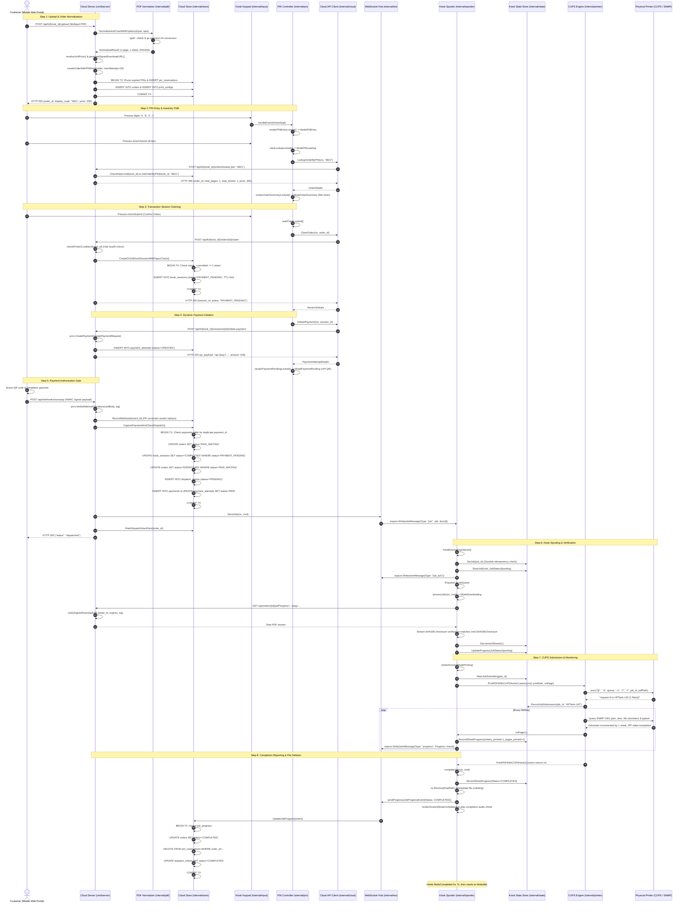
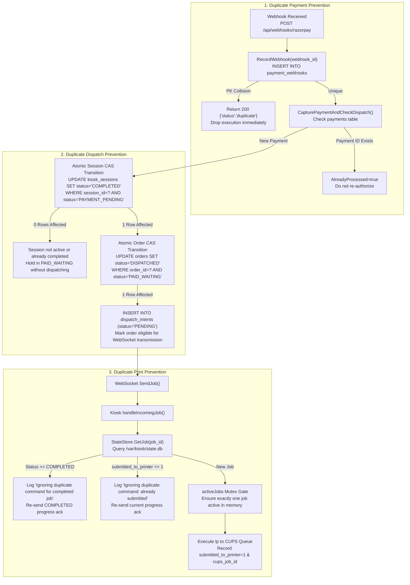

# XeroxGo Minimum Working Core — Execution Path Analysis

This document provides an exhaustive, function-by-function trace of the **Minimum Working Core** in XeroxGo. It tracks a single, end-to-end print transaction through every file, function call, database mutation, network message, and hardware interface.

---

## 1. Concrete Transaction Specification

The benchmark transaction traced in this document represents the canonical minimum workflow:

| Parameter | Value | Architectural Significance |
| :--- | :--- | :--- |
| **Document Type** | Native PDF (`single_page.pdf`) | Bypasses office document conversion (`soffice`) |
| **Page Count** | Exactly 1 logical page | Simplex, no pagination splits |
| **Dimensions** | Standard ISO A4 (595 $\times$ 842 pt) | Bypasses N-Up imposition and resizing |
| **Color Mode** | B&W (Monochrome) | Standard tariff, no color plane transformations |
| **Copies** | 1 copy | Single pass through physical print engine |
| **Duplex Mode** | `SIMPLEX` | No blank back-page padding; single physical sheet |
| **Expected Physical Output** | Exactly 1 physical A4 sheet | Sheet count = 1, page count = 1 |
| **Payment Method** | Dynamic UPI QR | Scanned via phone, verified via webhook |
| **Print Spooler** | CUPS via `lp` (or direct PJL port 9100) | Production target: Brother HL-L5210DN over Ethernet (`192.168.99.2:9100`); Demo queue: HP LaserJet Tank 1020w (`HPTank`); Earlier test: Brother DCP-T310 (`DCPT310`) |

---

## 2. End-to-End Execution Sequence Diagram

---

## 3. Function-by-Function Execution Trace

### Phase 1: Upload, Normalization & PIN Reservation
1. **HTTP Ingress & Routing:**
   - Client sends `POST /api/k/kiosk-001/upload` with multipart form data.
   - Vercel reverse proxy injects header `X-XeroxGo-Proxy-Secret` ([`frontend/vercel.json:3-7`](file:///home/shabas/Projects/XeroxGo/frontend/vercel.json#L3-L7)).
   - Ingress handler validates proxy secret ([`cloud-backend/cmd/server/main.go:2008-2031`](file:///home/shabas/Projects/XeroxGo/cloud-backend/cmd/server/main.go#L2008-L2031)).
   - Mux routes to `app.handleUpload` ([`cloud-backend/cmd/server/main.go:241`](file:///home/shabas/Projects/XeroxGo/cloud-backend/cmd/server/main.go#L241)).
2. **Input Parsing & Form Extraction:**
   - Checks kiosk ID and parses multipart form bounded by 50 MiB ([`main.go:253-266`](file:///home/shabas/Projects/XeroxGo/cloud-backend/cmd/server/main.go#L253-L266)).
   - Single file branch without metadata: extracts copies (1), duplex (`contracts.DuplexSimplex`), orientation (`AUTO`), pages per sheet (1) ([`main.go:627-691`](file:///home/shabas/Projects/XeroxGo/cloud-backend/cmd/server/main.go#L627-L691)).
   - Stages raw upload to temporary file: `upload_in_*.pdf` ([`main.go:697-712`](file:///home/shabas/Projects/XeroxGo/cloud-backend/cmd/server/main.go#L697-L712)).
3. **PDF Normalization Engine:**
   - Calls `pdf.NormalizeAndCountWithOptions` ([`cloud-backend/internal/pdf/normalizer.go:343`](file:///home/shabas/Projects/XeroxGo/cloud-backend/internal/pdf/normalizer.go#L343)).
   - Validates PDF structure: executes `qpdf --check` and `qpdf --is-encrypted` ([`normalizer.go:364-398`](file:///home/shabas/Projects/XeroxGo/cloud-backend/internal/pdf/normalizer.go#L364-L398)).
   - Counts raw pages: executes `qpdf --show-npages` $\rightarrow$ returns 1 page ([`normalizer.go:401-412`](file:///home/shabas/Projects/XeroxGo/cloud-backend/internal/pdf/normalizer.go#L401-L412)).
   - Simplex & 1-page check: `needsDuplexPadding = false` ([`normalizer.go:493`](file:///home/shabas/Projects/XeroxGo/cloud-backend/internal/pdf/normalizer.go#L493)).
   - Executes Ghostscript normalization to A4 DeviceGray:
     `gs -dSAFER -sDEVICE=pdfwrite -dCompatibilityLevel=1.7 -dPDFSETTINGS=/prepress -sColorConversionStrategy=Gray -dProcessColorModel=/DeviceGray -sPAPERSIZE=a4 -dFIXEDMEDIA -dPDFFitPage -dNOPAUSE -dQUIET -dBATCH -sOutputFile=<out> <in>` ([`normalizer.go:503-552`](file:///home/shabas/Projects/XeroxGo/cloud-backend/internal/pdf/normalizer.go#L503-L552)).
   - Computes SHA256 checksum on output file ([`normalizer.go:594-609`](file:///home/shabas/Projects/XeroxGo/cloud-backend/internal/pdf/normalizer.go#L594-L609)).
   - Returns `NormalizedResult{TotalPages: 1, TotalSheets: 1, PaddedPages: 1, SHA256Checksum: "..."}`.
4. **Tariff Resolution:**
   - `s.resolveUnitPrice(pricing, true, "BW", contracts.DuplexSimplex)` ([`main.go:781`](file:///home/shabas/Projects/XeroxGo/cloud-backend/cmd/server/main.go#L781)).
   - Queries `pricing` table via `s.db.GetPricing(ctx)` ([`cloud-backend/internal/store/analytics.go:29`](file:///home/shabas/Projects/XeroxGo/cloud-backend/internal/store/analytics.go#L29)).
   - Simplex B&W tariff resolved: 200 paise (₹2.00) ([`main.go:210-239`](file:///home/shabas/Projects/XeroxGo/cloud-backend/cmd/server/main.go#L210-L239)).
5. **Signed URL Generation:**
   - `generateSignedDownloadURL(baseURL, orderID, downloadSecret, 24*time.Hour)`: creates HMAC-SHA256 signature combining `orderID` and Unix expiration timestamp ([`main.go:148-155`](file:///home/shabas/Projects/XeroxGo/cloud-backend/cmd/server/main.go#L148-L155)).
6. **PIN Allocation & Atomic Persistence:**
   - `s.createOrderWithPINRetry(ctx, &order, 25)` ([`main.go:123-146`](file:///home/shabas/Projects/XeroxGo/cloud-backend/cmd/server/main.go#L123-L146)).
   - Generates random 4-digit code via `randomDisplayCode` ([`main.go:95-101`](file:///home/shabas/Projects/XeroxGo/cloud-backend/cmd/server/main.go#L95-L101)).
   - Invokes `s.db.CreateOrder(ctx, order)` ([`cloud-backend/internal/store/db.go:853`](file:///home/shabas/Projects/XeroxGo/cloud-backend/internal/store/db.go#L853)).
   - Opens database transaction:
     * Prunes expired PINs: `DELETE FROM pin_reservations WHERE kiosk_id = ? AND expires_at_ns <= ?;` ([`db.go:935`](file:///home/shabas/Projects/XeroxGo/cloud-backend/internal/store/db.go#L935)).
     * Reserves PIN: `INSERT INTO pin_reservations (kiosk_id, pin, order_id, expires_at_ns, created_at_ns) VALUES (?, ?, ?, ?, ?);` ([`db.go:945`](file:///home/shabas/Projects/XeroxGo/cloud-backend/internal/store/db.go#L945)).
     * Inserts order: `INSERT INTO orders (order_id, job_id, kiosk_id, display_code, status, price_paise, created_at_ns, updated_at_ns, pin_expires_at_ns, claim_token) VALUES (?, ?, ?, ?, 'PENDING_PAYMENT', ?, ?, ?, ?, ?);` ([`db.go:959`](file:///home/shabas/Projects/XeroxGo/cloud-backend/internal/store/db.go#L959)).
     * Inserts print config: `INSERT INTO print_configs (order_id, download_url, sha256_checksum, total_pages, total_sheets, copies, duplex, start_from_page, color_mode) VALUES (?, ?, ?, 1, 1, 1, 'SIMPLEX', 1, 'BW');` ([`db.go:984`](file:///home/shabas/Projects/XeroxGo/cloud-backend/internal/store/db.go#L984)).
     * Commits transaction ([`db.go:1002`](file:///home/shabas/Projects/XeroxGo/cloud-backend/internal/store/db.go#L1002)).
   - Returns JSON payload with `order_id`, `job_id`, `display_code` (e.g. `"4821"`), and `price_paise: 200` ([`main.go:840-857`](file:///home/shabas/Projects/XeroxGo/cloud-backend/cmd/server/main.go#L840-L857)).

---

### Phase 2: Kiosk Keypad Input, PIN Lookup & Order Summary
1. **Keypad Capture:**
   - Customer approaches physical kiosk. `internal/input/keyboard.go:50-130` reads character bytes from `/dev/tty1` in non-canonical raw mode.
   - Dispatches `input.Event{Type: input.ActionDigit, Digit: '4'}` to `pin.Controller.eventLoop` ([`kiosk-daemon/internal/pin/controller.go:213-232`](file:///home/shabas/Projects/XeroxGo/kiosk-daemon/internal/pin/controller.go#L213-L232)).
   - Transitions state from `StateIdle` to `StatePINEntry`, buffers `'4'`, resets 30-second inactivity timer, calls `renderPINEntryLocked` ([`controller.go:252-261`](file:///home/shabas/Projects/XeroxGo/kiosk-daemon/internal/pin/controller.go#L252-L261)).
   - Digits `'8'`, `'2'`, `'1'` are entered, updating buffer to `"4821"`.
   - Customer presses `ActionSubmit` (Enter) ([`controller.go:285-292`](file:///home/shabas/Projects/XeroxGo/kiosk-daemon/internal/pin/controller.go#L285-L292)).
2. **PIN Lookup Execution:**
   - `c.startLookupLocked()` transitions to `StatePINLoading` and invokes background goroutine ([`controller.go:480-539`](file:///home/shabas/Projects/XeroxGo/kiosk-daemon/internal/pin/controller.go#L480-L539)).
   - `LookupClient.LookupOrderByPIN(ctx, "4821")` sends `POST /api/k/kiosk-001/orders/lookup` with `Authorization: Bearer <kiosk_secret>` ([`kiosk-daemon/internal/cloud/pin_client.go:104-180`](file:///home/shabas/Projects/XeroxGo/kiosk-daemon/internal/cloud/pin_client.go#L104-L180)).
   - Cloud `handlePINLookup` validates authorization header ([`cloud-backend/cmd/server/pin_lookup_handler.go:61-73`](file:///home/shabas/Projects/XeroxGo/cloud-backend/cmd/server/pin_lookup_handler.go#L61-L73)).
   - Evaluates durable rate limiter: `s.pinLimiter.Check(ctx, kioskID, now)` ([`pin_lookup_handler.go:78`](file:///home/shabas/Projects/XeroxGo/cloud-backend/cmd/server/pin_lookup_handler.go#L78)).
   - Executes database query `s.db.GetOrderByPIN(ctx, kioskID, "4821")` ([`pin_lookup_handler.go:133`](file:///home/shabas/Projects/XeroxGo/cloud-backend/cmd/server/pin_lookup_handler.go#L133)):
     `SELECT o.order_id, o.job_id, o.kiosk_id, o.display_code, o.status, o.price_paise, o.pin_expires_at_ns, p.total_pages, p.total_sheets, p.copies, p.duplex, p.color_mode FROM orders o JOIN print_configs p ON o.order_id = p.order_id WHERE o.kiosk_id = ? AND o.display_code = ? AND o.status = 'PENDING_PAYMENT';` ([`db.go:1210-1280`](file:///home/shabas/Projects/XeroxGo/cloud-backend/internal/store/db.go#L1210-L1280)).
   - Checks expiration: `order.PINExpiresAt.Before(now)` ([`pin_lookup_handler.go:157`](file:///home/shabas/Projects/XeroxGo/cloud-backend/cmd/server/pin_lookup_handler.go#L157)).
   - Cloud records success in rate limiter and returns `pinLookupResponse` ([`pin_lookup_handler.go:167-187`](file:///home/shabas/Projects/XeroxGo/cloud-backend/cmd/server/pin_lookup_handler.go#L167-L187)).
3. **Order Summary Rendering:**
   - Kiosk controller transitions to `StateOrderSummary` ([`controller.go:535`](file:///home/shabas/Projects/XeroxGo/kiosk-daemon/internal/pin/controller.go#L535)).
   - Starts 60-second inactivity countdown timer ([`controller.go:537`](file:///home/shabas/Projects/XeroxGo/kiosk-daemon/internal/pin/controller.go#L537)).
   - Rasterizes `ModeOrderSummary` showing 1 page, 1 sheet, 1 copy, B&W, Simplex, ₹2.00, and action instructions ([`kiosk-daemon/internal/ui_ipc/renderer.go:1052-1140`](file:///home/shabas/Projects/XeroxGo/kiosk-daemon/internal/ui_ipc/renderer.go#L1052-L1140)).

---

### Phase 3: Order Claiming & Transaction Session Locking
1. **User Confirmation:**
   - Customer presses `ActionSubmit` (Enter) on keypad ([`controller.go:308`](file:///home/shabas/Projects/XeroxGo/kiosk-daemon/internal/pin/controller.go#L308)).
   - Invokes `c.startClaimLocked()` ([`controller.go:360`](file:///home/shabas/Projects/XeroxGo/kiosk-daemon/internal/pin/controller.go#L360)).
2. **Kiosk Session Claim API:**
   - Sends `POST /api/k/kiosk-001/orders/{order_id}/claim` ([`pin_client.go:183-255`](file:///home/shabas/Projects/XeroxGo/kiosk-daemon/internal/cloud/pin_client.go#L183-L255)).
   - Cloud `handleOrderClaim` parses path and verifies kiosk bearer token ([`cloud-backend/cmd/server/session_handler.go:164-184`](file:///home/shabas/Projects/XeroxGo/cloud-backend/cmd/server/session_handler.go#L164-L184)).
3. **Hardware Health & Paper Stock Pre-flight Check:**
   - Calls `s.checkPrinterCondition(kioskID)` ([`session_handler.go:188`](file:///home/shabas/Projects/XeroxGo/cloud-backend/cmd/server/session_handler.go#L188)).
   - Queries `s.hub.LatestHealth(kioskID)`: verifies `Online=true`, `State!="ERROR"`, `PaperJam=false`, `CoverOpen=false`, `OutputBinFull=false`, and telemetry is fresher than 60 seconds ([`session_handler.go:88-140`](file:///home/shabas/Projects/XeroxGo/cloud-backend/cmd/server/session_handler.go#L88-L140)).
   - Extracts current stock count (e.g. 250 sheets).
4. **Pessimistic Paper Reservation Transaction:**
   - Calls `s.db.CreateOrGetKioskSessionWithPaperCheck(ctx, kioskID, orderID, stock, 5*time.Minute, now)` ([`session_handler.go:208`](file:///home/shabas/Projects/XeroxGo/cloud-backend/cmd/server/session_handler.go#L208), [`db.go:2189`](file:///home/shabas/Projects/XeroxGo/cloud-backend/internal/store/db.go#L2189)).
   - Opens transaction:
     * Reads order required sheets: `1 sheet` ([`db.go:2205`](file:///home/shabas/Projects/XeroxGo/cloud-backend/internal/store/db.go#L2205)).
     * Sums committed sheets across all active sessions on this kiosk:
       `SELECT COALESCE(SUM(p.total_sheets), 0) FROM kiosk_sessions s JOIN print_configs p ON s.order_id = p.order_id WHERE s.kiosk_id = ? AND s.status = 'PAYMENT_PENDING' AND s.expires_at_ns > ? AND s.order_id != ?;` ([`db.go:2130-2160`](file:///home/shabas/Projects/XeroxGo/cloud-backend/internal/store/db.go#L2130-L2160)).
     * Verifies: `availableStock - committedSheets >= 1`. If insufficient, aborts with `ErrInsufficientPaper` ([`db.go:2219`](file:///home/shabas/Projects/XeroxGo/cloud-backend/internal/store/db.go#L2219)).
     * Generates `session_id = "sess_" + randomHex(16)`.
     * Inserts into `kiosk_sessions`:
       `INSERT INTO kiosk_sessions (session_id, kiosk_id, order_id, status, price_paise, expires_at_ns, created_at_ns, updated_at_ns) VALUES (?, ?, ?, 'PAYMENT_PENDING', 200, ?, ?, ?);` ([`db.go:2325`](file:///home/shabas/Projects/XeroxGo/cloud-backend/internal/store/db.go#L2325)).
     * Commits transaction.
   - Returns session ID and 5-minute expiration timestamp to kiosk ([`session_handler.go:249-258`](file:///home/shabas/Projects/XeroxGo/cloud-backend/cmd/server/session_handler.go#L249-L258)).

---

### Phase 4: Dynamic UPI Payment Generation & QR Display
1. **Initiate Payment Request:**
   - Kiosk controller transitions to `StatePaymentPending` ([`controller.go:437`](file:///home/shabas/Projects/XeroxGo/kiosk-daemon/internal/pin/controller.go#L437)).
   - Invokes background payment initiation: `LookupClient.InitiatePayment(ctx, sessionID)` ([`controller.go:458`](file:///home/shabas/Projects/XeroxGo/kiosk-daemon/internal/pin/controller.go#L458)).
   - Calls `POST /api/k/kiosk-001/sessions/{session_id}/initiate-payment` ([`pin_client.go:300-370`](file:///home/shabas/Projects/XeroxGo/kiosk-daemon/internal/cloud/pin_client.go#L300-L370)).
2. **Cloud Payment Creation:**
   - Cloud `handleInitiatePayment` verifies active session status ([`cloud-backend/cmd/server/session_handler.go:393-405`](file:///home/shabas/Projects/XeroxGo/cloud-backend/cmd/server/session_handler.go#L393-L405)).
   - Checks idempotency: `s.db.GetActivePaymentAttempt(ctx, sessionID, now)` ([`session_handler.go:441`](file:///home/shabas/Projects/XeroxGo/cloud-backend/cmd/server/session_handler.go#L441)).
   - Invokes provider `CreatePayment` ([`session_handler.go:488`](file:///home/shabas/Projects/XeroxGo/cloud-backend/cmd/server/session_handler.go#L488)).
   - Razorpay / Mock provider generates dynamic UPI link:
     `upi://pay?pa=merchant@upi&pn=XeroxGo&am=2.00&cu=INR&tr=att_...&tn=Order ord_...` ([`cloud-backend/internal/payments/mock.go:45-55`](file:///home/shabas/Projects/XeroxGo/cloud-backend/internal/payments/mock.go#L45-L55)).
   - Persists attempt in `payment_attempts`:
     `INSERT INTO payment_attempts (attempt_id, order_id, kiosk_id, session_id, provider, provider_order_id, amount_paise, currency, status, qr_payload, idempotency_key, expires_at_ns, created_at_ns, updated_at_ns) VALUES (?, ?, ?, ?, 'razorpay', ?, 200, 'INR', 'CREATED', ?, ?, ?, ?, ?);` ([`db.go:3129-3180`](file:///home/shabas/Projects/XeroxGo/cloud-backend/internal/store/db.go#L3129-L3180)).
   - Returns payment attempt details with `qr_payload` to kiosk ([`session_handler.go:548-563`](file:///home/shabas/Projects/XeroxGo/cloud-backend/cmd/server/session_handler.go#L548-L563)).
3. **Kiosk UI QR Rendering:**
   - Kiosk controller receives payload, sets `currentQRPayload`, starts animated 300-second countdown ([`controller.go:473-475`](file:///home/shabas/Projects/XeroxGo/kiosk-daemon/internal/pin/controller.go#L473-L475)).
   - `renderPaymentPendingLocked` rasterizes dynamic UPI QR code on framebuffer (`/dev/fb0`) alongside order cost, sheet count, and live countdown timer ([`kiosk-daemon/internal/ui_ipc/renderer.go:1142-1240`](file:///home/shabas/Projects/XeroxGo/kiosk-daemon/internal/ui_ipc/renderer.go#L1142-L1240)).

---

### Phase 5: Payment Authorization Gate & WebSocket Dispatch
1. **Webhook Reception & Signature Verification:**
   - Customer scans QR code on mobile banking app and completes UPI transaction.
   - Razorpay sends HTTP webhook to `POST /api/webhooks/razorpay` ([`cloud-backend/cmd/server/main.go:1417`](file:///home/shabas/Projects/XeroxGo/cloud-backend/cmd/server/main.go#L1417)).
   - Reads request body (bounded to 1 MiB) and extracts `X-Razorpay-Signature` ([`main.go:1423-1431`](file:///home/shabas/Projects/XeroxGo/cloud-backend/cmd/server/main.go#L1423-L1431)).
   - Validates HMAC-SHA256 signature against webhook secret: `prov.VerifyWebhookSignature(rawBody, sig)` ([`main.go:1433`](file:///home/shabas/Projects/XeroxGo/cloud-backend/cmd/server/main.go#L1433)).
   - Parses payload: event `payment.captured`, entity ID `pay_001`, amount `200` paise, currency `INR` ([`main.go:1458-1481`](file:///home/shabas/Projects/XeroxGo/cloud-backend/cmd/server/main.go#L1458-L1481)).
2. **Webhook Idempotency Gate:**
   - Calls `s.db.RecordWebhook(ctx, eventID)` ([`main.go:1569`](file:///home/shabas/Projects/XeroxGo/cloud-backend/cmd/server/main.go#L1569)).
   - Inserts into `payment_webhooks`: `INSERT INTO payment_webhooks (webhook_id, received_at_ns) VALUES (?, ?);` ([`db.go:1745`](file:///home/shabas/Projects/XeroxGo/cloud-backend/internal/store/db.go#L1745)).
   - Primary key collision returns `recorded = false` $\rightarrow$ returns HTTP 200 `{"status":"duplicate"}` immediately ([`main.go:1574-1578`](file:///home/shabas/Projects/XeroxGo/cloud-backend/cmd/server/main.go#L1574-L1578)).
3. **Physical Print Authorization Gate (`CapturePaymentAndCheckDispatch`):**
   - Invokes `s.db.CapturePaymentAndCheckDispatch(ctx, paymentRecord, now)` ([`main.go:1581`](file:///home/shabas/Projects/XeroxGo/cloud-backend/cmd/server/main.go#L1581), [`db.go:2537`](file:///home/shabas/Projects/XeroxGo/cloud-backend/internal/store/db.go#L2537)).
   - Opens database transaction:
     * Verifies payment does not already exist in `payments` table ([`db.go:2559-2577`](file:///home/shabas/Projects/XeroxGo/cloud-backend/internal/store/db.go#L2559-L2577)).
     * Queries order status and amount ([`db.go:2586-2602`](file:///home/shabas/Projects/XeroxGo/cloud-backend/internal/store/db.go#L2586-L2602)).
     * Atomically transitions order to `PAID_WAITING`:
       `UPDATE orders SET status = 'PAID_WAITING', updated_at_ns = ? WHERE order_id = ? AND status = 'PENDING_PAYMENT';` ([`db.go:2636-2653`](file:///home/shabas/Projects/XeroxGo/cloud-backend/internal/store/db.go#L2636-L2653)).
     * Checks active session:
       `SELECT session_id, kiosk_id, status, expires_at_ns FROM kiosk_sessions WHERE order_id = ? AND kiosk_id = ? AND status = 'PAYMENT_PENDING' AND expires_at_ns > ?;` ([`db.go:2656-2671`](file:///home/shabas/Projects/XeroxGo/cloud-backend/internal/store/db.go#L2656-L2671)).
     * **AUTHORIZATION DECISION POINT:** If session exists, is active, and matches payment session:
       1. Sets session complete: `UPDATE kiosk_sessions SET status = 'COMPLETED', updated_at_ns = ? WHERE session_id = ? AND status = 'PAYMENT_PENDING';` ([`db.go:2681-2686`](file:///home/shabas/Projects/XeroxGo/cloud-backend/internal/store/db.go#L2681-L2686)).
       2. Sets order dispatched: `UPDATE orders SET status = 'DISPATCHED', updated_at_ns = ? WHERE order_id = ? AND status = 'PAID_WAITING';` ([`db.go:2690-2698`](file:///home/shabas/Projects/XeroxGo/cloud-backend/internal/store/db.go#L2690-L2698)).
       3. Records durable dispatch intent: `INSERT INTO dispatch_intents (order_id, job_id, kiosk_id, session_id, status, created_at_ns, updated_at_ns) VALUES (?, ?, ?, ?, 'PENDING', ?, ?);` ([`db.go:2705-2710`](file:///home/shabas/Projects/XeroxGo/cloud-backend/internal/store/db.go#L2705-L2710)).
       4. Sets `dispatchEligible = true`.
     * Inserts into `payments` table ([`db.go:2722-2729`](file:///home/shabas/Projects/XeroxGo/cloud-backend/internal/store/db.go#L2722-L2729)).
     * Updates `payment_attempts.status = 'PAID'` ([`db.go:2732-2737`](file:///home/shabas/Projects/XeroxGo/cloud-backend/internal/store/db.go#L2732-L2737)).
     * Commits transaction ([`db.go:2739`](file:///home/shabas/Projects/XeroxGo/cloud-backend/internal/store/db.go#L2739)).
4. **WebSocket Job Dispatch:**
   - Evaluates: `if captureRes.DispatchEligible && captureRes.Command != nil` ([`main.go:1611`](file:///home/shabas/Projects/XeroxGo/cloud-backend/cmd/server/main.go#L1611)).
   - Calls `s.hub.SendJob(ctx, *captureRes.Command)` ([`main.go:1614`](file:///home/shabas/Projects/XeroxGo/cloud-backend/cmd/server/main.go#L1614), [`cloud-backend/internal/ws/hub.go:215`](file:///home/shabas/Projects/XeroxGo/cloud-backend/internal/ws/hub.go#L215)).
   - Serializes `wireMessage{Type: "job", Job: &cmd}` and writes to kiosk WebSocket session connection ([`hub.go:259-269`](file:///home/shabas/Projects/XeroxGo/cloud-backend/internal/ws/hub.go#L259-L269)).
   - Updates dispatch intent: `s.db.MarkDispatchIntentSent(ctx, orderID)` sets `status = 'SENT'` ([`main.go:1617`](file:///home/shabas/Projects/XeroxGo/cloud-backend/cmd/server/main.go#L1617), [`db.go:2949`](file:///home/shabas/Projects/XeroxGo/cloud-backend/internal/store/db.go#L2949)).

---

### Phase 6: Kiosk Ingestion, Download & CUPS Spooling
1. **Command Ingestion & Local State Guard:**
   - Kiosk WebSocket reader receives message and calls `c.handleIncomingJob(cmd)` ([`kiosk-daemon/internal/spooler/client.go:600`](file:///home/shabas/Projects/XeroxGo/kiosk-daemon/internal/spooler/client.go#L600)).
   - Validates download URL scheme and trusted domain ([`client.go:607`](file:///home/shabas/Projects/XeroxGo/kiosk-daemon/internal/spooler/client.go#L607)).
   - **Local Database Idempotency Check:** Queries `/var/kiosk/state.db`:
     `existing, err := c.cfg.StateStore.GetJob(ctx, cmd.JobID)` ([`client.go:622`](file:///home/shabas/Projects/XeroxGo/kiosk-daemon/internal/spooler/client.go#L622)).
     If already `COMPLETED` or `SubmittedToPrinter = 1`, it immediately drops the command and sends progress ack.
   - Enforces single-job concurrency: locks `c.activeJobs[cmd.JobID] = true` ([`client.go:679`](file:///home/shabas/Projects/XeroxGo/kiosk-daemon/internal/spooler/client.go#L679)).
   - Saves initial record: `c.cfg.StateStore.SaveJob(ctx, cmd, contracts.JobStatusSpooling)` ([`client.go:685`](file:///home/shabas/Projects/XeroxGo/kiosk-daemon/internal/spooler/client.go#L685), [`kiosk-daemon/internal/state/store.go:165`](file:///home/shabas/Projects/XeroxGo/kiosk-daemon/internal/state/store.go#L165)).
   - Sends acknowledgment back to cloud: `wireMessage{Type: "job_ack"}` and `JobProgressEvent{Status: "SPOOLING"}` ([`client.go:691-709`](file:///home/shabas/Projects/XeroxGo/kiosk-daemon/internal/spooler/client.go#L691-L709)).
   - Cloud hub receives ack and transitions `dispatch_intents.status = 'ACKNOWLEDGED'` ([`hub.go:167`](file:///home/shabas/Projects/XeroxGo/cloud-backend/internal/ws/hub.go#L167), [`db.go:1960-1966`](file:///home/shabas/Projects/XeroxGo/cloud-backend/internal/store/db.go#L1960-L1966)).
   - Pushes command to internal channel: `c.jobQueue <- cmd` ([`client.go:712`](file:///home/shabas/Projects/XeroxGo/kiosk-daemon/internal/spooler/client.go#L712)).
2. **Job Execution Worker (`processJob`):**
   - Background worker dequeues command and calls `c.processJob(ctx, cmd)` ([`client.go:845-855, 991`](file:///home/shabas/Projects/XeroxGo/kiosk-daemon/internal/spooler/client.go#L845-L855)).
   - Identifies that job matches active PIN transaction: `c.pinController.ResetToIdle()` clears PIN screen ([`client.go:996`](file:///home/shabas/Projects/XeroxGo/kiosk-daemon/internal/spooler/client.go#L996)).
   - Switches screen mode to `DOWNLOADING` ([`client.go:1028`](file:///home/shabas/Projects/XeroxGo/kiosk-daemon/internal/spooler/client.go#L1028)).
3. **Artifact Download & Stream Verification:**
   - Invokes `c.downloadAndVerify(ctx, cmd, finalPath)` ([`client.go:1056`](file:///home/shabas/Projects/XeroxGo/kiosk-daemon/internal/spooler/client.go#L1056), [`client.go:1374`](file:///home/shabas/Projects/XeroxGo/kiosk-daemon/internal/spooler/client.go#L1374)).
   - Sends `GET /api/orders/{id}/pdf?expires=...&sig=...` to cloud backend ([`client.go:1386`](file:///home/shabas/Projects/XeroxGo/kiosk-daemon/internal/spooler/client.go#L1386)).
   - Cloud `handleDownloadPDF` validates HMAC signature and expiry ([`cloud-backend/cmd/server/main.go:860-930`](file:///home/shabas/Projects/XeroxGo/cloud-backend/cmd/server/main.go#L860-L930)).
   - Kiosk streams response into SHA-256 hasher and atomic temporary file `finalPath + ".tmp"` ([`client.go:1400-1425`](file:///home/shabas/Projects/XeroxGo/kiosk-daemon/internal/spooler/client.go#L1400-L1425)).
   - Compares computed SHA-256 digest against `cmd.SHA256Checksum`. If identical, renames temporary file to `finalPath` ([`client.go:1427-1445`](file:///home/shabas/Projects/XeroxGo/kiosk-daemon/internal/spooler/client.go#L1427-L1445)).
4. **Local Stock Deduction & State Update:**
   - Deducts 1 sheet from `/var/kiosk/state.db`: `c.cfg.StateStore.DecrementSheets(ctx, 1)` ([`kiosk-daemon/internal/state/store.go:665-703`](file:///home/shabas/Projects/XeroxGo/kiosk-daemon/internal/state/store.go#L665-L703)).
   - Sends `JobProgressEvent{Status: "PRINTING", PagesPrinted: 0, SheetsPrinted: 0}` to cloud ([`client.go:1117-1125`](file:///home/shabas/Projects/XeroxGo/kiosk-daemon/internal/spooler/client.go#L1117-L1125)).
   - Rasterizes `ModePrinting` screen mode ([`client.go:1127`](file:///home/shabas/Projects/XeroxGo/kiosk-daemon/internal/spooler/client.go#L1127)).
5. **Physical CUPS Job Submission:**
   - **EXACT POINT OF CUPS RECEPTION:** Lines 1202-1218 in [`kiosk-daemon/internal/spooler/client.go`](file:///home/shabas/Projects/XeroxGo/kiosk-daemon/internal/spooler/client.go#L1202-L1218).
   - Invokes `printer.PrintPDFWithCUPSHooksCustom(jobCtx, c.cfg.CUPSRunner, c.cfg.CUPSQueue, streamCmd, printPath, onPage, 500*time.Millisecond, hooks)` ([`kiosk-daemon/internal/printer/cups.go:343`](file:///home/shabas/Projects/XeroxGo/kiosk-daemon/internal/printer/cups.go#L343)).
   - Calls `hooks.OnSubmitting()`: marks `submitted_to_printer = 1` in `/var/kiosk/state.db` ([`cups.go:389`](file:///home/shabas/Projects/XeroxGo/kiosk-daemon/internal/printer/cups.go#L389), [`store.go:432`](file:///home/shabas/Projects/XeroxGo/kiosk-daemon/internal/state/store.go#L432)).
   - Assembles command arguments: `lpArgs = []string{"-d", queue, "-n", "1", "-t", cmd.JobID, pdfPath}` ([`cups.go:371-385`](file:///home/shabas/Projects/XeroxGo/kiosk-daemon/internal/printer/cups.go#L371-L385)).
   - Executes binary via runner: `out, err := runner(ctx, "lp", lpArgs...)` ([`cups.go:393`](file:///home/shabas/Projects/XeroxGo/kiosk-daemon/internal/printer/cups.go#L393)).
   - Parses output: extracts CUPS request ID (e.g. `"HPTank-142"`) ([`cups.go:399-404`](file:///home/shabas/Projects/XeroxGo/kiosk-daemon/internal/printer/cups.go#L399-L404)).
   - Calls `hooks.OnSubmitted(cupsJobID)`: persists `"HPTank-142"` to `jobs.cups_job_id` in `/var/kiosk/state.db` ([`cups.go:407`](file:///home/shabas/Projects/XeroxGo/kiosk-daemon/internal/printer/cups.go#L407), [`store.go:471`](file:///home/shabas/Projects/XeroxGo/kiosk-daemon/internal/state/store.go#L471)).

---

### Phase 7: Hardware Monitoring, Completion & Local File Deletion
1. **Telemetry & Progress Loop:**
   - Enters `MonitorCUPSJobWithSNMPCustom` ([`cups.go:416`](file:///home/shabas/Projects/XeroxGo/kiosk-daemon/internal/printer/cups.go#L416), [`cups.go:453-570`](file:///home/shabas/Projects/XeroxGo/kiosk-daemon/internal/printer/cups.go#L453-L570)).
   - Queries baseline SNMP marker life count (`oidPrtMarkerLifeCount`) ([`cups.go:477-486`](file:///home/shabas/Projects/XeroxGo/kiosk-daemon/internal/printer/cups.go#L477-L486)).
   - Ticker fires every 500ms:
     * Evaluates real-time SNMP hardware error flags: checks bitmask for paper jam (`0x04`), door open (`0x08`), or empty tray (`0x40`) ([`cups.go:511-526`](file:///home/shabas/Projects/XeroxGo/kiosk-daemon/internal/printer/cups.go#L511-L526)).
     * Compares current marker life count against baseline: odometer advances by 1 sheet ([`cups.go:528-545`](file:///home/shabas/Projects/XeroxGo/kiosk-daemon/internal/printer/cups.go#L528-L545)).
     * Queries IPP job state via `QueryCUPSJobInfo` (`ipptool -tv ipp://localhost:631/jobs/142 get-job-attributes.test`): reports `job-state = completed`, `job-media-sheets-completed = 1` ([`cups.go:58-84`](file:///home/shabas/Projects/XeroxGo/kiosk-daemon/internal/printer/cups.go#L58-L84)).
     * Invokes callback `onPage(1)` ([`cups.go:539`](file:///home/shabas/Projects/XeroxGo/kiosk-daemon/internal/printer/cups.go#L539), [`client.go:1150-1199`](file:///home/shabas/Projects/XeroxGo/kiosk-daemon/internal/spooler/client.go#L1150-L1199)).
     * Kiosk updates local database: `RecordSheetProgress(pages_printed=1, sheets_printed=1)` ([`client.go:1182`](file:///home/shabas/Projects/XeroxGo/kiosk-daemon/internal/spooler/client.go#L1182)).
     * Dispatches `JobProgressEvent{Status: "PRINTING", PagesPrinted: 1, SheetsPrinted: 1}` to cloud hub ([`client.go:1188`](file:///home/shabas/Projects/XeroxGo/kiosk-daemon/internal/spooler/client.go#L1188)).
2. **Job Finalization (`completeJob`):**
   - Monitoring returns nil (success). Spooler calls `c.completeJob(ctx, cmd)` ([`client.go:1242, 1245`](file:///home/shabas/Projects/XeroxGo/kiosk-daemon/internal/spooler/client.go#L1242-L1245)).
   - Writes `contracts.JobStatusCompleted` to `/var/kiosk/state.db` ([`client.go:1256`](file:///home/shabas/Projects/XeroxGo/kiosk-daemon/internal/spooler/client.go#L1256)).
   - **Post-Print Local File Deletion:** Immediately deletes `/var/kiosk/jobs/<hash>.pdf` from disk: `_ = os.Remove(finalPath)` ([`client.go:1268-1271`](file:///home/shabas/Projects/XeroxGo/kiosk-daemon/internal/spooler/client.go#L1268-L1271)). Standard filesystem unlinking; does not perform cryptographic multi-pass shredding.
   - Dispatches terminal progress event over WebSocket: `JobProgressEvent{Status: "COMPLETED", PagesPrinted: 1, SheetsPrinted: 1}` ([`client.go:1275`](file:///home/shabas/Projects/XeroxGo/kiosk-daemon/internal/spooler/client.go#L1275)).
   - Transitions screen to `ModeCompleted` ([`client.go:1280`](file:///home/shabas/Projects/XeroxGo/kiosk-daemon/internal/spooler/client.go#L1280), [`renderer.go:792-860`](file:///home/shabas/Projects/XeroxGo/kiosk-daemon/internal/ui_ipc/renderer.go#L792-L860)).
   - Procedural audio chime executes in background goroutine: `audio.PlayJobCompleteChime()` plays synthesized WAV chord via `aplay` ([`client.go:1288`](file:///home/shabas/Projects/XeroxGo/kiosk-daemon/internal/spooler/client.go#L1288), [`kiosk-daemon/internal/audio/audio.go:90-120`](file:///home/shabas/Projects/XeroxGo/kiosk-daemon/internal/audio/audio.go#L90-L120)).
   - Releases concurrency lock: `delete(c.activeJobs, cmd.JobID)` ([`client.go:1290`](file:///home/shabas/Projects/XeroxGo/kiosk-daemon/internal/spooler/client.go#L1290)).
   - Schedules screen return to `ModeIdle` after 7 seconds ([`client.go:1294, 1346`](file:///home/shabas/Projects/XeroxGo/kiosk-daemon/internal/spooler/client.go#L1294-L1346)).
3. **Cloud Completion Synchronization:**
   - Cloud hub receives completion event and invokes `s.db.UpdateJobProgress(ctx, event)` ([`hub.go:175`](file:///home/shabas/Projects/XeroxGo/cloud-backend/internal/ws/hub.go#L175), [`cloud-backend/internal/store/db.go:1768`](file:///home/shabas/Projects/XeroxGo/cloud-backend/internal/store/db.go#L1768)).
   - Opens transaction:
     * Upserts `job_progress`: `status = 'COMPLETED', pages_printed = 1, sheets_printed = 1` ([`db.go:1902`](file:///home/shabas/Projects/XeroxGo/cloud-backend/internal/store/db.go#L1902)).
     * Updates order status: `UPDATE orders SET status = 'COMPLETED', updated_at_ns = ? WHERE job_id = ?;` ([`db.go:1940`](file:///home/shabas/Projects/XeroxGo/cloud-backend/internal/store/db.go#L1940)).
     * Releases PIN reservation: `DELETE FROM pin_reservations WHERE order_id = (SELECT order_id FROM orders WHERE job_id = ?);` ([`db.go:1950`](file:///home/shabas/Projects/XeroxGo/cloud-backend/internal/store/db.go#L1950)).
     * Closes dispatch intent: `UPDATE dispatch_intents SET status = 'COMPLETED', updated_at_ns = ? WHERE job_id = ?;` ([`db.go:1955`](file:///home/shabas/Projects/XeroxGo/cloud-backend/internal/store/db.go#L1955)).
     * Commits transaction ([`db.go:1968`](file:///home/shabas/Projects/XeroxGo/cloud-backend/internal/store/db.go#L1968)).
   - Entire transaction lifecycle completes cleanly.

---

## 4. Duplicate Prevention Analysis

The architecture enforces a three-layer defense-in-depth model ensuring no duplicate payments, duplicate dispatches, or duplicate physical prints can occur:

### Detailed Invariant Mapping:

| Risk Category | Safeguard Mechanism | Code Location | Database Invariant |
| :--- | :--- | :--- | :--- |
| **Duplicate Webhook Delivery** | Primary key constraint on `payment_webhooks.webhook_id` | [`db.go:1745`](file:///home/shabas/Projects/XeroxGo/cloud-backend/internal/store/db.go#L1745), [`main.go:1569-1578`](file:///home/shabas/Projects/XeroxGo/cloud-backend/cmd/server/main.go#L1569-L1578) | Rejection on duplicate `webhook_id` PK |
| **Duplicate Payment Registration** | `SELECT status FROM payments WHERE payment_id = ?;` | [`db.go:2559-2577`](file:///home/shabas/Projects/XeroxGo/cloud-backend/internal/store/db.go#L2559-L2577) | Primary key uniqueness on `payment_id` |
| **Competing Session Dispatches** | Compare-And-Swap (CAS) on `kiosk_sessions.status` | [`db.go:2681-2689`](file:///home/shabas/Projects/XeroxGo/cloud-backend/internal/store/db.go#L2681-L2689) | `status = 'COMPLETED' WHERE status = 'PAYMENT_PENDING'` |
| **Order Status Race** | CAS on `orders.status` | [`db.go:2691-2698`](file:///home/shabas/Projects/XeroxGo/cloud-backend/internal/store/db.go#L2691-L2698) | `status = 'DISPATCHED' WHERE status = 'PAID_WAITING'` |
| **Kiosk Retransmission Duplicate** | Local SQLite job status check before queuing | [`client.go:621-649`](file:///home/shabas/Projects/XeroxGo/kiosk-daemon/internal/spooler/client.go#L621-L649) | `jobs.status == COMPLETED` or `jobs.submitted_to_printer == 1` |
| **Concurrent Kiosk Spooling** | Memory mutex on `c.activeJobs` map | [`client.go:661-680`](file:///home/shabas/Projects/XeroxGo/kiosk-daemon/internal/spooler/client.go#L661-L680) | `len(c.activeJobs) == 0` check |
| **Post-Crash Double Submission** | In-flight CUPS job re-attachment on daemon reboot | [`client.go:760-844`](file:///home/shabas/Projects/XeroxGo/kiosk-daemon/internal/spooler/client.go#L760-L844) | Resumes monitoring existing `cups_job_id` via IPP |

---

## 5. Minimum Necessary Component Classification

For this benchmark workflow (Single A4 PDF $\rightarrow$ 1 copy $\rightarrow$ B&W $\rightarrow$ Simplex $\rightarrow$ Preview $\rightarrow$ PIN $\rightarrow$ Session $\rightarrow$ Payment $\rightarrow$ Dispatch $\rightarrow$ CUPS $\rightarrow$ Completion), the involved files and subsystems are classified as follows:

| Classification | Components & Files | Rationale |
| :--- | :--- | :--- |
| **CORE** | • `pkg/contracts/models.go` • `cloud-backend/cmd/server/main.go` • `cloud-backend/cmd/server/pin_lookup_handler.go` • `cloud-backend/cmd/server/session_handler.go` • `cloud-backend/internal/store/db.go` • `cloud-backend/internal/pdf/normalizer.go` • `cloud-backend/internal/payments/razorpay.go` (or `mock.go`) • `cloud-backend/internal/ws/hub.go` • `kiosk-daemon/cmd/daemon/main.go` • `kiosk-daemon/internal/spooler/client.go` • `kiosk-daemon/internal/pin/controller.go` • `kiosk-daemon/internal/cloud/pin_client.go` • `kiosk-daemon/internal/printer/cups.go` • `kiosk-daemon/internal/state/store.go` • `kiosk-daemon/internal/ui_ipc/renderer.go` • `frontend/index.html`, `portal.js`, `portal.css` | Absolutely necessary for document upload, normalization, pricing, PIN reservation, lookup, session claiming, payment processing, dispatch, CUPS execution, and framebuffer rendering. Without any of these, the transaction fails. |
| **SAFETY-CRITICAL** | • `CapturePaymentAndCheckDispatch` ([`db.go:2537`](file:///home/shabas/Projects/XeroxGo/cloud-backend/internal/store/db.go#L2537)) • `RecordWebhook` ([`db.go:1733`](file:///home/shabas/Projects/XeroxGo/cloud-backend/internal/store/db.go#L1733)) • `CreateOrGetKioskSessionWithPaperCheck` ([`db.go:2189`](file:///home/shabas/Projects/XeroxGo/cloud-backend/internal/store/db.go#L2189)) • `generateSignedDownloadURL` & `verifySignedDownloadURL` ([`main.go:148, 157`](file:///home/shabas/Projects/XeroxGo/cloud-backend/cmd/server/main.go#L148)) • `handleIncomingJob` local check ([`client.go:621`](file:///home/shabas/Projects/XeroxGo/kiosk-daemon/internal/spooler/client.go#L621)) • `downloadAndVerify` SHA256 check ([`client.go:1374`](file:///home/shabas/Projects/XeroxGo/kiosk-daemon/internal/spooler/client.go#L1374)) • `MonitorCUPSJobWithTelemetryCustom` ([`cups.go:453`](file:///home/shabas/Projects/XeroxGo/kiosk-daemon/internal/printer/cups.go#L453)) • Post-print document unlinking ([`client.go:1268`](file:///home/shabas/Projects/XeroxGo/kiosk-daemon/internal/spooler/client.go#L1268)) | Prevents unintended financial loss, duplicate physical printing, out-of-paper jamming, unattended printing, document spoofing, and privacy data leaks. |
| **SUPPORT** | • `scripts/verify_gate.sh` • `Dockerfile` • `go.work` • `deploy/supabase/schema.sql` • `deploy/rpi-os/xeroxgo-kiosk.service` • Unit & regression tests (`*_test.go`) | Build infrastructure, testing, process supervision, and database schema bootstrap. |
| **OPTIONAL** | • `kiosk-daemon/internal/audio/audio.go` (Sound chime) • `kiosk-daemon/internal/viewer/server.go` (Live preview HTTP) • `pkg/contracts/ads.go`, `cloud-backend/internal/store/ads.go` (Promo ads) • `frontend/admin.html`, `js/admin.js`, `store/analytics.go` (Admin KPIs) • `kiosk-daemon/plymouth/*` (Silent bootsplash) • `kiosk-daemon/internal/printer/pjl.go` (Legacy RAW 9100 engine) | Can be disabled without breaking the primary print transaction. |

---

## 6. Safety Dependencies for Retries, Crashes & Uncertain Print Outcomes

To maintain deterministic accounting when hardware failures or crashes occur, the minimum core relies on the following safety dependencies:

1. **CUPS Daemon-Crash Resumption (`resumeCUPSMonitoring`):**
   - If the kiosk daemon process is killed or the Raspberry Pi restarts while CUPS is actively processing a job, [`client.go:760-844`](file:///home/shabas/Projects/XeroxGo/kiosk-daemon/internal/spooler/client.go#L760-L844) inspects `/var/kiosk/state.db` on startup.
   - Finds any job where `submitted_to_printer = 1` and `status != COMPLETED`.
   - Instead of re-invoking `lp` (which would cause a duplicate print), it queries CUPS via IPP (`QueryCUPSJobInfo`) and re-attaches the monitoring loop to the existing CUPS request ID.
2. **WebSocket Disconnect & Reconnect Reconciliation:**
   - If network connectivity between cloud and kiosk drops while an order is in `DISPATCHED` status:
     * The cloud preserves the intent in `dispatch_intents` as `PENDING` or `SENT` ([`db.go:2705`](file:///home/shabas/Projects/XeroxGo/cloud-backend/internal/store/db.go#L2705)).
     * Upon WebSocket reconnection, `h.ServeHTTP` calls `h.db.ResetUnacknowledgedDispatchIntents(ctx, kioskID)` and `h.db.GetPendingDispatchOrders(ctx, kioskID)` ([`cloud-backend/internal/ws/hub.go:142-155`](file:///home/shabas/Projects/XeroxGo/cloud-backend/internal/ws/hub.go#L142-L155)).
     * Automatically replays all unacknowledged jobs to the kiosk without requiring user intervention.
3. **Physical Sheet Verification via Hardware Telemetry:**
   - Relying solely on CUPS job state is insufficient because CUPS reports `completed` as soon as the print rasterizer finishes sending data to the printer buffer, even if sheets are still in the paper feed path or jamming.
   - [`cups.go:509-545`](file:///home/shabas/Projects/XeroxGo/kiosk-daemon/internal/printer/cups.go#L509-L545) verifies hardware truth via SNMP:
     * Reads `oidPrtMarkerLifeCount` (physical mechanical sheet ejection odometer).
     * Inspects `oidHrPrinterDetectedErrorState` for paper feed jams (bit 5) or empty paper trays (bit 1).
     * If an error occurs, transitions order to `PAUSED_ERROR` and halts printing.
4. **Cloud-Owned Continuation Slicing (`GenerateContinuationPDF`):**
   - If printing is interrupted after sheet 0 of 1 (or sheet $K$ of $N$ in a larger job), the kiosk calls `POST /api/k/{id}/jobs/{id}/recover` with confirmed printed sheets ([`cloud-backend/cmd/server/recovery_handler.go:49`](file:///home/shabas/Projects/XeroxGo/cloud-backend/cmd/server/recovery_handler.go#L49)).
   - Cloud invokes `qpdf` continuation generator ([`cloud-backend/internal/pdf/recovery.go:26`](file:///home/shabas/Projects/XeroxGo/cloud-backend/internal/pdf/recovery.go#L26)), producing a continuation PDF starting at the exact interrupted sheet boundary.
   - Dispatches continuation with `start_from_page=1`, requiring zero slicing logic on the Raspberry Pi.

---

## 7. Missing Validations, Untested Assumptions & Uncertainties

During the code-level trace of the minimum working core, the following discrepancies, missing validations, and edge-case risks were identified:

1. **Unsynchronized Frontend Pricing Calculation:**
   - In [`frontend/js/portal.js`](file:///home/shabas/Projects/XeroxGo/frontend/js/portal.js), price estimation runs client-side JavaScript formulas using hardcoded default rates if `/api/pricing` is slow or unavailable. While the cloud backend authoritatively recalculates `PricePaise` during upload, any mismatch causes the price shown on the phone to diverge from the final price charged at the kiosk.
2. **Missing In-Memory Cleanup of Abandoned `deferredJobs`:**
   - In [`kiosk-daemon/internal/spooler/client.go:1000-1013`](file:///home/shabas/Projects/XeroxGo/kiosk-daemon/internal/spooler/client.go#L1000-L1013), if an incoming job is deferred because another user is actively using the keypad, it is appended to `c.deferredJobs`. While `drainDeferredJobsIfSafe` drains them when the active transaction ends ([`client.go:954`](file:///home/shabas/Projects/XeroxGo/kiosk-daemon/internal/spooler/client.go#L954)), if the kiosk daemon is rebooted before the active session ends, the in-memory `deferredJobs` slice is lost. (However, the cloud hub's reconnect reconciliation catches this and re-sends the job).
3. **No Automatic Purge for Expired Payment Attempts:**
   - In [`cloud-backend/internal/store/db.go:3129`](file:///home/shabas/Projects/XeroxGo/cloud-backend/internal/store/db.go#L3129), `payment_attempts` records are written with an expiration timestamp (`expires_at_ns`), but there is no background sweeper or TTL index deleting stale `CREATED` records that were abandoned by the user.
4. **Zero Automated Test Coverage for Frontend Portal:**
   - The entire customer journey (uploading the PDF, client-side PDF.js rendering, page count calculation, and PIN presentation) lives in `frontend/js/portal.js` (2,239 LOC) and has **zero automated unit or integration tests**.

