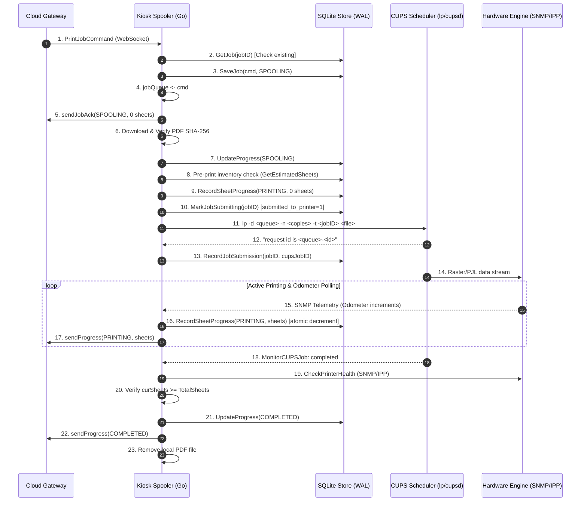
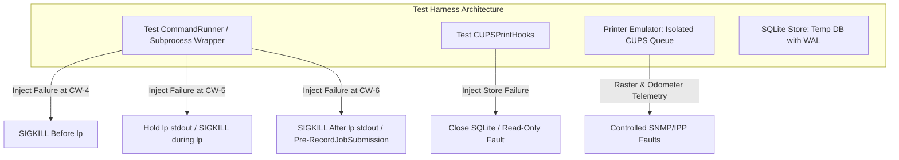

# D4c-1: Crash Window & Submission Safety Audit

**Repository:** `Shaabas/XeroxGo`  
**Branch:** `feat/crash-recovery-validation`  
**Base Commit:** `8cc541c` (post-D4b-3 merge)  
**Date:** November 2026  
**Auditor:** XeroxGo Core Engineering  
**Scope:** Kiosk spooler client (`kiosk-daemon/internal/spooler`), CUPS/IPP driver (`kiosk-daemon/internal/printer`), SQLite state store (`kiosk-daemon/internal/state`), and emulator test harness (`tools/printer-emulator`).

---

## 1. Executive Summary & Audit Scope

The XeroxGo kiosk daemon operates in an unattended retail environment where hardware power loss, kernel panics, process crashes (e.g. `SIGKILL`, OOM killer), and SQLite database lockups can occur at any millisecond during print job processing.

The core safety invariants of the printing system are:
1. **Zero Duplicate Printing:** Under no failure condition may the kiosk resubmit or replay an already-submitted job or reprint already-ejected pages without operator intervention.
2. **Authoritative Physical Proof:** No print job may transition to `COMPLETED` unless hardware SNMP/IPP telemetry confirms that physical media sheets ($\ge \text{TotalSheets}$) actually exited the printer engine.
3. **Fail-Closed Ambiguity:** Any interruption where printer submission or physical ejection is indeterminate must pause the job in `PAUSED_ERROR` with hold verification, halting further automatic execution.
4. **Inventory & Paper Monotonicity:** Paper tray decrementing must be atomic, monotonic, and idempotent across multiple crashes, re-admissions, or replayed progress updates.

This audit precisely traces the entire lifecycle from cloud command reception through CUPS submission, hardware printing, and durable completion. It identifies eight distinct crash windows, analyzes the divergence between SQLite state and CUPS scheduler state, investigates job title reconciliation and history purge behaviors, and provides a deterministic test matrix for D4c-2.

---

## 2. Complete State Transition & Lifecycle Sequence

The print job progression traverses five major systems:
- **Cloud Gateway:** WebSocket command dispatcher and status consumer.
- **Kiosk Memory:** In-memory queue (`jobQueue`), active reservations (`activeJobs`), deferred queue (`deferredJobs`).
- **SQLite Store:** Single-connection WAL-mode database (`PRAGMA synchronous=FULL`).
- **CUPS Scheduler:** Local IPP spooler (`cupsd`, `lp`, `lpstat`, `ipptool`).
- **Hardware Engine:** Physical printer mechanism, SNMP/IPP telemetry engine, paper tray sensor.



### Detailed Component State Across Lifecycle Steps

| Step | Operation | In-Memory (`activeJobs`) | SQLite `status` | SQLite `submitted` | SQLite `cups_job_id` | SQLite `sheets_printed` | CUPS State | Hardware State |
| :--- | :--- | :--- | :--- | :--- | :--- | :--- | :--- | :--- |
| **0** | Pre-arrival | Empty | None | 0 | `""` | 0 | None | Idle |
| **1** | `handleIncomingJob` | `true` | None | 0 | `""` | 0 | None | Idle |
| **2** | `SaveJob` committed | `true` | `SPOOLING` | 0 | `""` | 0 | None | Idle |
| **3** | `jobQueue` admission | `true` | `SPOOLING` | 0 | `""` | 0 | None | Idle |
| **4** | PDF Downloaded | `true` | `SPOOLING` | 0 | `""` | 0 | None | Idle |
| **5** | Pre-print check | `true` | `PRINTING` | 0 | `""` | 0 | None | Idle |
| **6** | `MarkJobSubmitting` | `true` | `PRINTING` | 1 | `""` | 0 | None | Idle |
| **7** | `lp` executing | `true` | `PRINTING` | 1 | `""` | 0 | Spooling / Accepted | Buffer empty |
| **8** | `lp` returned ID | `true` | `PRINTING` | 1 | `""` | 0 | `pending` / `processing` | Buffer loading |
| **9** | `RecordJobSubmission` | `true` | `PRINTING` | 1 | `<queue>-<id>` | 0 | `processing` | Printing sheet 1 |
| **10**| Sheet 1 confirmed | `true` | `PRINTING` | 1 | `<queue>-<id>` | 1 | `processing` | Sheet 1 ejected |
| **11**| All sheets output | `true` | `PRINTING` | 1 | `<queue>-<id>` | $N$ | `completed` | All ejected |
| **12**| `completeJob` committed | `false` | `COMPLETED` | 1 | `<queue>-<id>` | $N$ | `completed` | Idle |

---

## 3. Comprehensive Crash Window Matrix (CW-1 through CW-8)

This matrix maps every discrete failure boundary where process termination (`SIGKILL`, crash), system power loss, or database write failures can occur.

```
       [CW-1]        [CW-2]          [CW-3]          [CW-4]            [CW-5]              [CW-6]            [CW-7]            [CW-8]
Cloud -------> SQLite ------> Queue --------> PDF ----------> MarkJob ---------> lp -------------> RecordJob -------> Printing -------> Complete
Event          SaveJob        Admit           Download        Submitting         Execution          Submission         (Odometer)         & Cleanup
```

### Crash Window Table

| Window ID | Exact Code Boundary | Failure Modes | SQLite Knowledge | CUPS Knowledge | Physical Hardware | Current Restart Behavior | Safety Classification | Duplicate Risk |
| :--- | :--- | :--- | :--- | :--- | :--- | :--- | :--- | :--- |
| **CW-1** | Between network packet arrival and `store.SaveJob` (`client.go:1113`) | Crash, SIGKILL, Power cut, SQLite lock | None (row does not exist) | None | Idle | Daemon boots clean; no incomplete job found. Cloud command was unacknowledged; cloud re-dispatches. | Definitely Unsubmitted | None |
| **CW-2** | Between `store.SaveJob` and `jobQueue <- cmd` / `sendJobAck` (`client.go:1123-1145`) | Crash, SIGKILL, Queue full deadlock | `status = SPOOLING`, `submitted = 0`, `cups_id = ""`, `sheets = 0` | None | Idle | `isDefinitelyNotSubmitted` is `true` (`client.go:496`). Automatically re-enqueues `cmd` to `jobQueue` on startup. | Definitely Unsubmitted | None |
| **CW-3** | Worker dequeue to PDF download & checksum verification (`client.go:1583-1601`) | Network failure, Crash during download, Corrupted PDF | `status = SPOOLING`, `submitted = 0`, `cups_id = ""`, `sheets = 0` | None | Idle | `isDefinitelyNotSubmitted` is `true`. Kiosk re-enqueues job; worker re-downloads and verifies PDF SHA-256. | Definitely Unsubmitted | None |
| **CW-4** | `hooks.OnSubmitting` (`client.go:1838`) to `runner(ctx, "lp", ...)` (`cups.go:524`) | Crash after `MarkJobSubmitting` commits but before `lp` executes | `status = PRINTING`, `submitted = 1`, `cups_id = ""`, `sheets = 0` | None (0 jobs received) | Idle | `isDefinitelyNotSubmitted` is `false`. Falls to line 638 fallback: pauses in `PAUSED_ERROR` ("interrupted during printer submission"). **Does not resubmit**. | Ambiguous Submission (False Positive) | None (Fails Closed) |
| **CW-5** | `lp` invocation and CUPS acceptance window (`cups.go:524-527`) | `lp` forks, `cupsd` accepts spool file, process killed before `lp` returns stdout | `status = PRINTING`, `submitted = 1`, `cups_id = ""`, `sheets = 0` | Job accepted (`<queue>-<id>`), `pending` or `processing` | Buffer receiving data; sheet output possible | Falls to line 638 fallback: pauses in `PAUSED_ERROR`. **Does not resubmit**. **CRITICAL GAP:** Does NOT query CUPS by title, does NOT hold CUPS job; unmonitored printing continues. | Ambiguous Submission (True Subm. Unlinked) | None from kiosk; Unmonitored CUPS printing |
| **CW-6** | `lp` regex parsing to `RecordJobSubmission` commit (`client.go:1841-1854`, `cups.go:537-541`) | Process killed after `lp` returns request ID but before SQLite write commits | `status = PRINTING`, `submitted = 1`, `cups_id = ""` | Job active (`<queue>-<id>`) in CUPS | Actively printing | Same as CW-5: pauses in `PAUSED_ERROR` without resubmission, but fails to adopt or hold existing CUPS job. | Ambiguous Submission (True Subm. Unlinked) | None from kiosk; Unmonitored CUPS printing |
| **CW-7** | Active printing, SNMP odometer polling, `RecordSheetProgress` (`client.go:1762-1825`) | Power failure or crash mid-job (e.g. sheet $k$ of $N$) | `status = PRINTING`, `submitted = 1`, `cups_id = <id>`, `sheets = k` | Active, stopped, or held in CUPS | Sheet $k$ ejected; sheet $k+1$ in buffer | Startup checks `incomplete.CUPSJobID != ""`. If CUPS active, resumes monitoring without resubmit (`client.go:617`). If paused/fault, holds job and preserves $k$ verified sheets. | Definitely Submitted | None (Monotonic Resume/Hold) |
| **CW-8** | Printing finishes to durable `completeJob` commit & PDF removal (`client.go:1913-1945`) | Crash after CUPS completed and sheets ejected, but before SQLite `COMPLETED` | `status = PRINTING`, `submitted = 1`, `cups_id = <id>`, `sheets = N` | `completed` in CUPS | All $N$ sheets physically ejected | Startup queries CUPS (`completed`), verifies hardware healthy and `SheetsPrinted >= TotalSheets` (`client.go:586`), executes `completeJob`. | Definitely Submitted (Verified Output) | None (Self-Healing Completion) |

---

## 4. Deep-Dive Vulnerability & Gap Analysis

### 4.1. CW-5 & CW-6: The Unlinked Submission Window & Unmonitored Output Risk

#### Mechanism
In `processJob`, the submission hook sequence is:
```go
hooks := &printer.CUPSPrintHooks{
    OnSubmitting: func() error {
        return c.cfg.StateStore.MarkJobSubmitting(jobCtx, cmd.JobID) // sets submitted_to_printer=1
    },
    OnSubmitted: func(cupsJobID string) error {
        return c.cfg.StateStore.RecordJobSubmission(jobCtx, cmd.JobID, cupsJobID) // sets cups_job_id
    },
}
```
If process death or power loss occurs after `lp` transmits the job to `cupsd` but before `RecordJobSubmission` commits, SQLite persists:
- `submitted_to_printer = 1`
- `cups_job_id = ""`

#### Current Startup Recovery Behavior
In `client.go` lines 514–656:
```go
if strings.TrimSpace(c.cfg.CUPSQueue) != "" && incomplete.CUPSJobID != "" {
    // Reconcile with CUPS ...
} else {
    // Ambiguous submission (crash during lp submission or PJL stream without CUPS ID)
    reason := "interrupted during printer submission; physical output uncertain, manual reconciliation required"
    evt := contracts.JobProgressEvent{
        Status: contracts.JobStatusPausedError,
        ErrorReason: reason,
        ...
    }
    _ = c.cfg.StateStore.RecordSheetProgress(ctx, evt)
    c.sendProgress(ctx, evt)
}
```

#### The Vulnerability
1. **Protection Succeeded:** Startup recovery does **not** re-enqueue the job to `jobQueue`, preventing duplicate submission from XeroxGo.
2. **Defect Identified (Confirmed Defect 1):** Because `incomplete.CUPSJobID == ""`, the daemon enters the `else` fallback. It makes **no attempt to inspect the CUPS queue** or call `HoldAndVerifyCUPSJob`.
3. **Physical Consequence:** If `cupsd` accepted the job, CUPS continues processing the spool file. The physical printer prints and ejects all pages completely unmonitored. Meanwhile, XeroxGo has reported `PAUSED_ERROR` (0 sheets verified) to the cloud. An operator or customer may request a refund or re-dispatch the job, resulting in physical waste and duplicate customer delivery.

---

### 4.2. CUPS Job Title (`-t JobID`) Reconciliation Feasibility & Non-Uniqueness Risks

When `lp` is invoked in `cups.go:500-515`:
```go
lpArgs := []string{
    "-d", queue,
    "-n", strconv.Itoa(cmd.Copies),
    "-t", cmd.JobID, // Job title explicitly set to Cloud JobID
}
```
CUPS assigns `cmd.JobID` to the IPP `job-name` attribute.

#### Reconciliation Feasibility
When recovering an ambiguous submission with `submitted_to_printer == 1` and `cups_job_id == ""`:
1. Query CUPS active jobs via `lpstat -W not-completed -l -o <queue>` or IPP `get-jobs.test` for `<queue>`.
2. Inspect `job-name` attributes across all uncompleted jobs.
3. If exactly **one** active CUPS job has `job-name == cmd.JobID`:
   - Bind `cups_job_id` to that discovered request ID in SQLite.
   - Immediately issue `HoldAndVerifyCUPSJob` to arrest unmonitored printing.
   - Transition to `PAUSED_ERROR` with verified hold outcome.

#### Non-Uniqueness & Collision Constraints
CUPS does **not** enforce unique constraint checks on `job-name`. Multiple jobs can share the same title if:
- A previous execution or test harness submitted an identical title.
- An operator manually queued a job with that name.
- Multiple print copies were submitted under legacy logic.

**Safety Rule:**
- **Exact Single Match:** If and only if exactly one CUPS job matches `cmd.JobID`, adoption is safe.
- **Multiple Matches:** If $> 1$ jobs match `cmd.JobID`, adoption is ambiguous. The daemon must attempt to hold **all** matching jobs and mark `PAUSED_ERROR` citing "multiple matching CUPS jobs found for JobID; operator intervention required".
- **Zero Matches:** If 0 jobs match in the active queue, check the completed queue. If 0 jobs match anywhere, physical output cannot be assumed 0 if CUPS discards history (see Section 4.3).

---

### 4.3. CUPS History Retention vs. Discard (`PreserveJobHistory No`)

#### Configuration Variance
- `PreserveJobHistory Yes` (Standard CUPS default): Retains job metadata in `/var/spool/cups` until `MaxJobs` limit.
- `PreserveJobHistory No` (Hardened / Embedded / Ephemeral Linux): Purges job record immediately upon terminal state (`completed`, `canceled`, `aborted`).

#### Impact on XeroxGo Startup Recovery
In `cups.go:245-371`, `QueryCUPSJobInfo` queries `lpstat -W not-completed` followed by `lpstat -W completed`.
If `PreserveJobHistory No` is active, a job that finished printing during daemon reboot will disappear from both lists:
```go
if activeErr == nil && compErr == nil {
    return CUPSJobInfo{
        State:     CUPSJobStateUnknown,
        RawStatus: "job not listed in not-completed or completed",
    }, nil
}
```
In `client.go:619`:
```go
} else {
    // Reconciliation uncertain or job aborted/canceled in CUPS.
    reason := "interrupted printer submission; manual reconciliation required"
    ...
    evt.Status = contracts.JobStatusPausedError
    _ = c.cfg.StateStore.RecordSheetProgress(ctx, evt)
}
```

#### The Gap (Confirmed Defect 3)
Notice that lines 563–606 check physical proof:
```go
} else if qErr == nil && cupsInfo.State == printer.CUPSJobStateCompleted {
    ...
    if incomplete.SheetsPrinted >= incomplete.Command.TotalSheets {
        c.completeJob(ctx, incomplete.Command)
    }
}
```
If CUPS purged the job, `cupsInfo.State` is `CUPSJobStateUnknown`.
Even if SQLite durably recorded `SheetsPrinted == TotalSheets` prior to the crash, startup recovery **skips the completion branch** and demotes the fully printed job to `PAUSED_ERROR`!
**Required Invariant:** If `incomplete.SheetsPrinted >= incomplete.Command.TotalSheets` is already durably verified in SQLite, the job **must complete**, regardless of whether CUPS purged its history or returned `StateUnknown`, provided the printer engine is online and healthy.

---

### 4.4. Cloud Command Replay Matrix

When the cloud reconnects or re-dispatches a command (`PrintJobCommand`), `handleIncomingJob` (`client.go:880-1153`) processes it against the SQLite store:

| Stored Job State | Incoming Command Type | Action Taken | Dispatched to `jobQueue`? | `job_ack` Status | Local State Modified? | Duplicate Print Risk |
| :--- | :--- | :--- | :--- | :--- | :--- | :--- |
| **Completed** (`status=COMPLETED`) | Identical | Logs duplicate; sends `job_ack` | **No** | `COMPLETED` | No | None |
| **Completed** (`status=COMPLETED`) | Conflicting payload | `isConflictingDuplicate` = true | **No** | None (dropped) | No | None |
| **Submitted** (`submitted=1` or `cups_id!=""`) | Identical | Logs duplicate; sends `job_ack` | **No** | Current status | No | None |
| **Submitted** (`submitted=1` or `cups_id!=""`) | Conflicting payload | `isConflictingDuplicate` = true | **No** | None (dropped) | No | None |
| **Paused** (`status=PAUSED_ERROR`) | Identical | Logs duplicate; sends `job_ack` | **No** | `PAUSED_ERROR` | No | None |
| **In-Memory Active** | Identical | Logs duplicate; sends `job_ack` | **No** | `SP/PR` | No | None |
| **Unsubmitted** (`submitted=0`, `cups_id=""`, `sheets=0`) | Identical | Re-admits to `jobQueue` | **Yes** | `SPOOLING` | No (re-uses row) | None (fresh print) |
| **Unsubmitted** | Conflicting payload | `isConflictingDuplicate` = true | **No** | None (dropped) | No | None |
| **Store Lookup Error** | Any | Fails closed; drops command | **No** | None | No | None |

---

### 4.5. Partial Odometer Progress, Hardware Buffers, and Paper Stock Invariants

1. **Hardware Buffer vs. Physical Proof:**
   The printer engine's internal RAM buffer can hold 1 to 2 rasterized pages while printing. If power is lost or a fault occurs, buffered pages may either eject or be discarded by printer firmware on reset.
   XeroxGo's SNMP poller tracks `hrPrinterDetectedErrorState` and engine odometer counters.
   `RecordSheetProgress` strictly relies on confirmed odometer increments delivered to `onPage`.
2. **Paper Tray Decrement Atomicity:**
   In `store.go:303-430`, `RecordSheetProgress` updates `jobs` and `printer_state` in a single transaction:
   $$\Delta \text{Sheets} = \text{targetSheets} - \text{currentSheets}$$
   If $\Delta \text{Sheets} \le 0$, no decrement occurs (idempotent duplicate protection).
   If $\Delta \text{Sheets} > 0$, `estimated_sheets` is decremented with `WHERE estimated_sheets >= delta`.
   This ensures that double-callbacks or crash-recovery cycles never double-decrement paper inventory.

---

## 5. Deterministic Crash Injection Opportunities (D4c-2 Test Design)

To rigorously validate crash recovery in D4c-2 without physical printer wear or manual timing:



### Deterministic Interception Points
1. **Runner Wrapper Interception (`CommandRunner`):**
   Inject a mock or wrapping `CommandRunner` into `ClientConfig.CUPSRunner`. The wrapper can:
   - Synchronize on a channel when `lp` is called.
   - Return simulated `lp` output while immediately terminating the test daemon via `os.Kill` or `cancelCtx`.
   - Delay `lp` execution while an external process issues `SIGKILL`.
2. **Hook-Based Process Termination (`CUPSPrintHooks`):**
   - Inject `OnSubmitting` hook that triggers `syscall.Kill(syscall.Getpid(), syscall.SIGKILL)` to test CW-4.
   - Inject wrapper around `OnSubmitted` that kills process before calling `store.RecordJobSubmission` to test CW-6.
3. **Subprocess Isolation:**
   Execute the compiled `kiosk-daemon` or test binary as an `exec.Cmd`. The supervisor inspects file markers (e.g. SQLite WAL updates, CUPS queue presence) and sends `SIGKILL` or `SIGSTOP` deterministically.
4. **Queue Isolation:**
   All emulator tests target `XeroxGo_D3_Emulator`. The host physical printer (`DCPT310`) remains untouched.

---

## 6. Proposed D4c-2 Test Matrix

| Test ID | Test Scenario Name | Target Window | Injection Mechanism | Pre-Crash Condition | Restart Verification & Invariants |
| :--- | :--- | :--- | :--- | :--- | :--- |
| **D4c2-01** | `TestCrashRecovery_UnsubmittedJobRetriedCleanly` | CW-2 | Crash daemon immediately after `SaveJob` before worker dequeue | `status=SPOOLING`, `submitted=0`, `cups_id=""`, `sheets=0` | Startup recovery re-enqueues job; job prints to completion; exactly 1 CUPS job submitted; paper stock decremented by exact `TotalSheets`. |
| **D4c2-02** | `TestCrashRecovery_PreSubmissionCrash_FailsSafe` | CW-4 | Intercept `OnSubmitting`, commit `MarkJobSubmitting`, crash before `lp` | `status=PRINTING`, `submitted=1`, `cups_id=""`, `sheets=0` | Startup recovery marks `PAUSED_ERROR`; zero `lp` calls executed on restart; zero duplicate prints; queue empty. |
| **D4c2-03** | `TestCrashRecovery_LPAmbiguity_JobAdoptedOrHeld` | CW-5 | `lp` accepts job in CUPS; kill daemon before `OnSubmitted` | `status=PRINTING`, `submitted=1`, `cups_id=""`, CUPS has active job | Startup recovery detects unlinked submission; queries CUPS; holds active CUPS job; marks `PAUSED_ERROR`; zero duplicate prints. |
| **D4c2-04** | `TestCrashRecovery_PostLPSubmissionCrash_Reconciled` | CW-6 | `lp` completes, kill daemon during `OnSubmitted` before SQLite commit | `submitted=1`, `cups_id=""`, CUPS has `queue-xxx` | Startup queries CUPS by title; discovers `queue-xxx`; binds `cups_job_id`; holds job; verifies hold outcome in `PAUSED_ERROR`. |
| **D4c2-05** | `TestCrashRecovery_MidPrintCrash_ResumesMonitoring` | CW-7 | Print 2 of 4 sheets; kill daemon while CUPS job is `processing` | `submitted=1`, `cups_id=xxx`, `sheets=2`, CUPS `processing` | Startup resumes CUPS monitoring (`resumeCUPSMonitoring`); sheets 3 and 4 complete; verified total = 4; zero duplicate job submitted. |
| **D4c2-06** | `TestCrashRecovery_MidPrintCrashWithFault_PreservesSheets` | CW-7 | Print 1 of 3 sheets; inject paper jam; kill daemon | `submitted=1`, `cups_id=xxx`, `sheets=1`, CUPS `stopped` | Startup recovery preserves 1 sheet; rejects unverified CUPS counters; verifies hold; job stays `PAUSED_ERROR`; paper stock decremented by exactly 1. |
| **D4c2-07** | `TestCrashRecovery_CompletionCrash_CompletesWithProof` | CW-8 | All sheets printed, CUPS reports `completed`, kill before `completeJob` | `status=PRINTING`, `submitted=1`, `sheets=Total`, CUPS `completed` | Startup detects printer healthy and `SheetsPrinted >= TotalSheets`; completes job; deletes local PDF; sends `COMPLETED` ack. |
| **D4c2-08** | `TestCrashRecovery_PurgedCUPSHistory_HonorsPhysicalProof` | CW-8 / Purged | CUPS purges completed job (`StateUnknown`), SQLite has `SheetsPrinted == Total` | `status=PRINTING`, `cups_id=xxx`, `sheets=Total`, CUPS 404/unknown | Startup recognizes full physical proof; self-heals to `COMPLETED` rather than demoting to `PAUSED_ERROR`. |
| **D4c2-09** | `TestCrashRecovery_ReplayedCommand_IdempotentAck` | Replay | Replay identical command after daemon reboot for completed/paused job | Job in `COMPLETED` or `PAUSED_ERROR` | Kiosk returns immediate `job_ack` with stored state; never re-enqueues; never resubmits. |
| **D4c2-10** | `TestCrashRecovery_ConflictingCommand_Rejected` | Replay | Replay conflicting command (different checksum/pages) for stored job | Job in SQLite store | Kiosk rejects conflicting command; logs payload mismatch; does not alter stored job or queue. |

---

## 7. Categorized Inventory of Findings

### 7.1. Confirmed Defects
1. **Unmonitored CUPS Spooling on Ambiguous Submission Crash (CW-5 / CW-6):**  
   *Code Reference:* `kiosk-daemon/internal/spooler/client.go:638-657`  
   *Description:* When `submitted_to_printer == 1` but `cups_job_id == ""`, restart recovery immediately pauses the job in SQLite but makes zero calls to CUPS. If `cupsd` accepted the job, printing proceeds completely unmonitored.
2. **Missing Job Title (`-t JobID`) Reconciliation:**  
   *Code Reference:* `kiosk-daemon/internal/spooler/client.go:514` & `cups.go:503`  
   *Description:* Although jobs are submitted with `-t cmd.JobID`, restart recovery never queries CUPS by title when `cups_job_id` is blank, forfeiting the ability to adopt and hold orphaned active jobs.
3. **Purged CUPS History False Pause on Completed Jobs:**  
   *Code Reference:* `kiosk-daemon/internal/spooler/client.go:563-636`  
   *Description:* If CUPS purges completed jobs (`PreserveJobHistory No`), `QueryCUPSJobInfo` returns `StateUnknown`. Lines 619–636 unconditionally mark `PAUSED_ERROR`, ignoring whether physical odometer proof (`SheetsPrinted >= TotalSheets`) was already durably recorded.

### 7.2. Untested Risks
1. **Unsynchronized File System Write Window:**  
   If OS power loss occurs before SQLite's WAL page flushes to non-volatile disk, `submitted_to_printer` could remain `0` while `lp` succeeded in transmitting data. On reboot, `isDefinitelyNotSubmitted` would evaluate to `true` and resubmit a duplicate. (Mitigated by SQLite `PRAGMA synchronous=FULL`, but needs power-cut simulation).
2. **CUPS Job Title Collisions:**  
   If title reconciliation is implemented, multiple jobs matching the same title must be detected and treated as ambiguous rather than blindly adopting the first match.
3. **Unacknowledged Completion on Network Disconnect:**  
   If `completeJob` executes and the PDF is deleted, but network disconnection prevents `sendProgress(COMPLETED)` from reaching the cloud, cloud state remains `PRINTING` until command replay occurs.

### 7.3. Existing Protections (Verified Robust)
1. **Fail-Closed Ambiguous Submission:**  
   *Code Reference:* `kiosk-daemon/internal/spooler/client.go:496-513, 638-657`  
   *Description:* The daemon strictly requires `!submitted && cups_job_id == "" && sheets == 0 && pages == 0 && error == ""` before retrying a job. Any ambiguity halts automatic resubmission.
2. **Physical Proof Requirement for Completion:**  
   *Code Reference:* `kiosk-daemon/internal/spooler/client.go:586-606, 1913-1922`  
   *Description:* Hardware odometer sheets must satisfy `curSheets >= cmd.TotalSheets`. CUPS scheduler completion alone is explicitly rejected as proof of delivery.
3. **Authoritative Sheet Monotonicity & Paper Stock Safety:**  
   *Code Reference:* `kiosk-daemon/internal/state/store.go:303-430`  
   *Description:* `RecordSheetProgress` runs in an atomic SQLite transaction with monotonic clamping, preventing double-decrementing of paper stock across repeated callbacks or crashes.
4. **Duplicate & Conflicting Command Rejection:**  
   *Code Reference:* `kiosk-daemon/internal/spooler/client.go:919-976`  
   *Description:* Completed, submitted, and paused jobs acknowledge replayed commands via `job_ack` without resubmitting. Conflicting payloads are detected and dropped.

---

## 8. Conclusion & Next Steps for D4c-2

This audit establishes the theoretical and empirical map of all crash boundaries in the XeroxGo print subsystem. The system exhibits high resilience against duplicate printing due to fail-closed state evaluation, but suffers from unmonitored physical spooling when crashes interrupt the `lp` submission window.

**Action Plan for D4c-2:**
1. Implement test-only crash injection hooks and runner wrappers for the 10 proposed scenarios.
2. Validate existing protections and confirm the mapped crash behaviors against the isolated emulator queue.
3. Prepare implementation patches for the confirmed defects (CUPS title adoption, hold on ambiguous recovery, and purged history completion handling).
