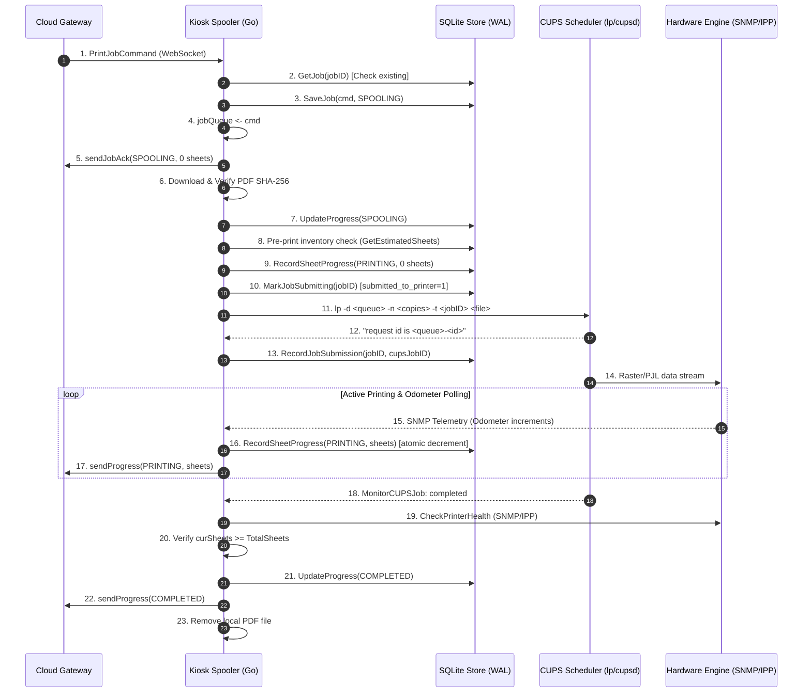
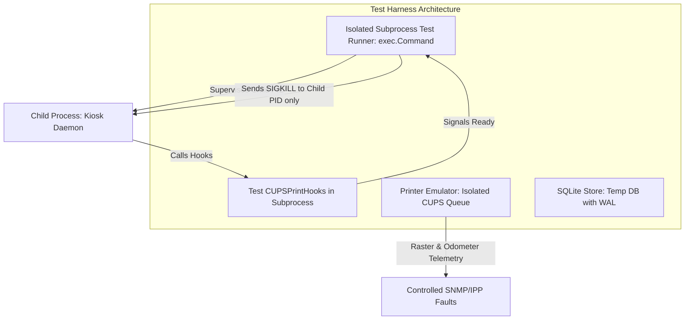

# D4c-1: Crash Window & Submission Safety Audit

**Repository:** `Shaabas/XeroxGo`  
**Branch:** `feat/crash-recovery-validation`  
**Base Commit:** `8cc541c` (post-D4b-3 merge)  
**Date:** November 2026  
**Auditor:** XeroxGo Core Engineering  
**Scope:** Kiosk spooler client (`kiosk-daemon/internal/spooler`), CUPS/IPP driver (`kiosk-daemon/internal/printer`), SQLite state store (`kiosk-daemon/internal/state`), and emulator test harness (`tools/printer-emulator`).

---

## 1. Executive Summary & Audit Scope

The XeroxGo kiosk daemon operates in an unattended retail environment where hardware power loss, kernel panics, process crashes (e.g. `SIGKILL`, OOM killer), and SQLite database lockups can occur at any millisecond during print job processing.

The core safety invariants of the printing system are:
1. **Zero Duplicate Printing:** Under no failure condition may the kiosk resubmit or replay an already-submitted job or reprint already-ejected pages without explicit operator intervention.
2. **Authoritative Physical Proof:** No print job may transition to `COMPLETED` unless hardware SNMP/IPP telemetry confirms that physical media sheets ($\ge \text{TotalSheets}$) actually exited the printer engine.
3. **Fail-Closed Ambiguity:** Any interruption where printer submission, scheduler tracking, or physical ejection is indeterminate must pause the job in `PAUSED_ERROR` with hold verification, halting further automatic execution.
4. **Inventory & Paper Monotonicity:** Paper tray decrementing must be atomic, monotonic, and idempotent across multiple crashes, re-admissions, or replayed progress updates.

This audit traces the entire lifecycle from cloud command reception through CUPS submission, hardware printing, and durable completion. It identifies eight distinct crash windows, analyzes the divergence between SQLite state and CUPS scheduler state, investigates job title reconciliation and history purge behaviors, evaluates SQLite WAL durability guarantees, uncovers single-job query limits in recovery, and establishes a validation-only test design for D4c-2.

> [!IMPORTANT]
> **Validation-Only Scope for D4c-2:**  
> D4c-2 is strictly a test validation and characterization phase of the *existing* production codebase. It must assert existing production behavior and document defects empirically; it does **not** assume proposed fixes exist, nor does it authorize automatic job adoption, automatic resubmission, or automatic completion without scheduler and physical confirmation.

---

## 2. Complete State Transition & Lifecycle Sequence

The print job progression traverses five major systems:
- **Cloud Gateway:** WebSocket command dispatcher and status consumer.
- **Kiosk Memory:** In-memory queue (`jobQueue`), active reservations (`activeJobs`), deferred queue (`deferredJobs`).
- **SQLite Store:** Single-connection WAL-mode database (`PRAGMA synchronous=FULL`).
- **CUPS Scheduler:** Local IPP spooler (`cupsd`, `lp`, `lpstat`, `ipptool`).
- **Hardware Engine:** Physical printer mechanism, SNMP/IPP telemetry engine, paper tray sensor.



### Detailed Component State Across Lifecycle Steps

| Step | Operation | In-Memory (`activeJobs`) | SQLite `status` | SQLite `submitted` | SQLite `cups_job_id` | SQLite `sheets_printed` | CUPS State | Hardware State |
| :--- | :--- | :--- | :--- | :--- | :--- | :--- | :--- | :--- |
| **0** | Pre-arrival | Empty | None | 0 | `""` | 0 | None | Idle |
| **1** | `handleIncomingJob` | `true` | None | 0 | `""` | 0 | None | Idle |
| **2** | `SaveJob` committed | `true` | `SPOOLING` | 0 | `""` | 0 | None | Idle |
| **3** | `jobQueue` admission | `true` | `SPOOLING` | 0 | `""` | 0 | None | Idle |
| **4** | PDF Downloaded | `true` | `SPOOLING` | 0 | `""` | 0 | None | Idle |
| **5** | Pre-print check | `true` | `PRINTING` | 0 | `""` | 0 | None | Idle |
| **6** | `MarkJobSubmitting` | `true` | `PRINTING` | 1 | `""` | 0 | None | Idle |
| **7** | `lp` executing | `true` | `PRINTING` | 1 | `""` | 0 | Spooling / Accepted | Buffer empty |
| **8** | `lp` returned ID | `true` | `PRINTING` | 1 | `""` | 0 | `pending` / `processing` | Buffer loading |
| **9** | `RecordJobSubmission` | `true` | `PRINTING` | 1 | `<queue>-<id>` | 0 | `processing` | Printing sheet 1 |
| **10**| Sheet 1 confirmed | `true` | `PRINTING` | 1 | `<queue>-<id>` | 1 | `processing` | Sheet 1 ejected |
| **11**| All sheets output | `true` | `PRINTING` | 1 | `<queue>-<id>` | $N$ | `completed` | All ejected |
| **12**| `completeJob` committed | `false` | `COMPLETED` | 1 | `<queue>-<id>` | $N$ | `completed` | Idle |

---

## 3. Comprehensive Crash Window Matrix (CW-1 through CW-8)

This matrix maps every discrete failure boundary where process termination (`SIGKILL`, application crash), system power loss, or database write failures can occur.

```
       [CW-1]        [CW-2]          [CW-3]          [CW-4]            [CW-5]              [CW-6]            [CW-7]            [CW-8]
Cloud -------> SQLite ------> Queue --------> PDF ----------> MarkJob ---------> lp -------------> RecordJob -------> Printing -------> Complete
Event          SaveJob        Admit           Download        Submitting         Execution          Submission         (Odometer)         & Cleanup
```

### Crash Window Table

| Window ID | Exact Code Boundary | Failure Modes | SQLite Knowledge | CUPS Knowledge | Physical Hardware | Current Restart Behavior | Safety Classification | Duplicate Risk |
| :--- | :--- | :--- | :--- | :--- | :--- | :--- | :--- | :--- |
| **CW-1** | Between network packet arrival and `store.SaveJob` (`client.go:1113`) | Crash, SIGKILL, Power cut, SQLite lock | None (row does not exist) | None | Idle | Daemon boots clean; no incomplete job found. Cloud command was unacknowledged; cloud re-dispatches. | Definitely Unsubmitted | None |
| **CW-2** | Between `store.SaveJob` and `jobQueue <- cmd` / `sendJobAck` (`client.go:1123-1145`) | Crash, SIGKILL, Queue full deadlock | `status = SPOOLING`, `submitted = 0`, `cups_id = ""`, `sheets = 0` | None | Idle | `isDefinitelyNotSubmitted` is `true` (`client.go:496`). Automatically re-enqueues `cmd` to `jobQueue` on startup. | Definitely Unsubmitted | None |
| **CW-3** | Worker dequeue to PDF download & checksum verification (`client.go:1583-1601`) | Network failure, Crash during download, Corrupted PDF | `status = SPOOLING`, `submitted = 0`, `cups_id = ""`, `sheets = 0` | None | Idle | `isDefinitelyNotSubmitted` is `true`. Kiosk re-enqueues job; worker re-downloads and verifies PDF SHA-256. | Definitely Unsubmitted | None |
| **CW-4** | `hooks.OnSubmitting` (`client.go:1838`) to `runner(ctx, "lp", ...)` (`cups.go:524`) | Crash after `MarkJobSubmitting` commits but before `lp` executes | `status = PRINTING`, `submitted = 1`, `cups_id = ""`, `sheets = 0` | None (0 jobs received) | Idle | `isDefinitelyNotSubmitted` is `false`. Falls to line 638 fallback: pauses in `PAUSED_ERROR` ("interrupted during printer submission"). **Does not resubmit**. | Ambiguous Submission (False Positive) | None (Fails Closed) |
| **CW-5** | `lp` invocation and CUPS acceptance window (`cups.go:524-527`) | `lp` forks, `cupsd` accepts spool file, process killed before `lp` returns stdout | `status = PRINTING`, `submitted = 1`, `cups_id = ""`, `sheets = 0` | Job accepted (`<queue>-<id>`), `pending` or `processing` | Buffer receiving data; sheet output possible | Falls to line 638 fallback: pauses in `PAUSED_ERROR`. **Does not resubmit**. **CRITICAL GAP (Highest Priority):** Lacks `cups_job_id`; makes no CUPS queries; does not hold CUPS job; unmonitored printing continues. | Ambiguous Submission (Highest Priority Unlinked Active Job) | None from kiosk; Unmonitored CUPS printing |
| **CW-6** | `lp` regex parsing to `RecordJobSubmission` commit (`client.go:1841-1854`, `cups.go:537-541`) | Process killed after `lp` returns request ID but before SQLite write commits | `status = PRINTING`, `submitted = 1`, `cups_id = ""` | Job active (`<queue>-<id>`) in CUPS | Actively printing | Same as CW-5: pauses in `PAUSED_ERROR` without resubmission, but fails to adopt or hold existing CUPS job. | Ambiguous Submission (Highest Priority Unlinked Active Job) | None from kiosk; Unmonitored CUPS printing |
| **CW-7** | Active printing, SNMP odometer polling, `RecordSheetProgress` (`client.go:1762-1825`) | Power failure or crash mid-job (e.g. sheet $k$ of $N$) | `status = PRINTING`, `submitted = 1`, `cups_id = <id>`, `sheets = k` | Active, stopped, or held in CUPS | Sheet $k$ ejected; sheet $k+1$ in buffer | Startup checks `incomplete.CUPSJobID != ""`. If CUPS active, resumes monitoring without resubmit (`client.go:617`). If paused/fault, holds job and preserves $k$ verified sheets. | Definitely Submitted | None (Monotonic Resume/Hold) |
| **CW-8** | Printing finishes to durable `completeJob` commit & PDF removal (`client.go:1913-1945`) | Crash after CUPS completed and sheets ejected, but before SQLite `COMPLETED` | `status = PRINTING`, `submitted = 1`, `cups_id = <id>`, `sheets = N` | `completed` in CUPS | All $N$ sheets physically ejected | Startup queries CUPS (`completed`), verifies hardware healthy and `SheetsPrinted >= TotalSheets` (`client.go:586`), executes `completeJob`. | Definitely Submitted (Verified Output) | None (Self-Healing Completion) |

---

## 4. Deep-Dive Vulnerability & Gap Analysis

### 4.1. CW-5 & CW-6: Highest-Priority Unlinked CUPS Submission Risk

#### Mechanism
In `processJob`, the submission hook sequence is:
```go
hooks := &printer.CUPSPrintHooks{
    OnSubmitting: func() error {
        return c.cfg.StateStore.MarkJobSubmitting(jobCtx, cmd.JobID) // sets submitted_to_printer=1
    },
    OnSubmitted: func(cupsJobID string) error {
        return c.cfg.StateStore.RecordJobSubmission(jobCtx, cmd.JobID, cupsJobID) // sets cups_job_id
    },
}
```
If process death occurs after `lp` transmits the print file to `cupsd` but before `RecordJobSubmission` commits, SQLite persists:
- `submitted_to_printer = 1`
- `cups_job_id = ""`

#### Current Startup Recovery Behavior
In `client.go` lines 514–656:
```go
if strings.TrimSpace(c.cfg.CUPSQueue) != "" && incomplete.CUPSJobID != "" {
    // Reconcile with CUPS ...
} else {
    // Ambiguous submission (crash during lp submission or PJL stream without CUPS ID)
    reason := "interrupted during printer submission; physical output uncertain, manual reconciliation required"
    evt := contracts.JobProgressEvent{
        Status: contracts.JobStatusPausedError,
        ErrorReason: reason,
        ...
    }
    _ = c.cfg.StateStore.RecordSheetProgress(ctx, evt)
    c.sendProgress(ctx, evt)
}
```

#### The Vulnerability
1. **Protection Succeeded:** Startup recovery does **not** re-enqueue the job to `jobQueue`, preventing duplicate submission from XeroxGo.
2. **Defect Identified (Confirmed Defect 1 — Highest Priority):** Because `incomplete.CUPSJobID == ""`, the daemon enters the line 638 `else` fallback. It makes **no attempt to inspect the CUPS queue** and cannot call `HoldAndVerifyCUPSJob` because it does not have a job ID.
3. **Physical Consequence:** If `cupsd` accepted the job, CUPS continues rasterizing and transmitting the job to the printer engine. The physical printer prints and ejects all pages completely unmonitored. Meanwhile, XeroxGo has reported `PAUSED_ERROR` (0 sheets verified) to the cloud. An operator or customer may request a refund or re-dispatch the job, resulting in physical waste and duplicate customer delivery.

---

### 4.2. CUPS Job Title (`-t JobID`): Analysis as an Unverified Recovery Strategy

When `lp` is invoked in `cups.go:500-515`:
```go
lpArgs := []string{
    "-d", queue,
    "-n", strconv.Itoa(cmd.Copies),
    "-t", cmd.JobID, // Job title set to Cloud JobID
}
```
CUPS assigns `cmd.JobID` to the IPP `job-name` attribute.

#### Why a Matching CUPS Job Title DOES NOT Prove Ownership
It is tempting to propose that if XeroxGo finds an active CUPS job whose title matches `cmd.JobID`, it can simply adopt that CUPS job ID. **This assumption is unsafe and technically flawed:**
1. **Titles Are Non-Authoritative Client Strings:** CUPS job titles (`job-name`) are arbitrary strings supplied by print clients. CUPS does not validate, authenticate, or restrict job titles.
2. **No Uniqueness Enforcement:** CUPS permits arbitrarily many jobs with identical titles.
3. **Risk of Adopting Unrelated or Stale Jobs:**
   - A previous execution, a manual test script, or an unprivileged local user could submit a job with title `cmd.JobID`.
   - If an orphaned job remained from an earlier reboot, an identical title would not prove it belongs to the current transaction.
   - The payload, copy count, duplex mode, or user identity of the matching CUPS job might differ entirely from the stored job.
4. **Adversarial / Cross-Process Spoofing:** Any local process connecting to `localhost:631` could create a job titled `cmd.JobID`. Blind adoption would cause XeroxGo to bind to an untrusted job.

#### Classification: Unverified Recovery Strategy
Title-based adoption must be classified strictly as an **unverified recovery strategy**. Before any adoption logic could ever be considered, it would require:
- Collision tests (multiple jobs with identical titles).
- Stale-job tests (matching title from an old discarded job vs. a new active job).
- Strict validation that D4c-2 asserts **current behavior** (which does not perform title adoption) rather than assuming adoption is active.

---

### 4.3. CUPS History Retention vs. Discard (`PreserveJobHistory No`) & Completion Evidence

#### Configuration Variance
- `PreserveJobHistory Yes` (Standard CUPS default): Retains job metadata in `/var/spool/cups` until `MaxJobs` limit.
- `PreserveJobHistory No` (Hardened / Embedded / Ephemeral Linux): Purges job record immediately upon terminal state (`completed`, `canceled`, `aborted`).

#### Current Startup Recovery Behavior
In `cups.go:245-371`, `QueryCUPSJobInfo` queries `lpstat -W not-completed` followed by `lpstat -W completed`.
If `PreserveJobHistory No` is active, a job that completed during daemon reboot disappears from both lists:
```go
if activeErr == nil && compErr == nil {
    return CUPSJobInfo{
        State:     CUPSJobStateUnknown,
        RawStatus: "job not listed in not-completed or completed",
    }, nil
}
```
In `client.go:619-636`:
```go
} else {
    // Reconciliation uncertain or job aborted/canceled in CUPS.
    reason := "interrupted printer submission; manual reconciliation required"
    ...
    evt.Status = contracts.JobStatusPausedError
    _ = c.cfg.StateStore.RecordSheetProgress(ctx, evt)
}
```

#### Safe Fail-Closed Behavior (Not an Automatic Completion Opportunity)
In an earlier assessment, it was suggested that if SQLite recorded `SheetsPrinted >= TotalSheets`, the daemon should automatically complete the job when CUPS returns `StateUnknown`. **This recommendation is unsafe and is explicitly retracted.**

Demoting to `PAUSED_ERROR` when CUPS state is unknown is a **correct fail-closed safety protection**. When CUPS history is unavailable:
- The scheduler cannot confirm whether the print stream completed normally or aborted.
- The printer engine could have power-cycled, discarded raster data, or experienced an unlogged fault.
- Persisted sheet counts alone do not prove that the specific job's entire physical output exited cleanly without defects.

#### Additional Evidence Required Before Completion Can Ever Be Trusted
For an interrupted print job to transition to `COMPLETED` when scheduler history is absent, the following multi-factor evidence hierarchy is strictly required:
1. **Corroborated Engine Odometer Deltas:** Direct hardware telemetry proving that the engine odometer incremented by exactly `TotalSheets` during the specific job execution window, with start and end timestamps bounding the job.
2. **Continuous Hardware Health Invariant:** Authoritative evidence that the engine remained continuously online and reported zero media jams, cover-open events, paper-out states, or power-reset markers between submission and recovery.
3. **Hardware Job Log Corroboration:** Engine-level job accounting log (via PJL, SNMP, or IPP job log) confirming the exact document hash and sheet ejection count.
4. **Interleaving Absence Proof:** Proof that no other print job (local or remote) executed on the engine between the recorded start and completion.
5. **Operator or Cloud Confirmation:** In the absence of the above four factors, **falling closed to `PAUSED_ERROR` is the only safe and acceptable action.**

---

### 4.4. SQLite WAL & Durability Guarantees

#### Durability Configuration
XeroxGo configures SQLite in `store.go:81-105`:
- `PRAGMA journal_mode=WAL;`
- `PRAGMA synchronous=FULL;`
- `db.SetMaxOpenConns(1)`

#### Distinguishing Process Crashes from Storage Hardware Failures
1. **Ordinary Process Crashes (`SIGKILL`, application panic, OOM killer, `exit(1)`):**
   - Under `synchronous=FULL`, SQLite issues an `fsync()` on the WAL file before every transaction commit completes.
   - The Linux kernel page cache preserves all committed WAL pages in system memory even when a process is killed abruptly.
   - Committed transactions (`SaveJob`, `MarkJobSubmitting`, `RecordJobSubmission`, `RecordSheetProgress`) **cannot be lost** during ordinary process crashes.
   - On restart, SQLite's WAL recovery automatically replays committed transactions from the WAL file into the main database. Uncommitted transactions roll back cleanly.
2. **Storage Controller / Hardware Power Loss:**
   - Only physical power loss (where drive volatile write caches lose unwritten blocks), kernel panics that freeze the OS filesystem layer, or flash storage hardware corruption can cause committed writes to be lost.
   - In D4c-2 testing, process crashes simulated via POSIX signals (`SIGKILL`) validate software recovery under fully durable SQLite commits. True power-cut simulation represents an out-of-band hardware test.

---

### 4.5. Single-Row Recovery Limit Gap in `GetIncompleteJob()`

#### Code Inspection
In `store.go:524-533`:
```sql
SELECT job_id, kiosk_id, display_code, download_url, sha256_checksum,
       total_pages, total_sheets, copies, duplex, start_from_page,
       status, pages_printed, sheets_printed, error_reason,
       cups_job_id, submitted_to_printer, updated_at_ns
FROM jobs
WHERE status IN ('SPOOLING', 'PRINTING', 'PAUSED_ERROR')
ORDER BY updated_at_ns DESC, job_id ASC
LIMIT 1;
```

#### The Gap (Confirmed Defect 2)
The query executes `LIMIT 1`.
If multiple jobs exist in incomplete states (for example, Job 1 in `PAUSED_ERROR` from a previous fault, and Job 2 in `PRINTING` when the daemon crashed):
- `GetIncompleteJob()` returns **only the single most recently updated job** (Job 2).
- Startup recovery in `client.go:494-658` reconciles Job 2 and then proceeds immediately to starting workers and accepting new cloud connections.
- **Job 1 is completely ignored.** It is never inspected, its CUPS job is never checked or held, and no progress event is dispatched to the cloud for it.
- If Job 1 had an active CUPS job running, that job remains orphaned and unmonitored.

---

### 4.6. Cloud Command Replay Matrix

When the cloud reconnects or re-dispatches a command (`PrintJobCommand`), `handleIncomingJob` (`client.go:880-1153`) processes it against the SQLite store:

| Stored Job State | Incoming Command Type | Action Taken | Dispatched to `jobQueue`? | `job_ack` Status | Local State Modified? | Duplicate Print Risk |
| :--- | :--- | :--- | :--- | :--- | :--- | :--- |
| **Completed** (`status=COMPLETED`) | Identical | Logs duplicate; sends `job_ack` | **No** | `COMPLETED` | No | None |
| **Completed** (`status=COMPLETED`) | Conflicting payload | `isConflictingDuplicate` = true | **No** | None (dropped) | No | None |
| **Submitted** (`submitted=1` or `cups_id!=""`) | Identical | Logs duplicate; sends `job_ack` | **No** | Current status | No | None |
| **Submitted** (`submitted=1` or `cups_id!=""`) | Conflicting payload | `isConflictingDuplicate` = true | **No** | None (dropped) | No | None |
| **Paused** (`status=PAUSED_ERROR`) | Identical | Logs duplicate; sends `job_ack` | **No** | `PAUSED_ERROR` | No | None |
| **In-Memory Active** | Identical | Logs duplicate; sends `job_ack` | **No** | `SP/PR` | No | None |
| **Unsubmitted** (`submitted=0`, `cups_id=""`, `sheets=0`) | Identical | Re-admits to `jobQueue` | **Yes** | `SPOOLING` | No (re-uses row) | None (fresh print) |
| **Unsubmitted** | Conflicting payload | `isConflictingDuplicate` = true | **No** | None (dropped) | No | None |
| **Store Lookup Error** | Any | Fails closed; drops command | **No** | None | No | None |

---

### 4.7. Partial Odometer Progress, Hardware Buffers, and Paper Stock Invariants

1. **Hardware Buffer vs. Physical Proof:**
   The printer engine's internal RAM buffer can hold 1 to 2 rasterized pages while printing. If power is lost or a fault occurs, buffered pages may either eject or be discarded by printer firmware on reset.
   XeroxGo's SNMP poller tracks `hrPrinterDetectedErrorState` and engine odometer counters.
   `RecordSheetProgress` strictly relies on confirmed odometer increments delivered to `onPage`.
2. **Paper Tray Decrement Atomicity:**
   In `store.go:303-430`, `RecordSheetProgress` updates `jobs` and `printer_state` in a single transaction:
   $$\Delta \text{Sheets} = \text{targetSheets} - \text{currentSheets}$$
   If $\Delta \text{Sheets} \le 0$, no decrement occurs (idempotent duplicate protection).
   If $\Delta \text{Sheets} > 0$, `estimated_sheets` is decremented with `WHERE estimated_sheets >= delta`.
   This ensures that double-callbacks or crash-recovery cycles never double-decrement paper inventory.

---

## 5. Deterministic Crash Injection Opportunities (D4c-2 Test Design)

To rigorously validate crash recovery in D4c-2 without physical printer wear or manual timing:



### Safety Rules for Subprocess Crash Testing
> [!CAUTION]
> **Subprocess Isolation & Process Signal Restrictions:**
> 1. **Isolated Subprocesses Only:** Any test simulating real process termination (`SIGKILL`, `SIGTERM`, `SIGSTOP`) must execute the target daemon or worker as an **isolated child subprocess** using Go's `exec.Command`.
> 2. **Never Signal Test Runner:** Tests must **never** call `syscall.Kill(syscall.Getpid(), ...)` or terminate the parent test runner process.
> 3. **Never Signal System Daemons:** Tests must **never** signal the host CUPS daemon (`cupsd`) or unrelated system processes.
> 4. **Host Printer Untouched:** All tests must target the isolated emulator queue `XeroxGo_D3_Emulator`. The host physical printer (`DCPT310`) must remain untouched and idle.

---

## 6. Proposed D4c-2 Test Matrix (Validation-Only)

> [!NOTE]
> All D4c-2 tests must assert the **existing behavior of the current codebase** and document defects empirically. They must **not** assume proposed fixes (such as automatic title adoption or multi-job recovery loops) already exist.

| Test ID | Test Scenario Name | Target Window | Injection Mechanism | Pre-Crash Condition | Existing Behavior Assertions & Invariants |
| :--- | :--- | :--- | :--- | :--- | :--- |
| **D4c2-01** | `TestCrashRecovery_UnsubmittedJobRetriedCleanly` | CW-2 | Terminate subprocess after `SaveJob` before worker dequeue | `status=SPOOLING`, `submitted=0`, `cups_id=""`, `sheets=0` | Assert startup recovery detects `isDefinitelyNotSubmitted==true`; re-enqueues job; job prints to completion; exactly 1 CUPS job submitted; paper stock decremented by exact `TotalSheets`. |
| **D4c2-02** | `TestCrashRecovery_PreSubmissionCrash_FailsSafe` | CW-4 | Intercept `OnSubmitting`, commit `MarkJobSubmitting`, terminate subprocess before `lp` | `status=PRINTING`, `submitted=1`, `cups_id=""`, `sheets=0` | Assert existing behavior: startup recovery marks `PAUSED_ERROR`; zero `lp` calls executed on restart; zero duplicate prints; queue empty. |
| **D4c2-03** | `TestCrashRecovery_LPAmbiguity_DocumentsUnmonitoredSpooling` | CW-5 | `lp` accepts job in CUPS emulator; terminate subprocess before `OnSubmitted` | `status=PRINTING`, `submitted=1`, `cups_id=""`, CUPS has active job | Assert existing behavior: startup recovery marks `PAUSED_ERROR` without holding CUPS job; documents defect that CUPS job continues unmonitored; zero duplicate submissions from kiosk. |
| **D4c2-04** | `TestCrashRecovery_PostLPSubmissionCrash_DocumentsUnlinkedJob` | CW-6 | `lp` completes, terminate subprocess during `OnSubmitted` before SQLite commit | `submitted=1`, `cups_id=""`, CUPS has `queue-xxx` | Assert existing behavior: startup pauses in `PAUSED_ERROR`; does not adopt CUPS job; documents defect that active job is unlinked. |
| **D4c2-05** | `TestCrashRecovery_MidPrintCrash_ResumesMonitoring` | CW-7 | Print 2 of 4 sheets; terminate subprocess while CUPS job is `processing` | `submitted=1`, `cups_id=xxx`, `sheets=2`, CUPS `processing` | Assert existing behavior: startup resumes CUPS monitoring (`resumeCUPSMonitoring`); sheets 3 and 4 complete; verified total = 4; zero duplicate job submitted. |
| **D4c2-06** | `TestCrashRecovery_MidPrintCrashWithFault_PreservesSheets` | CW-7 | Print 1 of 3 sheets; inject paper jam; terminate subprocess | `submitted=1`, `cups_id=xxx`, `sheets=1`, CUPS `stopped` | Assert existing behavior: startup preserves 1 verified sheet; rejects unverified CUPS counters; verifies hold; job stays `PAUSED_ERROR`; paper stock decremented by exactly 1. |
| **D4c2-07** | `TestCrashRecovery_CompletionCrash_CompletesWithProof` | CW-8 | All sheets printed, CUPS reports `completed`, terminate before `completeJob` | `status=PRINTING`, `submitted=1`, `sheets=Total`, CUPS `completed` | Assert existing behavior: startup detects printer healthy and `SheetsPrinted >= TotalSheets`; completes job; deletes local PDF; sends `COMPLETED` ack. |
| **D4c2-08** | `TestCrashRecovery_PurgedCUPSHistory_AssertsFailClosedPause` | CW-8 / Purged | CUPS purges completed job (`StateUnknown`), SQLite has `SheetsPrinted == Total` | `status=PRINTING`, `cups_id=xxx`, `sheets=Total`, CUPS 404/unknown | Assert existing behavior: startup marks `PAUSED_ERROR` (fail-closed); does **not** complete automatically without scheduler confirmation. |
| **D4c2-09** | `TestCrashRecovery_ReplayedCommand_IdempotentAck` | Replay | Replay identical command after daemon reboot for completed/paused job | Job in `COMPLETED` or `PAUSED_ERROR` | Assert existing behavior: kiosk returns immediate `job_ack` with stored state; never re-enqueues; never resubmits. |
| **D4c2-10** | `TestCrashRecovery_ConflictingCommand_Rejected` | Replay | Replay conflicting command (different checksum/pages) for stored job | Job in SQLite store | Assert existing behavior: kiosk rejects conflicting command; logs payload mismatch; does not alter stored job or queue. |
| **D4c2-11** | `TestCrashRecovery_MultipleIncompleteJobs_DocumentsSingleRowLimit` | Recovery Query | Seed store with multiple incomplete jobs (Job 1 `PAUSED_ERROR`, Job 2 `PRINTING`) | Multiple unfinished jobs in store | Assert existing behavior: `GetIncompleteJob()` returns only Job 2 (due to `LIMIT 1`); Job 1 remains unrecovered; documents the single-row gap. |
| **D4c2-12** | `TestCrashRecovery_TitleCollisionAndStaleJob_RejectsAdoption` | Title Risk | Submit fake/stale job to CUPS with matching title before crash recovery | Active/stale CUPS job with same title | Assert existing behavior: kiosk makes no title-based adoption; confirms title match alone does not alter job identity. |

---

## 7. Categorized Inventory of Findings

### 7.1. Confirmed Defects in Existing Behavior
1. **Unmonitored CUPS Spooling on Ambiguous Submission Crash (CW-5 / CW-6) — Highest Priority Risk:**  
   *Code Reference:* `kiosk-daemon/internal/spooler/client.go:638-657`  
   *Description:* When `submitted_to_printer == 1` but `cups_job_id == ""`, restart recovery immediately pauses the job in SQLite but makes zero calls to CUPS. If `cupsd` accepted the job, printing proceeds completely unmonitored while XeroxGo reports 0 verified sheets.
2. **Single-Row Recovery Query Limit (`LIMIT 1`):**  
   *Code Reference:* `kiosk-daemon/internal/state/store.go:524-533`  
   *Description:* `GetIncompleteJob()` executes `ORDER BY updated_at_ns DESC LIMIT 1`. If multiple jobs are interrupted or paused, only the single most recently updated job is evaluated. All older incomplete jobs are ignored, leaving potential active CUPS jobs unheld and un-reconciled.

### 7.2. Unverified Strategies & Untested Risks
1. **Title-Based Adoption as an Unverified Strategy:**  
   *Code Reference:* `kiosk-daemon/internal/printer/cups.go:503`  
   *Description:* CUPS job titles (`-t cmd.JobID`) are arbitrary client strings and do not prove job ownership, provenance, or payload integrity. Adopting CUPS jobs based solely on matching titles risks adopting stale, duplicate, or spoofed jobs.
2. **Storage Controller Hardware Power-Loss Boundary:**  
   *Code Reference:* `kiosk-daemon/internal/state/store.go:81-105`  
   *Description:* Process crashes (`SIGKILL`) cannot cause lost commits due to SQLite WAL + `synchronous=FULL`. However, true hardware power loss before physical drive cache flushes could theoretically leave `submitted_to_printer=0` while `lp` transmitted data, leading to a duplicate print attempt on restart.
3. **Unacknowledged Completion on Network Disconnect:**  
   *Code Reference:* `kiosk-daemon/internal/spooler/client.go:1925-1945`  
   *Description:* If the daemon crashes after committing `COMPLETED` and deleting the PDF but before `sendProgress(COMPLETED)` reaches the cloud, cloud state remains `PRINTING` until command replay triggers a `COMPLETED` ack.

### 7.3. Existing Protections (Verified Robust)
1. **Fail-Closed Ambiguous Submission:**  
   *Code Reference:* `kiosk-daemon/internal/spooler/client.go:496-513, 638-657`  
   *Description:* The daemon strictly requires `!submitted && cups_job_id == "" && sheets == 0 && pages == 0 && error == ""` before retrying a job. Any ambiguity halts automatic resubmission.
2. **Fail-Closed Handling of Missing/Unknown CUPS History:**  
   *Code Reference:* `kiosk-daemon/internal/spooler/client.go:563-636`  
   *Description:* If CUPS history is missing (`StateUnknown`), XeroxGo safely refuses to complete the job automatically, demoting to `PAUSED_ERROR` pending operator reconciliation.
3. **Physical Proof Requirement for Completion:**  
   *Code Reference:* `kiosk-daemon/internal/spooler/client.go:586-606, 1913-1922`  
   *Description:* Hardware odometer sheets must satisfy `curSheets >= cmd.TotalSheets`. CUPS scheduler completion alone is explicitly rejected as proof of delivery.
4. **Authoritative Sheet Monotonicity & Paper Stock Safety:**  
   *Code Reference:* `kiosk-daemon/internal/state/store.go:303-430`  
   *Description:* `RecordSheetProgress` runs in an atomic SQLite transaction with monotonic clamping, preventing double-decrementing of paper stock across repeated callbacks or crashes.
5. **Duplicate & Conflicting Command Rejection:**  
   *Code Reference:* `kiosk-daemon/internal/spooler/client.go:919-976`  
   *Description:* Completed, submitted, and paused jobs acknowledge replayed commands via `job_ack` without resubmitting. Conflicting payloads are detected and dropped.

---

## 8. Conclusion & Guidelines for D4c-2

This audit establishes the empirical map of all crash boundaries in the XeroxGo print subsystem. The system exhibits high resilience against duplicate printing due to fail-closed state evaluation, but suffers from unmonitored physical spooling when crashes interrupt the `lp` submission window (CW-5/CW-6) and leaves older incomplete jobs unrecovered due to the `LIMIT 1` query constraint.

**D4c-2 Execution Guidelines:**
1. **Validation-Only Scope:** D4c-2 must write tests that assert existing behavior and empirically document defects. It must not implement production fixes or authorize automatic adoption.
2. **Subprocess Isolation:** Real process crashes (`SIGKILL`) must be injected into isolated child subprocesses; never signal the parent test runner or system `cupsd`.
3. **Queue Isolation:** All tests run exclusively against `XeroxGo_D3_Emulator`. `DCPT310` remains untouched.
